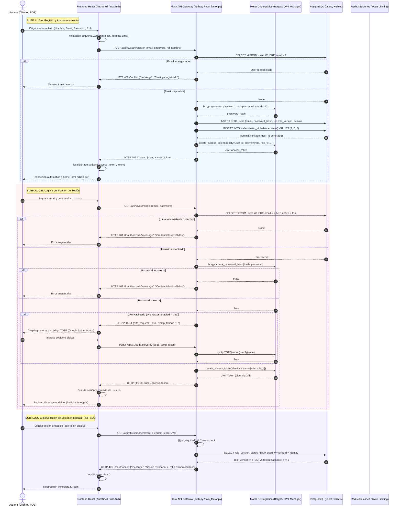

# Diagrama de Secuencia — Flujo 01: Autenticación, Registro y Seguridad Multi-Rol

> **Módulo:** Acceso, Identidad y Seguridad  
> **Fuentes de Código:** [`backend/app/controllers/auth.py`](file:///d:/Programs/Chambeapp_frontend-main/backend/app/controllers/auth.py), [`backend/app/controllers/two_factor.py`](file:///d:/Programs/Chambeapp_frontend-main/backend/app/controllers/two_factor.py), [`backend/app/auth/decorators.py`](file:///d:/Programs/Chambeapp_frontend-main/backend/app/auth/decorators.py), [`frontend/src/features/auth/`](file:///d:/Programs/Chambeapp_frontend-main/frontend/src/features/auth/)  
> **Historias de Usuario:** [HU-01](file:///d:/Programs/Chambeapp_frontend-main/documentation/Requerimientos/HistoriasDeUsuario.md#hu-01-registro-de-usuario), [HU-02](file:///d:/Programs/Chambeapp_frontend-main/documentation/Requerimientos/HistoriasDeUsuario.md#hu-02-inicio-de-sesión-y-autenticación-jwt), [HU-03](file:///d:/Programs/Chambeapp_frontend-main/documentation/Requerimientos/HistoriasDeUsuario.md#hu-03-cierre-de-sesión), [HU-49](file:///d:/Programs/Chambeapp_frontend-main/documentation/Requerimientos/HistoriasDeUsuario.md#hu-49-autenticación-en-dos-factores-2fa-totp), [HU-50](file:///d:/Programs/Chambeapp_frontend-main/documentation/Requerimientos/HistoriasDeUsuario.md#hu-50-recuperación-de-contraseña-mediante-código-otp).

---

## 1. Diagrama de Secuencia (Mermaid)

---

## 2. Descripción Técnica y Contratos de Datos

### Puntos de Decisión y Reglas de Negocio
1. **Aprovisionamiento Atómico:** Cada nuevo registro de usuario genera simultáneamente en la misma transacción (`db.session.commit()`) un registro en `users` y una billetera en `wallets` con saldo cero, garantizando que ninguna cuenta exista sin libro contable.
2. **Revocación Desacoplada sin Blacklist en Memoria (`role_version`):** En lugar de consultar una lista negra en Redis para cada petición REST, el backend incluye el claim `role_v` en el JWT. Si un administrador suspende a un usuario o degrada su rol, solo incrementa `user.role_version += 1` en la BD; la siguiente llamada con el token anterior falla inmediatamente con `HTTP 401`.
3. **Hashing de Contraseñas:** Se utiliza `bcrypt` con 12 rondas de salting, mitigando ataques de fuerza bruta y diccionarios precomputados.
