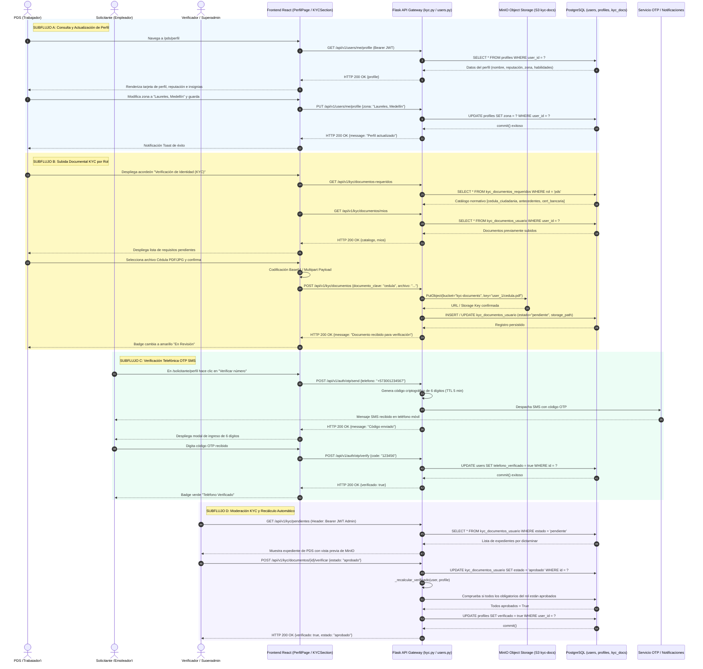

# Diagrama de Secuencia — Flujo 02: Perfil de Usuario y Verificación de Identidad (KYC)

> **Módulo:** Perfil de Usuario, Identidad y Cumplimiento Normativo (KYC)  
> **Fuentes de Código:** [`backend/app/controllers/kyc.py`](file:///d:/Programs/Chambeapp_frontend-main/backend/app/controllers/kyc.py), [`backend/app/controllers/users.py`](file:///d:/Programs/Chambeapp_frontend-main/backend/app/controllers/users.py), [`backend/app/controllers/two_factor.py`](file:///d:/Programs/Chambeapp_frontend-main/backend/app/controllers/two_factor.py), [`backend/app/models/kyc.py`](file:///d:/Programs/Chambeapp_frontend-main/backend/app/models/kyc.py), [`frontend/src/features/perfil/`](file:///d:/Programs/Chambeapp_frontend-main/frontend/src/features/perfil/)  
> **Historias de Usuario:** [HU-06](file:///d:/Programs/Chambeapp_frontend-main/documentation/Requerimientos/HistoriasDeUsuario.md#hu-06-consulta-y-edición-de-perfil-de-usuario), [HU-07](file:///d:/Programs/Chambeapp_frontend-main/documentation/Requerimientos/HistoriasDeUsuario.md#hu-07-subida-de-foto-de-perfil), [HU-51](file:///d:/Programs/Chambeapp_frontend-main/documentation/Requerimientos/HistoriasDeUsuario.md#hu-51-verificación-de-identidad-kyc-con-documento), [HU-52](file:///d:/Programs/Chambeapp_frontend-main/documentation/Requerimientos/HistoriasDeUsuario.md#hu-52-validación-telefónica-vía-otp-sms).

---

## 1. Diagrama de Secuencia (Mermaid)

---

## 2. Descripción Técnica y Contratos de Datos

### Puntos de Decisión y Reglas de Negocio
1. **Catálogo Normativo por Rol (`DocumentoRequerido`):** La API desacopla los requisitos por tipo de actor (`pds`, `solicitante`, `merchant`). Un trabajador requiere Cédula y antecedentes; un comercio requiere RUT y Cámara de Comercio.
2. **Documentos Multi-Instancia:** Habilidades técnicas o cuentas bancarias aceptan múltiples ejemplares diferenciados por la columna `instancia` (`kyc_documentos.instancia`).
3. **Recálculo Atómico de Verificación (`_recalcular_verificado`):** `Profile.verificado` nunca se edita manualmente. Se calcula como la conjunción lógica estricta (`AND`) de que cada documento marcado como `obligatorio=True` en `DocumentoRequerido` cuente con al menos un registro en estado `'aprobado'`.
4. **Almacenamiento Desacoplado de Evidencias:** Los binarios pesados residen en MinIO S3 bajo nombres canónicos seudonimizados; la base de datos relacional almacena únicamente la ruta, metadatos MIME, hash y estado del ciclo de vida.
