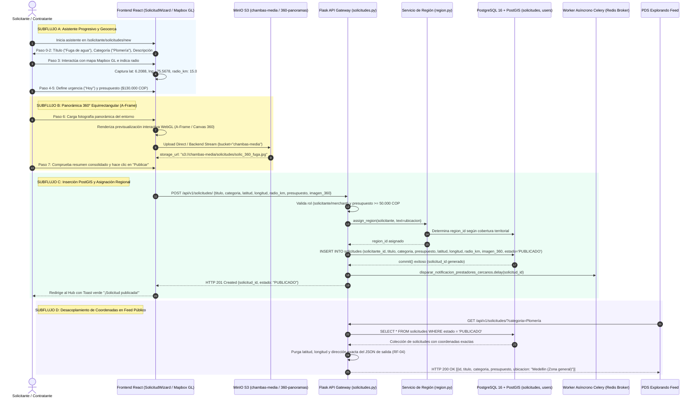

# Diagrama de Secuencia — Flujo 03: Publicación de Solicitudes de Chamba (Geocerca y Panorámicas 360°)

> **Módulo:** Publicación de Solicitudes, Geocercas PostGIS y Soporte Multimedia 360°  
> **Fuentes de Código:** [`backend/app/controllers/solicitudes.py`](file:///d:/Programs/Chambeapp_frontend-main/backend/app/controllers/solicitudes.py), [`backend/app/models/solicitud.py`](file:///d:/Programs/Chambeapp_frontend-main/backend/app/models/solicitud.py), [`backend/app/services/region.py`](file:///d:/Programs/Chambeapp_frontend-main/backend/app/services/region.py), [`frontend/src/features/solicitudes/`](file:///d:/Programs/Chambeapp_frontend-main/frontend/src/features/solicitudes/)  
> **Historias de Usuario:** [HU-08](file:///d:/Programs/Chambeapp_frontend-main/documentation/Requerimientos/HistoriasDeUsuario.md#hu-08-publicación-de-solicitud-con-georreferenciación), [HU-49](file:///d:/Programs/Chambeapp_frontend-main/documentation/Requerimientos/HistoriasDeUsuario.md#hu-49-soporte-de-fotos-360-y-panorámicas-en-solicitudes), [HU-01](file:///d:/Programs/Chambeapp_frontend-main/documentation/Requerimientos/HistoriasDeUsuario.md#hu-01-inicio-de-sesión).

---

## 1. Diagrama de Secuencia (Mermaid)

---

## 2. Descripción Técnica y Contratos de Datos

### Puntos de Decisión y Reglas de Negocio
1. **Validación de Presupuesto Mínimo:** Se restringe un piso financiero de `$50.000 COP` para evitar subcotización precaria, o se permite explícitamente `presupuesto: None` ("A convenir") requiriendo cotización abierta del trabajador.
2. **Privacidad de Coordenadas Geográficas (RF-04):** Para salvaguardar la seguridad física del solicitante, el endpoint público `GET /api/v1/solicitudes/` elimina de forma estricta las llaves `latitud`, `longitud` y `direccion`. Las coordenadas exactas solo se revelan al PDS una vez formalizado el contrato bilateral mediante firma digital.
3. **Indexación y Geocerca PostGIS:** El punto geográfico se almacena como `geometry(Point, 4326)` con un radio de cobertura `radio_km` (predeterminado 5.0 a 15.0 km), habilitando búsquedas espaciales optimizadas con `ST_DWithin`.
4. **Inspección Inmersiva 360° (A-Frame):** El atributo `imagen_360` almacena el URI a la proyección equirrectangular cargada en MinIO, consumida por el frontend mediante A-Frame para permitir a los postulantes inspeccionar patologías constructivas antes de cotizar.
