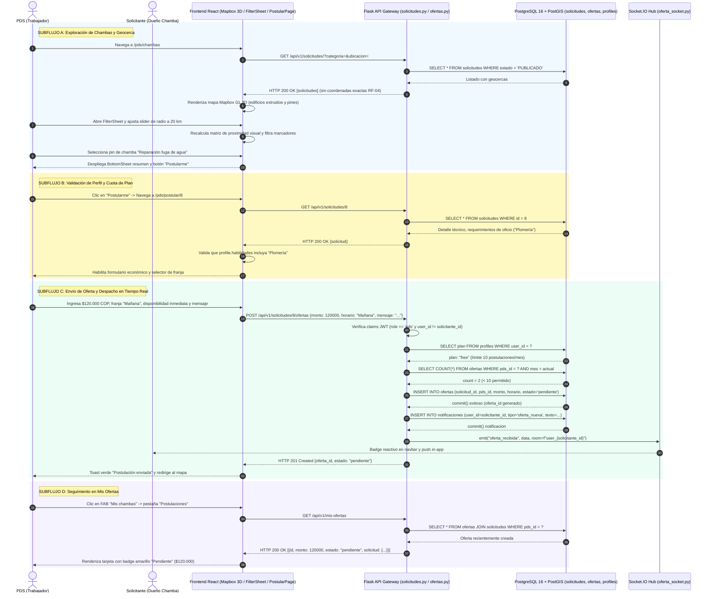

# Diagrama de Secuencia — Flujo 04: Exploración Geoespacial y Postulación de Ofertas (PDS)

> **Módulo:** Descubrimiento Geoespacial, Filtrado por Geocerca y Postulación Bilateral  
> **Fuentes de Código:** [`backend/app/controllers/solicitudes.py`](file:///d:/Programs/Chambeapp_frontend-main/backend/app/controllers/solicitudes.py), [`backend/app/controllers/ofertas.py`](file:///d:/Programs/Chambeapp_frontend-main/backend/app/controllers/ofertas.py), [`backend/app/models/oferta.py`](file:///d:/Programs/Chambeapp_frontend-main/backend/app/models/oferta.py), [`frontend/src/features/pds/`](file:///d:/Programs/Chambeapp_frontend-main/frontend/src/features/pds/)  
> **Historias de Usuario:** [HU-13](file:///d:/Programs/Chambeapp_frontend-main/documentation/Requerimientos/HistoriasDeUsuario.md#hu-13-búsqueda-y-filtrado-geoespacial-de-chambas), [HU-14](file:///d:/Programs/Chambeapp_frontend-main/documentation/Requerimientos/HistoriasDeUsuario.md#hu-14-postulación-de-ofertas-a-chambas), [HU-43](file:///d:/Programs/Chambeapp_frontend-main/documentation/Requerimientos/HistoriasDeUsuario.md#hu-43-filtrado-avanzado-por-distancia-y-geocerca), [HU-01](file:///d:/Programs/Chambeapp_frontend-main/documentation/Requerimientos/HistoriasDeUsuario.md#hu-01-inicio-de-sesión).

---

## 1. Diagrama de Secuencia (Mermaid)

---

## 2. Descripción Técnica y Contratos de Datos

### Puntos de Decisión y Reglas de Negocio
1. **Seguridad y Conflicto de Interés:** El backend aborta con `HTTP 403 Forbidden` si un usuario intenta ofertar en una solicitud creada por él mismo (`solicitud.solicitante_id == user_id`).
2. **Cuota Mensual por Nivel de Suscripción (RF-11):** Se aplica la política `PLANES_LIMITE_POSTULACIONES` sobre la tabla `ofertas`. Usuarios con plan gratuito (`free`) cuentan con una cuota mensual estricta; superado el límite se exige migración a nivel `pro` o `premium`.
3. **Puntualización de Condiciones "A Convenir":** Si la solicitud carece de fecha u horario prefijado, el modelo de datos de ofertas exige que el PDS suministre explícitamente `fecha_deseada` y `horario`, cerrando vacíos operativos.
4. **Alerta Bilateral en Tiempo Real:** La creación de la oferta desencadena una notificación persistente en base de datos (`notificaciones`) y un evento WebSockets Socket.IO canalizado a la sala personal del cliente (`user_{solicitante_id}`).
