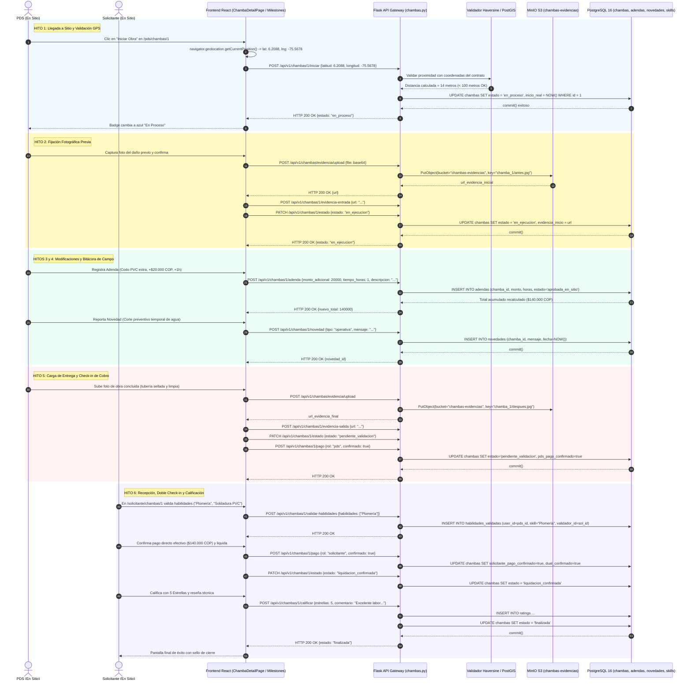

# Diagrama de Secuencia — Flujo 06: Ejecución y Ciclo Operativo de la Chamba (6 Hitos)

> **Módulo:** Ciclo de Vida Operativo, Geocercas en Terreno, Bitácora y Validación de Habilidades  
> **Fuentes de Código:** [`backend/app/controllers/chambas.py`](file:///d:/Programs/Chambeapp_frontend-main/backend/app/controllers/chambas.py), [`backend/app/models/chamba.py`](file:///d:/Programs/Chambeapp_frontend-main/backend/app/models/chamba.py), [`backend/app/services/geofence.py`](file:///d:/Programs/Chambeapp_frontend-main/backend/app/services/geofence.py), [`frontend/src/features/chambas/`](file:///d:/Programs/Chambeapp_frontend-main/frontend/src/features/chambas/)  
> **Historias de Usuario:** [HU-17](file:///d:/Programs/Chambeapp_frontend-main/documentation/Requerimientos/HistoriasDeUsuario.md#hu-17-iniciar-obra-con-validación-gps), [HU-18](file:///d:/Programs/Chambeapp_frontend-main/documentation/Requerimientos/HistoriasDeUsuario.md#hu-18-registro-de-evidencias-fotográficas-y-entorno-360), [HU-19](file:///d:/Programs/Chambeapp_frontend-main/documentation/Requerimientos/HistoriasDeUsuario.md#hu-19-adendas-al-contrato-en-ejecución), [HU-20](file:///d:/Programs/Chambeapp_frontend-main/documentation/Requerimientos/HistoriasDeUsuario.md#hu-20-reporte-de-novedades-e-incidencias), [HU-21](file:///d:/Programs/Chambeapp_frontend-main/documentation/Requerimientos/HistoriasDeUsuario.md#hu-21-validación-de-habilidades-demostradas-en-obra), [HU-22](file:///d:/Programs/Chambeapp_frontend-main/documentation/Requerimientos/HistoriasDeUsuario.md#hu-22-cierre-y-liquidación-de-la-chamba), [HU-23](file:///d:/Programs/Chambeapp_frontend-main/documentation/Requerimientos/HistoriasDeUsuario.md#hu-23-calificación-y-retroalimentación-del-servicio).

---

## 1. Diagrama de Secuencia (Mermaid)

---

## 2. Descripción Técnica y Contratos de Datos

### Puntos de Decisión y Reglas de Negocio
1. **Validación de Geocerca Estricta (HU-17):** Para transicionar de `'programada'` a `'en_proceso'`, el dispositivo del prestador debe enviar coordenadas que verifiquen una distancia euclidiana/Haversine menor a 100 metros respecto al punto pactado en el contrato, previniendo fraudes remotos.
2. **Evidencias Comparativas Antes/Después:** El expediente técnico exige dos anclajes visuales obligatorios en MinIO S3: `evidencia_inicio` (estado previo de la infraestructura) y `evidencia_salida` (resultado terminado) como respaldo ante eventuales reclamos o arbitrajes.
3. **Adendas Directas en Obra (HU-19):** Si surgen imprevistos o vicios ocultos durante la reparación, el PDS puede registrar un anexo de tiempo y costo sin romper el contrato original; el nuevo total devengado se refleja automáticamente en la orden de cobro ($140.000 COP).
4. **Doble Confirmación de Pago Directo:** La plataforma asegura que tanto el pagador como el receptor confirmen de forma bilateral e independiente (`pds_pago_confirmado = true` y `solicitante_pago_confirmado = true`) antes de permitir el cierre definitivo y la liquidación contable.
