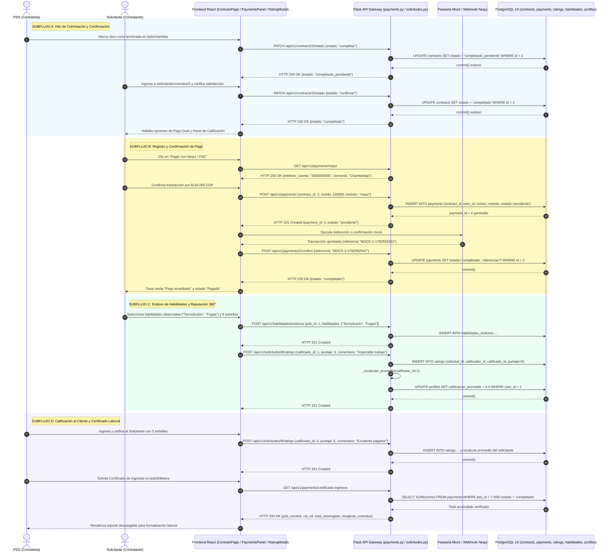

# Diagrama de Secuencia — Flujo 07: Pago Dual Directo y Calificación Mutua

> **Módulo:** Liquidación Financiera, Pasarela de Pagos (Nequi/PSE), Endosos y Reputación Bilateral  
> **Fuentes de Código:** [`backend/app/controllers/payments.py`](file:///d:/Programs/Chambeapp_frontend-main/backend/app/controllers/payments.py), [`backend/app/controllers/solicitudes.py`](file:///d:/Programs/Chambeapp_frontend-main/backend/app/controllers/solicitudes.py), [`backend/app/controllers/habilidades.py`](file:///d:/Programs/Chambeapp_frontend-main/backend/app/controllers/habilidades.py), [`frontend/src/features/contrato/`](file:///d:/Programs/Chambeapp_frontend-main/frontend/src/features/contrato/)  
> **Historias de Usuario:** [HU-21](file:///d:/Programs/Chambeapp_frontend-main/documentation/Requerimientos/HistoriasDeUsuario.md#hu-21-selección-de-método-de-pago-dual), [HU-22](file:///d:/Programs/Chambeapp_frontend-main/documentation/Requerimientos/HistoriasDeUsuario.md#hu-22-liberación-de-fondos-en-custodia-escrow), [HU-23](file:///d:/Programs/Chambeapp_frontend-main/documentation/Requerimientos/HistoriasDeUsuario.md#hu-23-confirmación-bilateral-de-pago-directo-en-efectivotransferencia), [HU-24](file:///d:/Programs/Chambeapp_frontend-main/documentation/Requerimientos/HistoriasDeUsuario.md#hu-24-calificación-y-reseña-cruzada).

---

## 1. Diagrama de Secuencia (Mermaid)

---

## 2. Descripción Técnica y Contratos de Datos

### Puntos de Decisión y Reglas de Negocio
1. **Doble Aprobación de Término de Servicio:** El contrato no permite emitir cobros ni liberar fondos hasta que ocurran dos transiciones sucesivas: primero el PDS invoca `{ estado: 'completar' }` pasando a `completado_pendiente`; luego el contratante invoca `{ estado: 'confirmar' }` pasando a `completado`.
2. **Modelo de Pago Dual Desacoplado:** El contratante puede liquidar en efectivo mano a mano o emplear la pasarela digital (Nequi/PSE). Al optar por la pasarela, el backend genera un registro en `payments` con estado inicial `pendiente` y garantiza idempotencia mediante la referencia externa única (`MOCK-2-1792552542`).
3. **Cálculo Incremental de Reputación (`_recalcular_promedio`):** Cada vez que se emite una calificación bilateral (`ratings`), la función `_recalcular_promedio` consulta el histórico completo de puntuaciones recibidas por el usuario y actualiza `Profile.calificacion_promedio` de forma inmediata.
4. **Formalización Laboral e Inclusión Financiera:** El endpoint `GET /api/v1/payments/certificado-ingresos` compila los ingresos percibidos dentro de la plataforma, sirviendo como soporte formal verificable para entidades bancarias y de seguridad social en Colombia.
