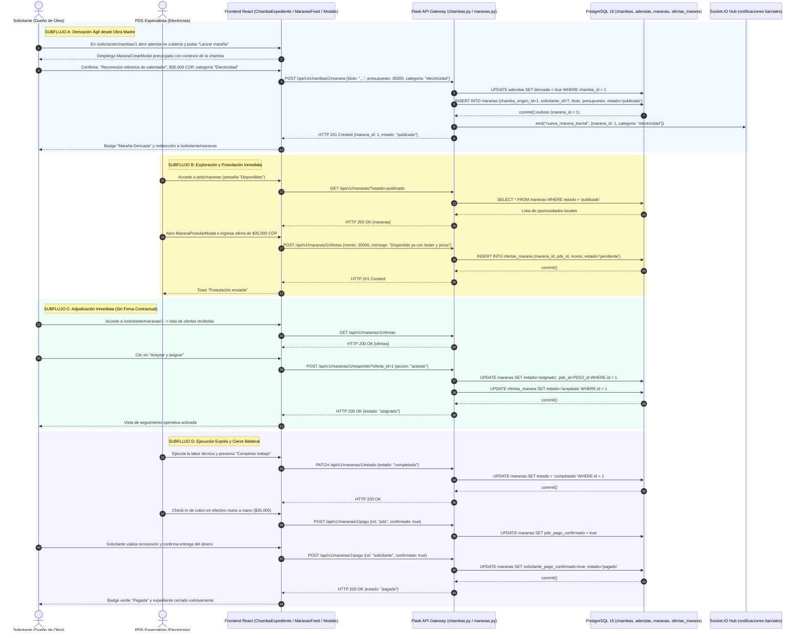

# Diagrama de Secuencia — Flujo 08: Derivación y Cierre Ágil de Marañas (Rebusques)

> **Módulo:** Micro-trabajos Barriales (Marañas), Derivación de Adendas y Ciclo Ágil sin Burocracia  
> **Fuentes de Código:** [`backend/app/controllers/maranas.py`](file:///d:/Programs/Chambeapp_frontend-main/backend/app/controllers/maranas.py), [`backend/app/controllers/chambas.py`](file:///d:/Programs/Chambeapp_frontend-main/backend/app/controllers/chambas.py), [`backend/app/models/marana.py`](file:///d:/Programs/Chambeapp_frontend-main/backend/app/models/marana.py), [`frontend/src/features/maranas/`](file:///d:/Programs/Chambeapp_frontend-main/frontend/src/features/maranas/)  
> **Historias de Usuario:** [HU-53](file:///d:/Programs/Chambeapp_frontend-main/documentation/Requerimientos/HistoriasDeUsuario.md#hu-53-publicación-ágil-de-marañas-o-rebusques), [HU-54](file:///d:/Programs/Chambeapp_frontend-main/documentation/Requerimientos/HistoriasDeUsuario.md#hu-54-postulación-rápida-y-cierre-directo-de-marañas).

---

## 1. Diagrama de Secuencia (Mermaid)

---

## 2. Descripción Técnica y Contratos de Datos

### Puntos de Decisión y Reglas de Negocio
1. **Derivación y Prevención de Doble Imputación:** Al derivar una tarea imprevista desde el expediente maestro de una chamba (`POST /api/v1/chambas/<id>/marana`), el backend marca `adendas.derivada = True` y descuenta su valor de la orden principal, evitando que el contratante pague dos veces por el mismo alcance.
2. **Ciclo Ágil de 3 Estados (vs FSM Formal de 6 Hitos):** A diferencia de las contrataciones formales de obra, las marañas prescinden de la firma manuscrita Canvas, reduciendo la fricción a tres estados canónicos: `publicado` -> `asignado` -> `completado` -> `pagado`.
3. **Micro-arbitraje Local y Notificación Barrial:** Mediante Socket.IO, la publicación de una maraña emite un broadcast a los prestadores con cobertura activa en la comuna correspondiente, posibilitando respuestas en menos de 15 minutos.
4. **Doble Confirmación Simplificada:** El pago en efectivo requiere que ambos participantes marquen su check-in en el modal `MaranaPago`; tras completarse, la maraña queda blindada en la base de datos contra reclamaciones extemporáneas.
