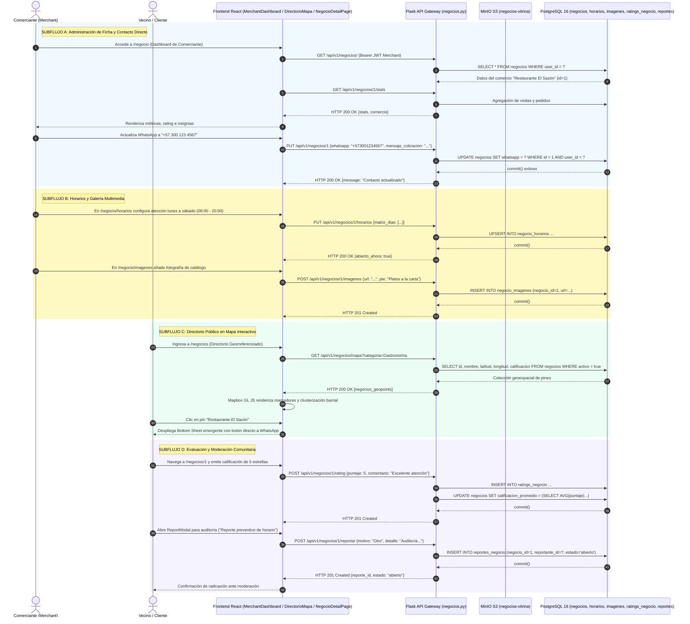

# Diagrama de Secuencia — Flujo 09: Directorio y Gestión de Negocios Locales

> **Módulo:** Directorio Comercial, Mapa Interactivo de Comercios, Horarios Dinámicos y Vitrina Digital  
> **Fuentes de Código:** [`backend/app/controllers/negocios.py`](file:///d:/Programs/Chambeapp_frontend-main/backend/app/controllers/negocios.py), [`backend/app/models/negocio.py`](file:///d:/Programs/Chambeapp_frontend-main/backend/app/models/negocio.py), [`frontend/src/features/negocios/`](file:///d:/Programs/Chambeapp_frontend-main/frontend/src/features/negocios/)  
> **Historias de Usuario:** [HU-55](file:///d:/Programs/Chambeapp_frontend-main/documentation/Requerimientos/HistoriasDeUsuario.md#hu-55-registro-y-perfil-de-negocio-local), [HU-56](file:///d:/Programs/Chambeapp_frontend-main/documentation/Requerimientos/HistoriasDeUsuario.md#hu-56-directorio-público-de-negocios-en-mapa-interactivo), [HU-57](file:///d:/Programs/Chambeapp_frontend-main/documentation/Requerimientos/HistoriasDeUsuario.md#hu-57-horarios-de-atención-y-contacto-directo), [HU-58](file:///d:/Programs/Chambeapp_frontend-main/documentation/Requerimientos/HistoriasDeUsuario.md#hu-58-galería-fotográfica-de-negocios-en-minio), [HU-59](file:///d:/Programs/Chambeapp_frontend-main/documentation/Requerimientos/HistoriasDeUsuario.md#hu-59-reseñas-y-calificaciones-de-negocios), [HU-60](file:///d:/Programs/Chambeapp_frontend-main/documentation/Requerimientos/HistoriasDeUsuario.md#hu-60-sistema-de-reporte-comunitario-de-negocios).

---

## 1. Diagrama de Secuencia (Mermaid)

---

## 2. Descripción Técnica y Contratos de Datos

### Puntos de Decisión y Reglas de Negocio
1. **Aislamiento Multitenant de Analíticas (RBAC):** La ruta `GET /api/v1/negocios/<id>/stats` exige autenticación JWT y restringe el acceso exclusivamente al propietario del establecimiento (`negocio.user_id == identity`). Peticiones de usuarios externos son rechazadas con `HTTP 403 Forbidden`.
2. **Evaluación de Apertura en Tiempo Real (`abierto_ahora`):** Al consultar el detalle de un comercio, el backend o el cliente computa dinámicamente si el instante actual (`now()`, huso America/Bogota UTC-5) cae dentro del intervalo `[hora_apertura, hora_cierre]` del día de la semana correspondiente (0=Domingo a 6=Sábado).
3. **Pines Vectoriales y Bounding Box:** El endpoint `/api/v1/negocios/mapa` devuelve una carga comprimida con atributos espaciales mínimos para nutrir las capas GeoJSON de Mapbox GL JS, garantizando fluidez en navegadores móviles.
4. **Gobierno Comunitario Descentralizado:** El sistema de reporte preventivo (`reportes_negocio`) permite a los vecinos notificar anomalías o suplantaciones, canalizando tickets de revisión directamente a la bandeja de moderación del administrador regional.
