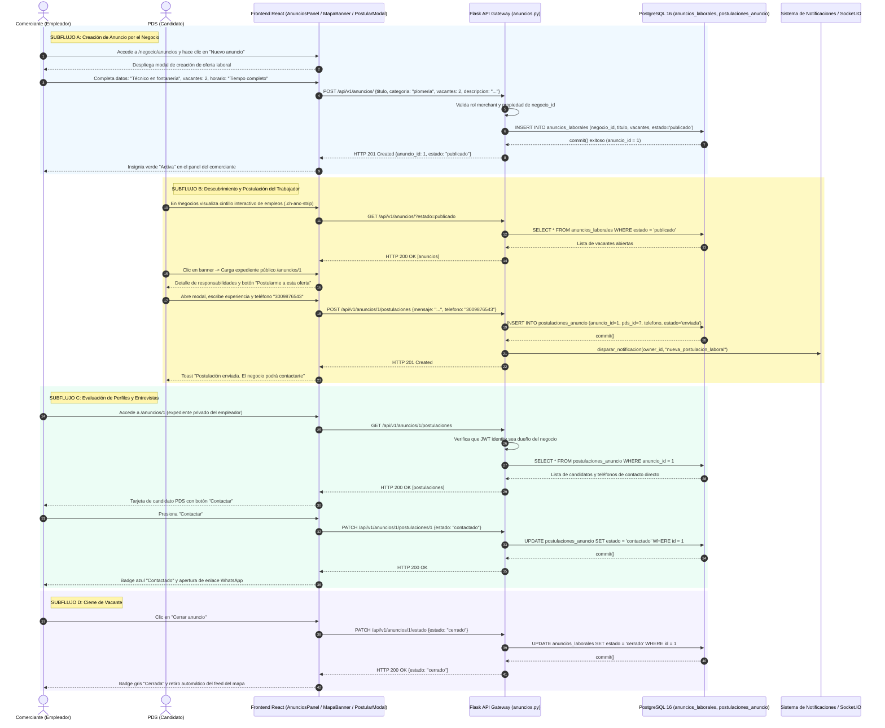

# Diagrama de Secuencia — Flujo 10: Anuncios Laborales de Negocios

> **Módulo:** Intermediación Laboral Barrial, Tablón de Vacantes y Postulaciones de Oficio  
> **Fuentes de Código:** [`backend/app/controllers/anuncios.py`](file:///d:/Programs/Chambeapp_frontend-main/backend/app/controllers/anuncios.py), [`backend/app/models/anuncio.py`](file:///d:/Programs/Chambeapp_frontend-main/backend/app/models/anuncio.py), [`frontend/src/features/negocios/`](file:///d:/Programs/Chambeapp_frontend-main/frontend/src/features/negocios/)  
> **Historias de Usuario:** [HU-61](file:///d:/Programs/Chambeapp_frontend-main/documentation/Requerimientos/HistoriasDeUsuario.md#hu-61-publicación-de-anuncios-laborales-por-negocios), [HU-62](file:///d:/Programs/Chambeapp_frontend-main/documentation/Requerimientos/HistoriasDeUsuario.md#hu-62-postulación-a-vacantes-laborales-de-negocios).

---

## 1. Diagrama de Secuencia (Mermaid)

---

## 2. Descripción Técnica y Contratos de Datos

### Puntos de Decisión y Reglas de Negocio
1. **Diferenciación Conceptual (Empleo Fijo vs Chamba Escrow):** Los anuncios de negocios responden a relaciones laborales continuas o de nómina tradicional, desacopladas del ciclo civil de contratos por hora y retención de fondos en custodia escrow.
2. **Protección de Datos Personales del Postulante:** El endpoint `GET /api/v1/anuncios/<id>/postulaciones` implementa control de acceso estricto (RBAC). Si un usuario externo o competidor intenta consultar los teléfonos o correos de los candidatos, la API responde con `HTTP 403 Forbidden`.
3. **Cintillo Flotante Geoespacial:** Para maximizar la visibilidad sin saturar la cartografía, las ofertas laborales activas se proyectan en un banner horizontal flotante (`.ch-anc-strip`) sobre el mapa vectorial de negocios, enlazando directamente al expediente de postulación.
4. **Ciclo de Vida de Vacante:** La transición a estado `cerrado` despublica la oferta de forma instantánea de la vista pública, pero mantiene el histórico de candidatos archivado en PostgreSQL para futuras auditorías o contrataciones.
