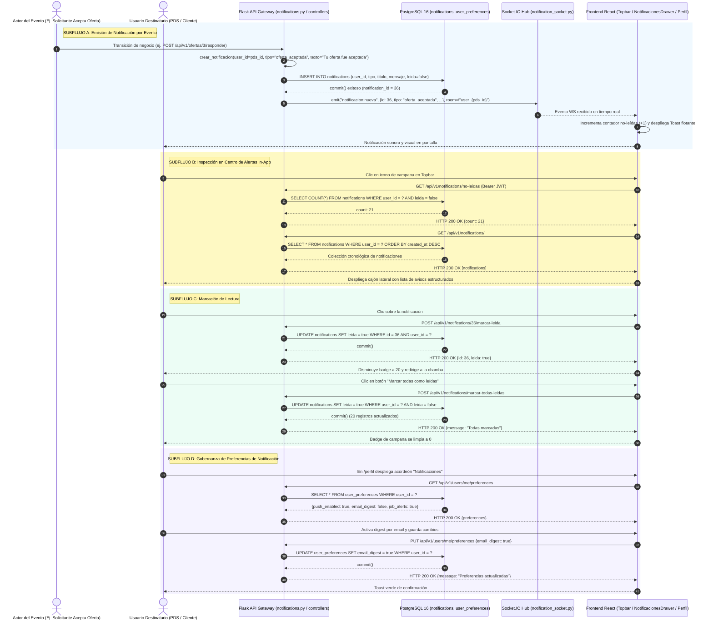

# Diagrama de Secuencia — Flujo 13: Notificaciones Push, In-App y Centro de Alertas

> **Módulo:** Notificaciones Multicanal, Centro de Alertas In-App, Sincronización Push y Preferencias  
> **Fuentes de Código:** [`backend/app/controllers/notifications.py`](file:///d:/Programs/Chambeapp_frontend-main/backend/app/controllers/notifications.py), [`backend/app/controllers/notification_socket.py`](file:///d:/Programs/Chambeapp_frontend-main/backend/app/controllers/notification_socket.py), [`backend/app/models/notification.py`](file:///d:/Programs/Chambeapp_frontend-main/backend/app/models/notification.py), [`frontend/src/features/notifications/`](file:///d:/Programs/Chambeapp_frontend-main/frontend/src/features/notifications/)  
> **Historias de Usuario:** [HU-33](file:///d:/Programs/Chambeapp_frontend-main/documentation/Requerimientos/HistoriasDeUsuario.md#hu-33-notificaciones-push-en-cambios-de-estado), [HU-34](file:///d:/Programs/Chambeapp_frontend-main/documentation/Requerimientos/HistoriasDeUsuario.md#hu-34-centro-de-notificaciones-in-app), [HU-35](file:///d:/Programs/Chambeapp_frontend-main/documentation/Requerimientos/HistoriasDeUsuario.md#hu-35-gestión-de-lectura-de-notificaciones), [HU-70](file:///d:/Programs/Chambeapp_frontend-main/documentation/Requerimientos/HistoriasDeUsuario.md#hu-70-preferencias-de-canales-de-notificación).

---

## 1. Diagrama de Secuencia (Mermaid)

---

## 2. Descripción Técnica y Contratos de Datos

### Puntos de Decisión y Reglas de Negocio
1. **Canal Personalizado WebSocket (`user_<id>`):** Cada usuario autenticado se une automáticamente al conectarse a una sala privada basada en su ID criptográfico del JWT (`room = f"user_{identity}"`). Esto garantiza que los eventos de notificación in-app lleguen en milisegundos sin generar tráfico espurio a otros clientes.
2. **Alertas Obligatorias de Formalización Laboral (RF-10):** Ciertos eventos de plataforma (como la formalización de contrato o el comprobante de liquidación de pago) se marcan con prioridad alta y no pueden ser silenciados en las preferencias del usuario, garantizando el cumplimiento del marco legal de seguridad social en Colombia.
3. **Optimización en Serialización de Listados:** El endpoint `/api/v1/notifications/` evita problemas de paginación que retornen esquemas vacíos mediante el consumo directo de la colección de entidades serializadas con Marshmallow `NotificationSchema(many=True)`.
4. **Idempotencia en Marcación de Lectura:** El endpoint `POST /api/v1/notifications/marcar-todas-leidas` opera de manera idempotente sobre todos los registros en `leida = false`, reduciendo el contador a cero en una única transacción de base de datos.
