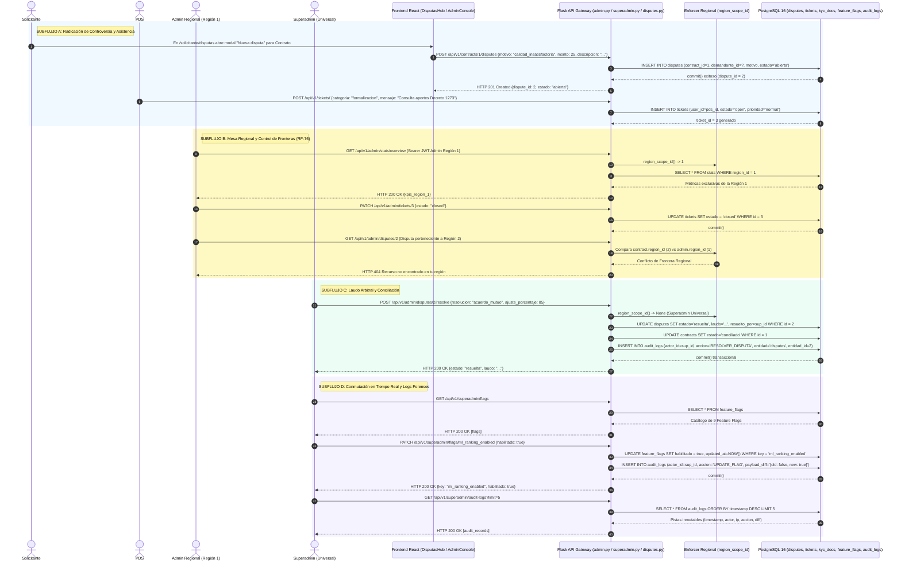

# Diagrama de Secuencia — Flujo 14: Moderación, Soporte y Auditoría Superadmin

> **Módulo:** Gobernanza Multi-Rol, Fronteras Regionales, Arbitraje de Disputas, Feature Flags y Auditoría Forense  
> **Fuentes de Código:** [`backend/app/controllers/admin.py`](file:///d:/Programs/Chambeapp_frontend-main/backend/app/controllers/admin.py), [`backend/app/controllers/superadmin.py`](file:///d:/Programs/Chambeapp_frontend-main/backend/app/controllers/superadmin.py), [`backend/app/controllers/disputes.py`](file:///d:/Programs/Chambeapp_frontend-main/backend/app/controllers/disputes.py), [`backend/app/models/audit.py`](file:///d:/Programs/Chambeapp_frontend-main/backend/app/models/audit.py), [`frontend/src/features/disputas/`](file:///d:/Programs/Chambeapp_frontend-main/frontend/src/features/disputas/)  
> **Historias de Usuario y Requerimientos:** [RF-73](file:///d:/Programs/Chambeapp_frontend-main/documentation/Requerimientos/Requerimientos.md) (Verificación KYC), [RF-74](file:///d:/Programs/Chambeapp_frontend-main/documentation/Requerimientos/Requerimientos.md) (Resolución de Disputas), [RF-75](file:///d:/Programs/Chambeapp_frontend-main/documentation/Requerimientos/Requerimientos.md) (Mesa de Ayuda), [RF-76](file:///d:/Programs/Chambeapp_frontend-main/documentation/Requerimientos/Requerimientos.md) (Aislamiento Regional), [RNF-AUD](file:///d:/Programs/Chambeapp_frontend-main/documentation/Requerimientos/Requerimientos.md) (Pistas Inmutables de Auditoría), [RNF-CFG](file:///d:/Programs/Chambeapp_frontend-main/documentation/Requerimientos/Requerimientos.md) (Feature Flags en Caliente).

---

## 1. Diagrama de Secuencia (Mermaid e Imagen Renderizada)

---

## 2. Descripción Técnica y Contratos de Datos

### Puntos de Decisión y Reglas de Negocio
1. **Segregación Estricta de Fronteras Regionales (RF-76):** El decorador de seguridad y la función `region_scope_id()` extraen la jurisdicción del administrador desde su identidad JWT. Si un operador regional intenta leer o alterar disputas o contratos fuera de su territorio, el sistema retorna `HTTP 404 Recurso no encontrado en tu región`, impidiendo fuga de datos sensibles entre departamentos.
2. **Autoridad Universal del Superadministrador:** El rol `superadmin` posee `scope = None`, otorgándole atribuciones de mediación universal, conmutación de políticas globales de plataforma y resolución de controversias escaladas.
3. **Conmutación de Funcionalidades en Caliente (RNF-CFG):** Los algoritmos de inteligencia artificial (como `ml_ranking_enabled`) se gobiernan mediante la tabla `feature_flags`. Esto permite activar o desactivar modelos predictivos en tiempo de ejecución sin redeploy ni reinicio de contenedores Docker.
4. **Pistas Inmutables de Auditoría Forense (RNF-AUD):** Cada mutación administrativa (aprobación KYC, laudo de disputa, cambio de bandera o parámetro económico) inserta de forma inmutable un registro en `audit_logs` que documenta el `actor_id`, `ip_address`, `timestamp_utc`, la entidad afectada y el `snapshot_diff` antes y después de la operación.
