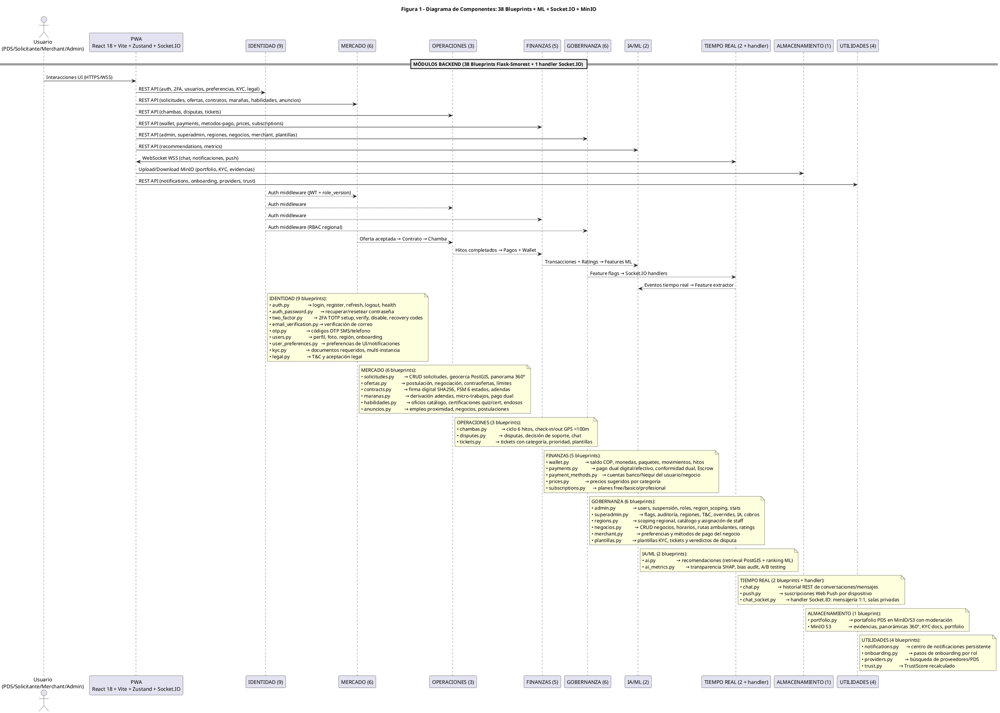

# Diagrama de Componentes — Figura 1: Arquitectura General (38 Blueprints + ML + Socket.IO + MinIO)

> **Módulo:** Visión General de Componentes Backend/Frontend  
> **Fuente:** `01_componentes.puml` (Figura 1)  
> **Referencias de Código:** Blueprints Flask-Smorest en `backend/app/controllers/`, Handlers Socket.IO en `backend/app/handlers/`, Frontend React en `frontend/src/`

---

## 1. Diagrama de Componentes (PlantUML)

---

## 2. Descripción de Componentes

### Frontend
| Componente | Tecnología | Descripción |
|------------|------------|-------------|
| **PWA** | React 18 + Vite 6 + Zustand + Socket.IO | Single Page Application, Service Worker offline, responsive |

### Backend - 38 Blueprints Agrupados en 9 Módulos

#### IDENTIDAD (9)
| Blueprint | Endpoints Principales | Responsabilidad |
|-----------|----------------------|-----------------|
| `auth.py` | `/auth/login`, `/auth/register`, `/auth/refresh`, `/auth/logout` | Autenticación JWT, registro, refresh tokens |
| `auth_password.py` | `/auth/forgot-password`, `/auth/reset-password` | Recuperación de contraseña |
| `two_factor.py` | `/auth/2fa/setup`, `/auth/2fa/verify`, `/auth/2fa/disable` | 2FA TOTP + códigos de recuperación |
| `email_verification.py` | `/auth/verify-email` | Verificación de correo |
| `otp.py` | `/auth/otp/send`, `/auth/otp/verify` | Códigos OTP SMS/teléfono |
| `users.py` | `/users/me`, `/users/me/foto`, `/users/me/region` | Perfil, foto, región |
| `user_preferences.py` | `/users/me/preferences` | Preferencias de UI/notificaciones |
| `kyc.py` | `/kyc/documentos-requeridos`, `/kyc/documentos` | Documentos requeridos y multi-instancia |
| `legal.py` | `/legal/tyc`, `/legal/aceptar` | Términos y condiciones |

#### MERCADO (6)
| Blueprint | Endpoints Principales | Responsabilidad |
|-----------|----------------------|-----------------|
| `solicitudes.py` | CRUD `/solicitudes`, geocerca PostGIS, `imagen_360` | Publicación chambas, radio_km, panorama 360° |
| `ofertas.py` | `/solicitudes/:id/ofertas`, negociación, contraofertas | Postulación PDS, límites por plan, negociación bilateral |
| `contracts.py` | `/contracts`, firma SHA256, FSM 6 estados, adendas | Formalización, adendas, estado contractual |
| `maranas.py` | `/chambas/:id/marana`, `/maranas`, micro-trabajos | Derivación adendas, rebusques, pago dual ágil |
| `habilidades.py` | `/habilidades`, `/certificaciones`, `/endosos` | Catálogo oficios, quiz/cert, endosos clientes |
| `anuncios.py` | `/anuncios`, postulaciones, contactos directos | Empleo barrial, negocios, no vinculante |

#### OPERACIONES (3)
| Blueprint | Endpoints Principales | Responsabilidad |
|-----------|----------------------|-----------------|
| `chambas.py` | `/chambas`, check-in/out GPS, 6 hitos | Ciclo ejecución, validación Haversine <100m |
| `disputes.py` | `/contracts/:id/disputes`, decisión soporte | Disputas, chat y veredicto |
| `tickets.py` | `/tickets`, `/tickets/mios`, categorías | Soporte con categoría, prioridad y plantillas |

#### FINANZAS (5)
| Blueprint | Endpoints Principales | Responsabilidad |
|-----------|----------------------|-----------------|
| `wallet.py` | `/wallet`, `/wallet/withdraw`, `/wallet/coins/buy`, `/wallet/admin/paquetes` | Saldo COP, monedas, paquetes, movimientos, hitos |
| `payments.py` | `/payments`, conformidad dual, Escrow 72h | Pago dual, comisiones 12%/8%, modalidad A/B |
| `payment_methods.py` | `/metodos-pago` | Cuentas banco/Nequi del usuario/negocio |
| `prices.py` | `/prices/sugeridos`, histórico, percentiles | Referencias por categoría, mercado |
| `subscriptions.py` | `/subscriptions`, planes | Suscripción free/basico/profesional |

#### GOBERNANZA (6)
| Blueprint | Endpoints Principales | Responsabilidad |
|-----------|----------------------|-----------------|
| `admin.py` | `/admin/stats`, `/admin/users`, `/admin/disputes`, `/admin/cobros` | KPIs scoped, suspensión, region_scoping |
| `superadmin.py` | `/superadmin/flags`, `/superadmin/audit-logs`, `/superadmin/regions`, `/superadmin/ai/params` | Flags, auditoría, multi-región, T&C, overrides |
| `regions.py` | `/regions`, scoping, catálogo DANE | RBAC regional, asignación staff |
| `negocios.py` | `/negocios`, horarios, rutas ambulantes, ratings | Directorio y gestión de negocios |
| `merchant.py` | `/merchant/preferences`, `/merchant/payment-methods` | Preferencias y métodos del negocio |
| `plantillas.py` | `/plantillas`, `/plantillas/<tipo>` | Plantillas KYC, tickets y veredictos |

#### IA/ML (2)
| Blueprint | Endpoints Principales | Responsabilidad |
|-----------|----------------------|-----------------|
| `ai.py` | `/ai/recommendations`, `/ai/solicitudes-for-provider` | Pipeline 2 etapas: PostGIS + LightGBM |
| `ai_metrics.py` | `/ai/metrics`, `/ai/metrics/feature-importance` | Transparencia, SHAP, A/B |

#### TIEMPO REAL (2 Blueprints + 1 Handler Socket.IO)
| Componente | Salas/Eventos | Responsabilidad |
|------------|---------------|-----------------|
| `chat.py` | REST `/chat/hilos`, historial | Conversaciones y mensajes |
| `push.py` | `/push/subscribe`, `/push/unsubscribe` | Suscripciones Web Push |
| `chat_socket.py` | `user:<id>`, `conversation_<id>`, `mapa`, `anuncios` | Único handler Socket.IO: chat, feeds, notificaciones |

#### ALMACENAMIENTO (1)
| Blueprint | Endpoints Principales | Responsabilidad |
|-----------|----------------------|-----------------|
| `portfolio.py` | `/portfolio`, subida y moderación | Portafolio PDS en MinIO/S3 |
| **MinIO S3** | Buckets/prefijos | Evidencias, KYC, portfolio, 360° |

#### UTILIDADES (4)
| Blueprint | Endpoints Principales | Responsabilidad |
|-----------|----------------------|-----------------|
| `notifications.py` | `/notifications`, centro alertas | Persistencia, marcación leída |
| `onboarding.py` | `/onboarding`, pasos por rol | Onboarding de usuarios |
| `providers.py` | `/providers`, búsqueda PDS | Descubrimiento de proveedores |
| `trust.py` | `/trust`, recálculo | TrustScore y componentes |

---

## 3. Flujos de Datos Principales

1. **Autenticación**: `PWA → MOD_AUTH` (JWT + role_version) → middleware protege todos los módulos
2. **Publicación Chamba**: `PWA → MOD_MERCADO (solicitudes)` → PostGIS geocerca → `MOD_ML` retrieval
3. **Ejecución → Pago**: `MOD_OPS (chambas)` hitos completados → `MOD_FIN (payments)` → `MOD_FIN (wallet)` partida doble
4. **ML Features**: `MOD_FIN` transacciones/ratings → `MOD_ML` feature extractor → entrenamiento nocturno
5. **Tiempo Real**: `MOD_WS` Socket.IO ↔ `PWA` (chat, notificaciones, presence) con Redis adapter multi-pod
6. **Almacenamiento**: `PWA → MOD_S3` (MinIO) evidencias, KYC, 360°, portfolio con prefijos regionales

---

## 4. Notas de Arquitectura

- **38 Blueprints Flask-Smorest**: OpenAPI 3 automático, validación Marshmallow, error handling unificado
- **RBAC por `role_version`**: Revocación inmediata de sesión sin blacklist (incrementa version en BD)
- **Multi-región**: `region_scope_id` en JWT claims, middleware inyecta `WHERE region_id = scope`
- **Feature Flags Hot Reload**: Tabla `feature_flags` + cache memoria + invalidación Redis pub/sub (5s)
- **Observabilidad**: Health checks multi-capa, Prometheus/Grafana 4 golden signals, Loki logs, audit_logs inmutables

---

*Generado automáticamente desde `01_componentes.puml` (Figura 1)*