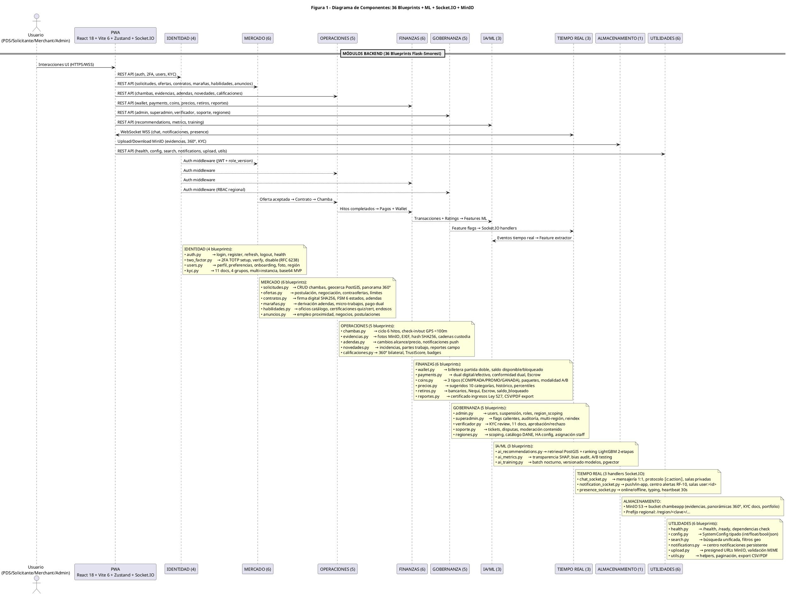

# Diagrama de Componentes — Figura 1: Arquitectura General (36 Blueprints + ML + Socket.IO + MinIO)

> **Módulo:** Visión General de Componentes Backend/Frontend  
> **Fuente:** `01_componentes.puml` (Figura 1)  
> **Referencias de Código:** Blueprints Flask-Smorest en `backend/app/controllers/`, Handlers Socket.IO en `backend/app/handlers/`, Frontend React en `frontend/src/`

---

## 1. Diagrama de Componentes (PlantUML)

---

## 2. Descripción de Componentes

### Frontend
| Componente | Tecnología | Descripción |
|------------|------------|-------------|
| **PWA** | React 18 + Vite 6 + Zustand + Socket.IO | Single Page Application, Service Worker offline, responsive |

### Backend - 36 Blueprints Agrupados en 9 Módulos

#### IDENTIDAD (4)
| Blueprint | Endpoints Principales | Responsabilidad |
|-----------|----------------------|-----------------|
| `auth.py` | `/auth/login`, `/auth/register`, `/auth/refresh`, `/auth/logout`, `/health` | Autenticación JWT, registro, refresh tokens |
| `two_factor.py` | `/2fa/setup`, `/2fa/verify`, `/2fa/disable` | 2FA TOTP (RFC 6238), Google Authenticator compatible |
| `users.py` | `/users/me/profile`, `/users/me/preferences`, `/users/me/onboarding`, `/users/me/region` | Perfil, preferencias, onboarding, foto, región |
| `kyc.py` | `/kyc/documentos-requeridos`, `/kyc/documentos`, `/kyc/documentos/:id/verificar` | 11 docs, 4 grupos, multi-instancia, base64 MVP |

#### MERCADO (6)
| Blueprint | Endpoints Principales | Responsabilidad |
|-----------|----------------------|-----------------|
| `solicitudes.py` | CRUD `/solicitudes`, geocerca PostGIS, `imagen_360` | Publicación chambas, radio_km, panorama 360° |
| `ofertas.py` | `/solicitudes/:id/ofertas`, negociación, contraofertas | Postulación PDS, límites por plan, negociación bilateral |
| `contratos.py` | `/contracts`, firma SHA256, FSM 6 estados, adendas | Formalización, adendas, estado contractual |
| `marañas.py` | `/chambas/:id/marana`, `/maranas`, micro-trabajos | Derivación adendas, rebusques, pago dual ágil |
| `habilidades.py` | `/habilidades`, `/certificaciones`, `/endosos` | Catálogo oficios, quiz/cert, endosos clientes |
| `anuncios.py` | `/anuncios`, postulaciones, contactos directos | Empleo barrial, negocios, no vinculante |

#### OPERACIONES (5)
| Blueprint | Endpoints Principales | Responsabilidad |
|-----------|----------------------|-----------------|
| `chambas.py` | `/chambas`, check-in/out GPS, 6 hitos | Ciclo ejecución, validación Haversine <100m |
| `evidencias.py` | `/evidencias/upload`, EXIF, hash SHA256 | Fotos MinIO, cadena custodia, antes/después |
| `adendas.py` | `/chambas/:id/adenda`, cambios alcance/precio | Modificaciones en obra, notificaciones push |
| `novedades.py` | `/chambas/:id/novedad`, incidencias, reportes | Bitácora campo, partes trabajo |
| `calificaciones.py` | `/ratings`, 360° bilateral, TrustScore | Reputación, badges, recálculo nocturno |

#### FINANZAS (6)
| Blueprint | Endpoints Principales | Responsabilidad |
|-----------|----------------------|-----------------|
| `wallet.py` | `/wallet`, saldo, transacciones, partida doble | Billetera virtual, DEBE/HABER invariante |
| `payments.py` | `/payments`, conformidad dual, Escrow 72h | Pago dual, comisiones 12%/8%, modalidad A/B |
| `coins.py` | `/wallet/coins`, 3 tipos, paquetes, FIFO | ChambeCoins COMPRADA/PROMO/GANADA |
| `precios.py` | `/precios/sugeridos`, histórico, percentiles | Referencias 10 categorías, mercado |
| `retiros.py` | `/retiros`, Nequi/Bancolombia, saldo_bloqueado | Dispersión ACH, escrow preventivo |
| `reportes.py` | `/reportes/certificado-ingresos`, PDF/CSV | Ley 527, formalización laboral |

#### GOBERNANZA (5)
| Blueprint | Endpoints Principales | Responsabilidad |
|-----------|----------------------|-----------------|
| `admin.py` | `/admin/stats`, `/admin/users`, `/admin/disputes` | KPIs scoped, suspensión, region_scoping |
| `superadmin.py` | `/superadmin/flags`, `/superadmin/audit-logs`, `/superadmin/regions` | Feature flags, auditoría, multi-región |
| `verificador.py` | `/kyc/pendientes`, `/verifications`, approve/reject | KYC review 11 docs, aprobación |
| `soporte.py` | `/tickets`, `/moderation`, disputas | Mesa ayuda, moderación contenido |
| `regiones.py` | `/regions`, `/detectar`, scoping, catálogo DANE | RBAC regional, HA config |

#### IA/ML (3)
| Blueprint | Endpoints Principales | Responsabilidad |
|-----------|----------------------|-----------------|
| `ai_recommendations.py` | `/recommendations`, retrieval + ranking | Pipeline 2 etapas: PostGIS + LightGBM |
| `ai_metrics.py` | `/metrics`, SHAP, bias audit, A/B | Transparencia, métricas producción |
| `ai_training.py` | `/training`, batch nocturno, pgvector | Versionado modelos, embeddings 384-dim |

#### TIEMPO REAL (3 Handlers Socket.IO)
| Handler | Salas/Eventos | Responsabilidad |
|---------|---------------|-----------------|
| `chat_socket.py` | `conversation:<id>`, `⟦c:action⟧` | Mensajería 1:1, negociación estructurada |
| `notification_socket.py` | `user:<id>`, `notificacion:nueva` | Push/in-app, centro alertas RF-10 |
| `presence_socket.py` | `presence:<id>`, heartbeat 30s | Online/offline, typing indicators |

#### ALMACENAMIENTO (1)
- **MinIO S3**: Bucket `chambeapp` con prefijos regionales `/region/<clave>/evidencias|kyc|portfolio|360|anuncios`
- Erasure Coding 2+2 (4 nodos/región), versioning, Object Lock (WORM KYC)

#### UTILIDADES (6)
| Blueprint | Endpoints Principales | Responsabilidad |
|-----------|----------------------|-----------------|
| `health.py` | `/health`, `/ready` | Liveness/readiness probes (DB+Redis+MinIO) |
| `config.py` | `/config`, SystemConfig tipado | Feature flags, parámetros globales |
| `search.py` | `/search`, filtros geo, unificada | Búsqueda global, PostGIS |
| `notifications.py` | `/notifications`, centro alertas | Persistencia, marcación leída |
| `upload.py` | `/upload/presigned`, validación MIME | URLs firmadas MinIO, seguridad |
| `utils.py` | Helpers, paginación, export | Utilidades transversales |

---

## 3. Flujos de Datos Principales

1. **Autenticación**: `PWA → MOD_AUTH` (JWT + role_version) → middleware protege todos los módulos
2. **Publicación Chamba**: `PWA → MOD_MERCADO (solicitudes)` → PostGIS geocerca → `MOD_ML` retrieval
3. **Ejecución → Pago**: `MOD_OPS (chambas)` hitos completados → `MOD_FIN (payments)` → `MOD_FIN (wallet)` partida doble
4. **ML Features**: `MOD_FIN` transacciones/ratings → `MOD_ML` feature extractor → entrenamiento nocturno
5. **Tiempo Real**: `MOD_WS` Socket.IO ↔ `PWA` (chat, notificaciones, presence) con Redis adapter multi-pod
6. **Almacenamiento**: `PWA → MOD_S3` (MinIO) evidencias, KYC, 360°, portfolio con prefijos regionales

---

## 4. Notas de Arquitectura

- **36 Blueprints Flask-Smorest**: OpenAPI 3 automático, validación Marshmallow, error handling unificado
- **RBAC por `role_version`**: Revocación inmediata de sesión sin blacklist (incrementa version en BD)
- **Multi-región**: `region_scope_id` en JWT claims, middleware inyecta `WHERE region_id = scope`
- **Feature Flags Hot Reload**: Tabla `feature_flags` + cache memoria + invalidación Redis pub/sub (5s)
- **Observabilidad**: Health checks multi-capa, Prometheus/Grafana 4 golden signals, Loki logs, audit_logs inmutables

---

*Generado automáticamente desde `01_componentes.puml` (Figura 1)*