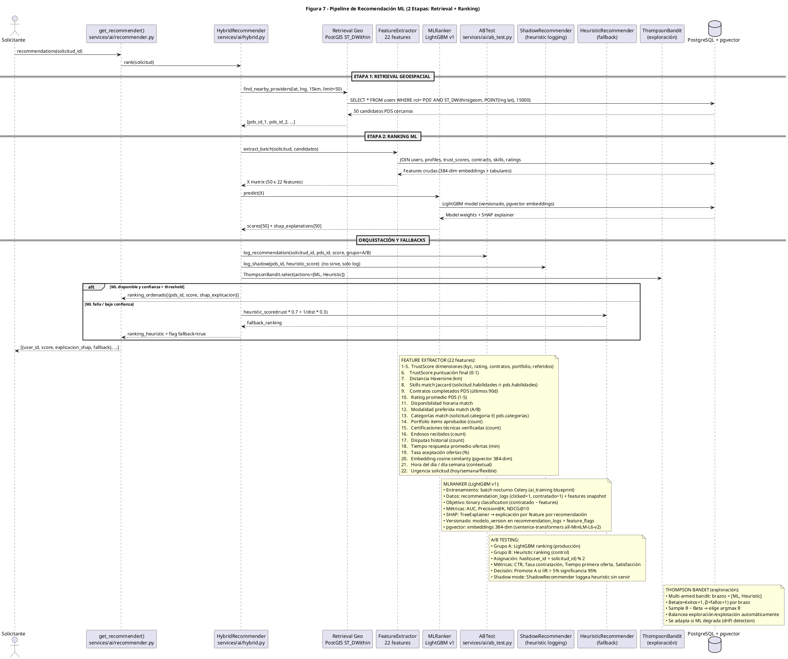

# Diagrama de Componentes/Flujo — Figura 7: Pipeline de Recomendación ML (2 Etapas: Retrieval + Ranking)

> **Módulo:** Motor de Recomendaciones IA/ML - Pipeline Híbrido Geoespacial + LightGBM  
> **Fuente:** `07_pipeline_recomendacion.puml` (Figura 7)  
> **Referencias de Código:** `backend/app/services/ai/recommender.py`, `backend/app/services/ai/hybrid.py`, `backend/app/services/ai/ab_test.py`, `backend/app/controllers/ai_recommendations.py`, `backend/app/controllers/ai_training.py`

---

## 1. Diagrama de Flujo (PlantUML)

---

## 2. Componentes del Pipeline

| Componente | Archivo/Clase | Responsabilidad |
|------------|---------------|-----------------|
| **get_recommender()** | `services/ai/recommender.py` | Entry point, orquesta pipeline, retorna ranking final |
| **HybridRecommender** | `services/ai/hybrid.py` | Coordinador: retrieval → feature extraction → ranking → fallbacks |
| **Retrieval Geo (PostGIS)** | `ST_DWithin` | Búsqueda geoespacial: PDS activos en radio 15km, top 50 |
| **FeatureExtractor** | `services/ai/features.py` | 22 features: TrustScore, distancia, skills, historial, embeddings pgvector |
| **MLRanker (LightGBM v1)** | `services/ai/ranker.py` | Ranking ML, SHAP explanations, versionado modelos |
| **ABTest** | `services/ai/ab_test.py` | A/B testing: Grupo A (ML) vs Grupo B (Heuristic) |
| **ShadowRecommender** | `services/ai/shadow.py` | Logging heurístico sin servir (shadow mode) |
| **HeuristicRecommender** | `services/ai/heuristic.py` | Fallback: `score = trust * 0.7 + 1/dist * 0.3` |
| **ThompsonBandit** | `services/ai/bandit.py` | Multi-armed bandit para exploración/explotación |

---

## 3. Flujo Paso a Paso

### Entrada
1. `S → GR`: `recommendations(solicitud_id)` - Solicitante pide recomendaciones para su solicitud

### Etapa 1: Retrieval Geoespacial (PostGIS)
2. `GR → HR`: `rank(solicitud)` - HybridRecommender inicia ranking
3. `HR → GEO`: `find_nearby_providers(lat, lng, 15km, limit=50)`
4. `GEO → DB`: `SELECT * FROM users WHERE rol='PDS' AND ST_DWithin(geom, POINT(lng lat), 15000)`
5. `DB → GEO`: 50 candidatos PDS cercanos (geometría PostGIS Point 4326)
6. `GEO → HR`: `[pds_id_1, pds_id_2, ...]` - Lista de candidatos

### Etapa 2: Ranking ML (LightGBM)
7. `HR → FE`: `extract_batch(solicitud, candidatos)` - Extrae features en lote
8. `FE → DB`: JOIN `users`, `profiles`, `trust_scores`, `contracts`, `skills`, `ratings`
9. `DB → FE`: Features crudas (embeddings 384-dim pgvector + tabulares)
10. `FE → HR`: Matriz X (50 candidatos × 22 features)
11. `HR → MR`: `predict(X)` - LightGBM predice scores
12. `MR → DB`: Carga modelo LightGBM (versionado, embeddings pgvector)
13. `DB → MR`: Model weights + SHAP TreeExplainer
14. `MR → HR`: `scores[50] + shap_explanations[50]` - Scores + explicabilidad

### Orquestación, A/B Testing y Fallbacks
15. `HR → AB`: `log_recommendation(solicitud_id, pds_id, score, grupo=A/B)` - Log A/B
16. `HR → SR`: `log_shadow(pds_id, heuristic_score)` - Shadow mode (solo log)
17. `HR → TB`: `ThompsonBandit.select(actions=[ML, Heuristic])` - Bandit elige estrategia
18. **Si ML OK (confianza > threshold)**:
    - `HR → GR`: `ranking_ordenado[{pds_id, score, shap_explicacion}]`
19. **Si ML falla / baja confianza**:
    - `HR → HER`: `heuristic_score(trust * 0.7 + 1/dist * 0.3)`
    - `HER → HR`: `fallback_ranking`
    - `HR → GR`: `ranking_heuristic + flag fallback=true`

### Salida
20. `GR → S`: `[{user_id, score, explicacion_shap, fallback}, ...]` - Ranking final al solicitante

---

## 4. Feature Extractor (22 Features)

| # | Feature | Tipo | Fuente | Descripción |
|---|---------|------|--------|-------------|
| 1-5 | TrustScore dimensiones | Float | `trust_scores` | KYC 25%, Rating 25%, Contratos 20%, Portfolio 15%, Referidos 15% |
| 6 | TrustScore final | Float (0-1) | `trust_scores.puntuacion` | Score consolidado ponderado |
| 7 | Distancia Haversine | Float (km) | PostGIS `ST_Distance` | Distancia geodésica solicitante-PDS |
| 8 | Skills match Jaccard | Float (0-1) | `profiles.habilidades` JSON | Intersección/Unión skills solicitud vs PDS |
| 9 | Contratos completados (90d) | Integer | `contracts` + `chambas` | Count contratos estado=completado últimos 90 días |
| 10 | Rating promedio PDS | Float (1-5) | `profiles.calificacion_promedio` | Promedio calificaciones recibidas |
| 11 | Disponibilidad horaria match | Boolean | `profiles` + solicitud.horario | Overlap franjas horarias |
| 12 | Modalidad preferida match | Boolean | `profiles` + solicitud.modalidad | Match A_comision / B_sin_comision |
| 13 | Categorías match | Boolean | `solicitud.categoria` ∈ `pds.categorias` | Oficio solicitado en skills PDS |
| 14 | Portfolio items aprobados | Integer | `portfolio_items` estado=aprobado | Count items portafolio validados |
| 15 | Certificaciones verificadas | Integer | `certificaciones_tecnicas` estado=verificado | Count certs formales validadas |
| 16 | Endosos recibidos | Integer | `endoso_habilidades` | Count endosos clientes únicos |
| 17 | Disputas historial | Integer | `disputes` | Count disputas abiertas/resueltas |
| 18 | Tiempo respuesta ofertas | Float (min) | `ofertas` created_at | Promedio tiempo primera oferta |
| 19 | Tasa aceptación ofertas | Float (%) | `ofertas` estado=aceptada | Aceptadas / Totales enviadas |
| 20 | Embedding cosine similarity | Float (0-1) | pgvector 384-dim | Similitud semántica solicitud-PDS (all-MiniLM-L6-v2) |
| 21 | Contexto temporal | Integer | `NOW()` | Hora del día (0-23) + día semana (0-6) |
| 22 | Urgencia solicitud | Enum | `solicitud.urgencia` | hoy=3, semana=2, flexible=1 (peso) |

---

## 5. MLRanker (LightGBM v1)

| Aspecto | Detalle |
|---------|---------|
| **Entrenamiento** | Batch nocturno Celery (`ai_training` blueprint), schedule configurable |
| **Datos entrenamiento** | `recommendation_logs` (clicked=1, contratado=1) + features snapshot JSON |
| **Objetivo** | Binary classification: `contratado ~ features` |
| **Métricas** | AUC, Precision@K, NDCG@10 |
| **Explicabilidad** | SHAP TreeExplainer → explicación por feature por recomendación |
| **Versionado** | `modelo_version` en `recommendation_logs` + `feature_flags` |
| **Embeddings** | pgvector 384-dim (sentence-transformers `all-MiniLM-L6-v2`) |
| **Modelo almacenado** | PostgreSQL (BLOB) + metadata en `system_configs` / `feature_flags` |

---

## 6. A/B Testing

| Parámetro | Valor |
|-----------|-------|
| **Grupo A (Tratamiento)** | LightGBM ranking (producción) |
| **Grupo B (Control)** | Heuristic ranking (`trust * 0.7 + 1/dist * 0.3`) |
| **Asignación** | `hash(user_id + solicitud_id) % 2` (determinístico, consistente) |
| **Métricas primarias** | CTR (Click-Through Rate), Tasa de contratación |
| **Métricas secundarias** | Tiempo primera oferta, Satisfacción (rating post-servicio) |
| **Decisión promote** | Lift > 5% con significancia estadística 95% (test proporciones) |
| **Shadow mode** | `ShadowRecommender` loggea heuristic scores sin servir a usuario |

---

## 7. Thompson Bandit (Exploración)

| Aspecto | Detalle |
|---------|---------|
| **Tipo** | Multi-armed bandit (Bernoulli) |
| **Brazos** | `[ML, Heuristic]` |
| **Prior** | Beta(α=1, β=1) por brazo (uniforme) |
| **Actualización** | α = éxitos + 1, β = fallos + 1 por brazo |
| **Selección** | Sample θ ~ Beta(α, β) por brazo → elige argmax θ |
| **Balance** | Exploración/explotación automática según incertidumbre |
| **Adaptación** | Detecta drift si ML degrada → aumenta exploración heuristic |

---

## 8. Entidades de Datos

| Tabla | Campos Clave | Propósito |
|-------|-------------|-----------|
| `recommendation_logs` | `id PK`, `solicitud_id FK`, `pds_id FK`, `puntuacion`, `ranking_pos`, `features_snapshot JSON`, `modelo_nombre[lightgbm_v1/heuristic]`, `modelo_version`, `notificado`, `respondio`, `aceptado`, `experiment_group[A/B]`, `created_at` | Log completo A/B + SHAP + features |
| `users` (PDS) | `geom Point 4326`, `rol=PDS`, `activo` | Candidatos retrieval geoespacial |
| `trust_scores` | `pds_id FK UK`, `puntuacion`, `nivel`, `componentes_json` | Features 1-6 |
| `profiles` | `habilidades JSON`, `categorias JSON` | Features 8, 12, 13 |
| `contracts`/`chambas` | `estado=completado`, fechas | Features 9, 17, 18, 19 |
| `portfolio_items` | `estado=aprobado` | Feature 14 |
| `certificaciones_tecnicas` | `estado=verificado` | Feature 15 |
| `endoso_habilidades` | count distinct competencia | Feature 16 |

---

## 9. Endpoints API

| Método | Endpoint | Descripción |
|--------|----------|-------------|
| GET | `/api/v1/ai/recommendations/:solicitud_id` | Ranking ordenado con SHAP explanations |
| GET | `/api/v1/ai/metrics` | Métricas producción: AUC, CTR, NDCG, lift A/B |
| POST | `/api/v1/ai/training/trigger` | Dispara entrenamiento batch nocturno (superadmin) |
| GET | `/api/v1/ai/shap/:recommendation_log_id` | Explicación SHAP detallada por feature |

---

## 10. Feature Flags Relacionadas

| Flag | Descripción | Default |
|------|-------------|---------|
| `ml_ranking_enabled` | Habilita LightGBM ranking (vs solo heuristic) | true |
| `ml_shap_explanations` | Incluye SHAP en respuesta API | true |
| `ml_fallback_threshold` | Umbral confianza para fallback heuristic | 0.3 |
| `ml_shadow_mode` | Activa ShadowRecommender logging | true |
| `ml_bandit_exploration` | Habilita Thompson Bandit | true |

---

*Generado automáticamente desde `07_pipeline_recomendacion.puml` (Figura 7) — Pipeline 2 etapas, 22 features, LightGBM + SHAP, A/B testing, Thompson Bandit*