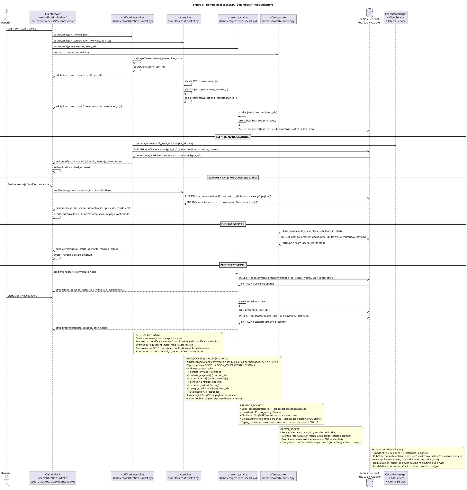

# Diagrama de Arquitectura — Figura 9: Tiempo Real Socket.IO (3 Handlers + Redis Adapter)

> **Módulo:** Arquitectura WebSocket Tiempo Real - Chat, Notificaciones, Presence, Ofertas  
> **Fuente:** `09_tiempo_real_socketio.puml` (Figura 9)  
> **Referencias de Código:** `backend/app/handlers/notification_socket.py`, `backend/app/handlers/chat_socket.py`, `backend/app/handlers/presence_socket.py`, `backend/app/handlers/oferta_socket.py`, `frontend/src/hooks/useNotificationSocket.ts`, `frontend/src/hooks/useChatSocket.ts`, `frontend/src/hooks/usePresenceSocket.ts`

---

## 1. Diagrama de Arquitectura (PlantUML)



---

## 2. Handlers Socket.IO (4 Handlers)

| Handler | Archivo | Salas | Eventos Principales |
|---------|---------|-------|---------------------|
| **notification_socket** | `handlers/notification_socket.py` | `user:<user_id>` | `join`, `notificacion:nueva`, `notificacion:leida`, `notificacion:eliminar`, `mark_read`, `delete` |
| **chat_socket** | `handlers/chat_socket.py` | `conversation:<conversation_id>` | `join_conversation`, `message`, `messages_read`, `typing:start/stop` |
| **presence_socket** | `handlers/presence_socket.py` | `presence:<user_id>`, `presence:updates` | `presence:join`, `heartbeat`, `typing` (relay), `presence:update` |
| **oferta_socket** | `handlers/oferta_socket.py` | `user:<user_id>` (reusa) | `oferta:nueva`, `oferta:actualizada`, `oferta:expirada` |

---

## 3. Flujo de Conexión y Autenticación

### 1. Login y Conexión Inicial
```
U → C: Login (JWT access_token)
C → NS: socket.emit('join', {token: JWT})
C → CS: socket.emit('join_conversation', {conversation_id})
C → PS: socket.emit('presence:join', {user_id})
C → OS: auto-join (conecta automático al namespace /ofertas)
```

### 2. Validación y Join de Salas
**Notification Socket (NS):**
- Valida JWT → extrae `user_id` + `region_scope`
- `socket.join(\`user:${user_id}\`)`
- ACK: `{joined: true, room: \`user:${user_id}\`}`

**Chat Socket (CS):**
- Valida JWT + `conversation_id`
- Verifica participante (`user_a` o `user_b` en `conversations`)
- `socket.join(\`conversation:${conversation_id}\`)`
- ACK: `{joined: true, room: \`conversation:${conversation_id}\`}`

**Presence Socket (PS):**
- `socket.join(\`presence:${user_id}\`)`
- Inicia heartbeat 30s (ping/pong)
- `SETEX \`presence:${user_id}\` 60s {online: true, socket_id, last_seen}`

---

## 4. Eventos por Dominio

### Notificaciones (Centro Alertas RF-10)
| Flujo | Descripción |
|-------|-------------|
| **Origen** | `SV → NS`: `cascade_service.notify_new_solicitud(pds_id, data)` |
| **Pub/Sub** | `NS → RD`: `PUBLISH \`notifications:user:${pds_id}\` {event: 'notificacion:nueva', payload}` |
| **Entrega** | `RD → NS`: (todos pods) ENTREGA a sockets en room `user:${pds_id}` |
| **Cliente** | `NS → C`: `emit('notificacion:nueva', {id, titulo, mensaje, datos, fase})` |
| **UI** | `C → C`: `setNotifications + badge + toast` |

**Persistencia:** `notifications` table (`leida=false`) → Centro alertas RF-10
**Agrupación UI:** Por `solicitud_id`, muestra fase más reciente

### Chat - Protocolo `⟦c:action⟧`
| Acción Contractual | Payload | Descripción |
|--------------------|---------|-------------|
| `⟦c:oferta_enviada⟧` | `{oferta_id}` | PDS envía oferta |
| `⟦c:oferta_aceptada⟧` | `{contrato_id}` | Solicitante acepta |
| `⟦c:contraoferta⟧` | `{monto, mensaje}` | Negociación precio/fecha |
| `⟦c:checkin_entrada⟧` | `{lat, lng}` | Hito 1: GPS entrada |
| `⟦c:checkin_salida⟧` | `{lat, lng}` | Hito 6: GPS salida |
| `⟦c:pago_confirmado⟧` | `{payment_id}` | Conformidad dual |
| `⟦c:calificacion⭐⟧` | `{estrellas}` | Rating 1-5 post-servicio |

**Firma digital:** SHA256 en payload de acciones contractuales
**Leído:** double-tick (entregado) + blue-tick (leído)

### Ofertas (Push Inmediato)
| Flujo | Descripción |
|-------|-------------|
| **Origen** | `SV → OS`: `oferta_service.notify_new_oferta(solicitante_id, oferta)` |
| **Pub/Sub** | `OS → RD`: `PUBLISH \`notifications:user:${solicitante_id}\` {event: 'oferta:nueva', payload}` |
| **Entrega** | `RD → OS`: ENTREGA a room `user:${solicitante_id}` |
| **Cliente** | `OS → C`: `emit('oferta:nueva', {oferta_id, monto, mensaje, estado})` |
| **UI** | Toast + navega a detalle solicitud |

**Integración CascadeManager:** Fase 0 (inmediata al crear oferta) + Fases 1-3 (geo)

### Presence y Typing
| Evento | Flujo | Descripción |
|--------|-------|-------------|
| `typing:start` | `C → PS → RD → PS → C` | Broadcast conversation room, debounce 500ms |
| `typing:stop` | Similar | Oculta "escribiendo..." |
| `presence:join` | `C → PS` | `SETEX presence:${user_id} 60s {online: true}` |
| `heartbeat` | `PS → PS` | 30s ping/pong (Eventlet) |
| `disconnect` | `PS → RD: DEL + PUBLISH presence:updates {online: false}` | Notifica contactos |

---

## 5. Redis Adapter (Socket.IO) - Escalabilidad Horizontal

| Aspecto | Detalle |
|---------|---------|
| **Instancias** | 3 pods API × 2 regiones = 6 instancias Socket.IO |
| **Canales Pub/Sub** | `notifications:user:*`, `chat:conversation:*`, `presence:updates` |
| **Formato mensaje** | `{event, payload, timestamp, origin_pod}` |
| **Deduplicación** | `origin_pod` evita eco (no re-emitir lo que envió el mismo pod) |
| **Escalabilidad** | Añadir pods sin cambios de código (adapter transparente) |
| **Failover** | Redis Sentinel HA: 3 Sentinels + 1 Master + 2 Replicas por región |

---

## 6. Frontend Hooks

### useNotificationSocket
```typescript
// Conexión WS + join room user:<id>
// Listeners: on('notificacion:nueva') → setNotifications + badge + toast
// Persistencia: notifications table (leida=false) → centro alertas RF-10
// Agrupación UI: agrupa por solicitud_id, muestra fase más reciente
// Offline: Service Worker cola notificaciones → sync al reconectar
```

### useChatSocket
```typescript
// Conexión WS + join_conversation {conversation_id}
// Protocolo ⟦c:action⟧ parsing en frontend/src/lib/mensajesChat.ts
// Render componentes interactivos: ContraofertaCard, CondicionCard, PagoCard
// Marcación lectura en lote: PATCH /conversations/:id/messages/read
// Evento socket: messages_read → doble check azul
```

### usePresenceSocket
```typescript
// Heartbeat 30s automático
// Online/Offline real-time para: chat (solo notifica PDS online), cascada
// Typing indicators: debounce 500ms, broadcast conversation room
```

---

## 7. Canales Redis Pub/Sub

| Canal | Patrón | Payload | Consumidores |
|-------|--------|---------|--------------|
| Notificaciones | `notifications:user:{user_id}` | `{event: 'notificacion:nueva', payload: Notification}` | notification_socket (todos pods) |
| Chat | `chat:conversation:{conversation_id}` | `{event: 'message', payload: Message}` | chat_socket (2 pods participantes) |
| Typing | `chat:conversation:{conversation_id}` | `{event: 'typing', user_id, start: boolean}` | chat_socket (otro participante) |
| Presence | `presence:updates` | `{user_id, online: boolean, last_seen}` | presence_socket (contactos) |
| Ofertas | `notifications:user:{user_id}` | `{event: 'oferta:nueva', payload: Oferta}` | oferta_socket (reusa notification rooms) |

---

## 8. Entidades de Datos Relacionadas

| Tabla | Campos Clave |
|-------|-------------|
| `conversations` | `id PK`, `user_a_id FK`, `user_b_id FK`, `creado_en` (UNIQUE user_a < user_b) |
| `messages` | `id PK`, `conversation_id FK`, `sender_id FK`, `contenido` (texto + `⟦c:action⟧`), `leido`, `creado_en` |
| `notifications` | `id PK`, `user_id FK`, `tipo[40]`, `titulo`, `mensaje`, `datos JSON`, `leida`, `creado_en` |
| `users` | `id PK`, `geom Point 4326`, `rol`, `activo`, `last_login` |

---

## 9. Seguridad y Aislamiento

| Capa | Medida |
|------|--------|
| **Autenticación** | JWT en handshake (`join {token}`), validación `role_version` |
| **Autorización Chat** | Verifica `user_id ∈ {user_a, user_b}` de `conversation` antes de join |
| **Autorización Notificaciones** | Solo room `user:<own_id>`, no cross-user |
| **Rate Limiting** | Socket.IO middleware: max 50 eventos/seg por conexión |
| **Deduplicación** | `origin_pod` en mensaje Redis evita eco broadcast |

---

## 10. Endpoints REST Relacionados

| Método | Endpoint | Descripción |
|--------|----------|-------------|
| GET | `/api/v1/chat/conversations/:id/messages` | Historial mensajes (paginado) |
| POST | `/api/v1/chat/conversations/:id/messages` | Enviar mensaje (persiste + emite WS) |
| PATCH | `/api/v1/chat/conversations/:id/messages/read` | Marcación lectura en lote |
| GET | `/api/v1/notifications/no-leidas` | Contador no leídas (badge) |
| GET | `/api/v1/notifications/` | Feed notificaciones (paginado) |
| POST | `/api/v1/notifications/:id/marcar-leida` | Marcar individual |
| POST | `/api/v1/notifications/marcar-todas-leidas` | Marcar todas (idempotente) |
| GET | `/api/v1/users/me/preferences` | Preferencias notificaciones (push, email_digest) |

---

*Generado automáticamente desde `09_tiempo_real_socketio.puml` (Figura 9) — 4 handlers, Redis Adapter multi-pod, protocolo ⟦c:action⟧, presence real-time*