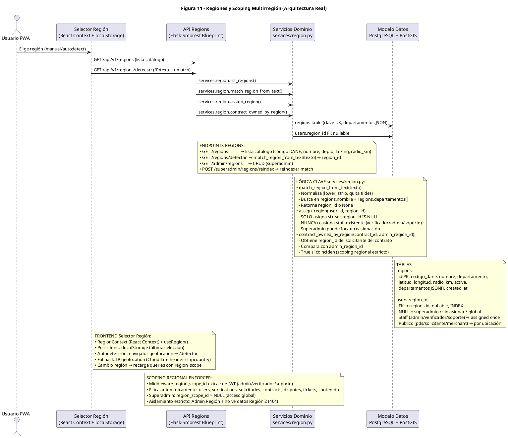

# Diagrama de Arquitectura — Figura 11: Regiones y Scoping Multirregión (Arquitectura Real)

> **Módulo:** RBAC Regional, Catálogo DANE, Detección Geográfica, Aislamiento de Datos  
> **Fuente:** `11_regiones.puml` (Figura 11)  
> **Referencias de Código:** `backend/app/services/region.py`, `backend/app/controllers/regions.py`, `backend/app/middleware/region_scope.py`, `frontend/src/context/RegionContext.tsx`, `frontend/src/hooks/useRegion.ts`

---

## 1. Diagrama de Arquitectura (PlantUML)



---

## 2. Componentes

| Componente | Tecnología | Responsabilidad |
|------------|------------|-----------------|
| **Usuario PWA** | React 18 + Vite 6 | Actor que selecciona/detecta región |
| **Selector Región (SEL)** | RegionContext + useRegion() + localStorage | UI: selector manual, autodetección GPS/IP, persistencia |
| **API Regions** | Flask-Smorest Blueprint | Endpoints catálogo, detección, CRUD admin |
| **Servicios Dominio (DOM)** | `services/region.py` | Lógica: match texto, asignación, scoping contratos |
| **Modelo Datos (MOD)** | PostgreSQL + PostGIS | Tablas `regions`, `users.region_id` |

---

## 3. Tabla `regions` (Catálogo DANE)

| Campo | Tipo | Descripción |
|-------|------|-------------|
| `id` | Integer PK | Identificador interno |
| `codigo_dane` | String(10) | Código DANE oficial (ej. "11001" = Bogotá) |
| `nombre` | String(120) | Nombre región (ej. "Caribe", "Andina") |
| `departamento` | String(100) | Departamento principal |
| `latitud` | Float | Centroide latitud |
| `longitud` | Float | Centroide longitud |
| `radio_km` | Float | Radio cobertura por defecto (km) |
| `activa` | Boolean | Región operativa |
| `departamentos` | JSON[] | Array códigos DANE departamentos incluidos |
| `created_at` | DateTime | Auditoría |

**Regiones DANE Predefinidas:**
| ID | Nombre | Código DANE | Departamentos | Radio (km) |
|----|--------|-------------|---------------|------------|
| 1 | Caribe | Caribe | ATL, BOL, CES, COR, LAG, MAG, SUC | 150 |
| 2 | Andina | Andina | ANT, BOY, CAL, CUN, HUI, NSN, QUI, RIS, SAN, TOL | 200 |
| 3 | Pacífica | Pacífica | CAU, CHO, NAR, VAC | 180 |
| 4 | Orinoquía | Orinoquía | ARA, CAS, MET, VIC | 300 |
| 5 | Amazonía | Amazonía | AMA, CAQ, GUA, GUV, PUT, VAU | 400 |

---

## 4. Columna `users.region_id`

| Valor | Significado | Asignación |
|-------|-------------|------------|
| `NULL` | Superadmin / Sin asignar / Global | Superadmin registra, o usuario sin región detectada |
| `region_id` (Staff) | Admin/Verificador/Soporte asignado | **Asignado una vez** al crear staff, **nunca reasigna** automático |
| `region_id` (Público) | PDS/Solicitante/Merchant | Por ubicación GPS/IP al registrarse/onboarding |

**Regla Crítica**: `assign_region(user_id, region_id)` **SOLO** asigna si `user.region_id IS NULL`. Staff existente nunca se reasigna automático (solo Superadmin puede forzar).

---

## 5. Endpoints API

| Método | Endpoint | Rol | Descripción |
|--------|----------|-----|-------------|
| GET | `/api/v1/regions` | Público | Lista catálogo: código DANE, nombre, depto, lat/lng, radio_km, activa |
| GET | `/api/v1/regions/detectar` | Público | `match_region_from_text(texto)` → `region_id` o `None` |
| GET | `/api/v1/admin/regions` | Superadmin | CRUD completo regiones |
| POST | `/api/v1/superadmin/regions/reindex` | Superadmin | Reindexar `match_region_from_text` (limpia cache) |

---

## 6. Lógica `services/region.py`

### `match_region_from_text(texto: str) → Optional[int]`
```python
def match_region_from_text(texto: str) -> Optional[int]:
    # 1. Normaliza
    texto_norm = normalize_text(texto)  # lower, strip, quita tildes
    
    # 2. Busca en regions.nombre + regions.departamentos[]
    region = Region.query.filter(
        Region.activa == True
    ).filter(
        db.or_(
            func.lower(Region.nombre).contains(texto_norm),
            Region.departamentos.contains([texto_norm.upper()])  # JSON contains
        )
    ).first()
    
    return region.id if region else None
```

### `assign_region(user_id: int, region_id: int) → bool`
```python
def assign_region(user_id: int, region_id: int) -> bool:
    user = User.query.get(user_id)
    if user.region_id is not None:
        return False  # Ya tiene región asignada (staff: nunca reasignar)
    
    user.region_id = region_id
    db.session.commit()
    return True
```

### `contract_owned_by_region(contract_id: int, admin_region_id: int) → bool`
```python
def contract_owned_by_region(contract_id: int, admin_region_id: int) -> bool:
    contract = Contract.query.get(contract_id)
    solicitante_region = contract.solicitante.region_id
    return solicitante_region == admin_region_id
```

---

## 7. Scoping Regional Enforcer (Middleware)

```python
# backend/app/middleware/region_scope.py
def region_scope_enforcer():
    # Ejecuta ANTES de cada endpoint /admin/*
    claims = get_jwt_claims()
    role = claims.get('rol')
    region_scope_id = claims.get('region_scope_id')
    
    if role == 'superadmin':
        # region_scope_id = NULL → bypass global
        g.region_scope_id = None
        return
    
    if role in ['admin', 'verificador', 'soporte']:
        if not region_scope_id:
            abort(403, "Staff sin región asignada")
        g.region_scope_id = region_scope_id
        return
    
    # Público (pds/solicitante/merchant): sin scoping admin
    g.region_scope_id = None
```

**Inyección automática en Queries:**
```python
# Ejemplo en admin blueprint
def get_disputes():
    query = Dispute.query.join(Contract).join(User, Contract.solicitante_id == User.id)
    
    if g.region_scope_id is not None:
        query = query.filter(User.region_id == g.region_scope_id)
    
    return query.all()
```

---

## 8. Aislamiento Estricto (404 vs 403)

| Escenario | Respuesta | Razón |
|-----------|-----------|-------|
| Admin Región 1 consulta disputa Región 2 | **HTTP 404** | Evita enumeración cross-region (no filtra, 404 directo) |
| Admin Región 1 consulta users Región 2 | **HTTP 404** | Mismo principio |
| Superadmin consulta cualquier recurso | **HTTP 200** | `region_scope_id = NULL` → bypass global |

---

## 9. Frontend - RegionContext

```typescript
// frontend/src/context/RegionContext.tsx
interface RegionContextType {
  region: Region | null;
  regions: Region[];
  selectRegion: (regionId: number) => Promise<void>;
  detectRegion: () => Promise<void>;
}

export const RegionProvider = ({ children }) => {
  const [region, setRegion] = useState<Region | null>(() => 
    JSON.parse(localStorage.getItem('selected_region') || 'null')
  );
  const [regions, setRegions] = useState<Region[]>([]);
  
  const selectRegion = async (regionId: number) => {
    const r = regions.find(x => x.id === regionId);
    if (r) {
      setRegion(r);
      localStorage.setItem('selected_region', JSON.stringify(r));
      // Recarga queries con nuevo region_scope
      queryClient.invalidateQueries({ queryKey: ['regions'] });
    }
  };
  
  const detectRegion = async () => {
    // 1. GPS navegador
    if (navigator.geolocation) {
      navigator.geolocation.getCurrentPosition(async (pos) => {
        const res = await api.get('/regions/detectar', { 
          params: { lat: pos.coords.latitude, lng: pos.coords.longitude } 
        });
        selectRegion(res.data.region_id);
      });
    }
    // 2. Fallback: IP (Cloudflare header cf-ipcountry)
  };
  
  return (
    <RegionContext.Provider value={{ region, regions, selectRegion, detectRegion }}>
      {children}
    </RegionContext.Provider>
  );
};
```

---

## 10. Cambio de Región → Recarga Queries

```typescript
// Al cambiar región (selectRegion o detectRegion):
queryClient.invalidateQueries({ queryKey: ['solicitudes'] });
queryClient.invalidateQueries({ queryKey: ['negocios'] });
queryClient.invalidateQueries({ queryKey: ['stats'] });
queryClient.invalidateQueries({ queryKey: ['notifications'] });
// Todas las queries React Query se re-fetchean con nuevo region_scope
```

---

*Generado automáticamente desde `11_regiones.puml` (Figura 11) — Catálogo DANE, scoping estricto 404, assign_region once, match_region_from_text*