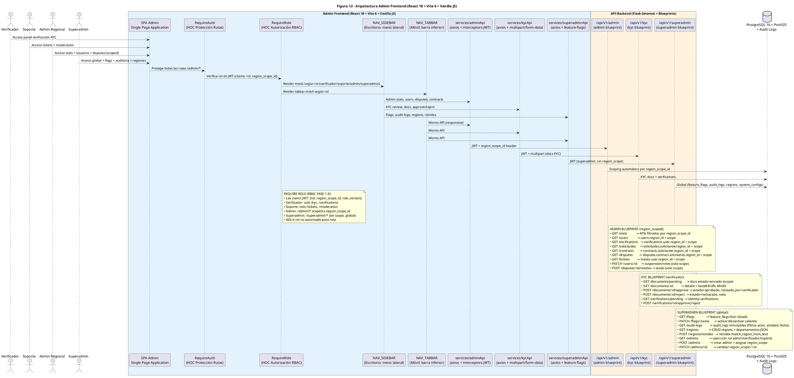

# Diagrama de Arquitectura — Figura 12: Arquitectura Admin Frontend (React 18 + Vite 6 + Vanilla JS)

> **Módulo:** Panel de Administración Multi-Rol (Verificador, Soporte, Admin Regional, Superadmin)  
> **Fuente:** `12_arquitectura_admin_frontend.puml` (Figura 12)  
> **Referencias de Código:** `frontend/src/admin/` (Admin Panel), `backend/app/controllers/admin.py`, `backend/app/controllers/superadmin.py`, `backend/app/controllers/kyc.py`, `backend/app/middleware/region_scope.py`

---

## 1. Diagrama de Arquitectura (PlantUML)



---

## 2. Stack Tecnológico Admin Frontend

| Capa | Tecnología | Descripción |
|------|------------|-------------|
| **Framework** | React 18 + Vite 6 | SPA, HMR rápido, build optimizado |
| **Lenguaje** | Vanilla JS (sin TypeScript) | Código ligero, sin build step extra |
| **Estado** | React Context + useReducer | Auth, región, UI state global |
| **HTTP Client** | Axios + interceptors | JWT auto-attach, refresh token, error handling |
| **Routing** | React Router v6 | Rutas protegidas `/admin/*`, `/superadmin/*` |
| **UI** | CSS Modules + CSS Variables | Temas light/dark, responsive, sin librería externa |
| **Charts** | Chart.js (lazy loaded) | KPIs dashboards admin |
| **Tables** | TanStack Table (react-table) | Sorting, filtering, pagination, virtualización |

---

## 3. Arquitectura de Componentes Frontend

### HOCs de Protección (RBAC Fase 1-3)

```javascript
// frontend/src/admin/hoc/RequireAuth.jsx
export const RequireAuth = ({ children }) => {
  const { user, loading } = useAuth();
  const navigate = useNavigate();
  
  useEffect(() => {
    if (!loading && !user) navigate('/login');
  }, [user, loading]);
  
  if (loading) return <Spinner />;
  if (!user) return null;
  
  return children;
};

// frontend/src/admin/hoc/RequireRole.jsx
export const RequireRole = ({ children, allowedRoles }) => {
  const { user } = useAuth();
  const { region } = useRegion();
  
  useEffect(() => {
    const role = user?.rol;
    const scope = user?.region_scope_id;
    
    // Superadmin: acceso global sin scope
    if (role === 'SUPERADMIN') return;
    
    // Staff requiere region_scope_id
    if (['ADMIN', 'VERIFICADOR', 'SOPORTE'].includes(role)) {
      if (!scope) navigate('/unauthorized');
      return;
    }
    
    // Roles no permitidos
    if (!allowedRoles.includes(role)) navigate('/unauthorized');
  }, [user]);
  
  return children;
};
```

### Rutas Protegidas

```javascript
// frontend/src/admin/routes/AdminRoutes.jsx
const AdminRoutes = () => (
  <RequireAuth>
    <Routes>
      {/* Verificador */}
      <Route path="/admin/kyc/*" element={
        <RequireRole allowedRoles={['VERIFICADOR', 'SUPERADMIN']}>
          <KYCPanel />
        </RequireRole>
      } />
      
      {/* Soporte */}
      <Route path="/admin/tickets/*" element={
        <RequireRole allowedRoles={['SOPORTE', 'ADMIN', 'SUPERADMIN']}>
          <TicketsPanel />
        </RequireRole>
      } />
      <Route path="/admin/moderation/*" element={
        <RequireRole allowedRoles={['SOPORTE', 'SUPERADMIN']}>
          <ModerationPanel />
        </RequireRole>
      } />
      
      {/* Admin Regional */}
      <Route path="/admin/stats/*" element={
        <RequireRole allowedRoles={['ADMIN', 'SUPERADMIN']}>
          <StatsPanel />
        </RequireRole>
      } />
      <Route path="/admin/users/*" element={
        <RequireRole allowedRoles={['ADMIN', 'SUPERADMIN']}>
          <UsersPanel />
        </RequireRole>
      } />
      <Route path="/admin/disputes/*" element={
        <RequireRole allowedRoles={['ADMIN', 'SUPERADMIN']}>
          <DisputesPanel />
        </RequireRole>
      } />
      <Route path="/admin/contracts/*" element={
        <RequireRole allowedRoles={['ADMIN', 'SUPERADMIN']}>
          <ContractsPanel />
        </RequireRole>
      } />
      
      {/* Superadmin */}
      <Route path="/superadmin/*" element={
        <RequireRole allowedRoles={['SUPERADMIN']}>
          <SuperadminPanel />
        </RequireRole>
      } />
    </Routes>
  </RequireAuth>
);
```

### Navegación Responsiva

| Componente | Breakpoint | Descripción |
|------------|------------|-------------|
| `NAV_SIDEBAR` | `≥ 1024px` (Desktop) | Menú lateral fijo, grupos por rol |
| `NAV_TABBAR` | `< 1024px` (Mobile/Tablet) | Barra inferior 5 tabs, swipeable |

**Menú por Rol:**
| Rol | Secciones Visibles |
|-----|-------------------|
| **Verificador** | KYC Docs, Verificaciones Identidad |
| **Soporte** | Tickets, Moderación Contenido |
| **Admin Regional** | Stats KPIs, Usuarios, Solicitudes, Contratos, Disputas, Tickets (scoped) |
| **Superadmin** | Todo lo anterior + Feature Flags, Audit Logs, Regiones, Admins Globales |

---

## 4. Servicios API (Axios + Interceptors)

### `services/adminApi.js` (Admin Regional)
```javascript
const adminApi = axios.create({
  baseURL: '/api/v1/admin',
  headers: { 'Content-Type': 'application/json' }
});

// Interceptor: adjunta region_scope_id header
adminApi.interceptors.request.use(config => {
  const token = getAccessToken();
  if (token) config.headers.Authorization = `Bearer ${token}`;
  
  // region_scope_id se extrae del JWT en backend middleware
  // No se envía en header (seguridad), backend lo lee de claims
  
  return config;
});

// Interceptor: refresh token en 401
adminApi.interceptors.response.use(
  response => response,
  async error => {
    if (error.response?.status === 401 && !error.config._retry) {
      error.config._retry = true;
      await refreshAccessToken();
      return adminApi(error.config);
    }
    return Promise.reject(error);
  }
);
```

### `services/kycApi.js` (Verificador - multipart)
```javascript
const kycApi = axios.create({ baseURL: '/api/v1/kyc' });

kycApi.interceptors.request.use(config => {
  const token = getAccessToken();
  if (token) config.headers.Authorization = `Bearer ${token}`;
  
  // Para upload docs: multipart/form-data
  if (config.data instanceof FormData) {
    config.headers['Content-Type'] = 'multipart/form-data';
  }
  return config;
});
```

### `services/superadminApi.js` (Superadmin)
```javascript
const superadminApi = axios.create({ baseURL: '/api/v1/superadmin' });

superadminApi.interceptors.request.use(config => {
  const token = getAccessToken();
  if (token) config.headers.Authorization = `Bearer ${token}`;
  // Superadmin: sin region_scope_id header (backend lo ignora)
  return config;
});
```

---

## 5. Blueprints Backend y Scoping

### Admin Blueprint (`/api/v1/admin`) - Region Scoped
| Endpoint | Método | Scoping Query | Descripción |
|----------|--------|---------------|-------------|
| `/stats` | GET | `WHERE region_id = scope` | KPIs: users, solicitudes, contratos, disputas, tickets |
| `/users` | GET | `WHERE users.region_id = scope` | Lista usuarios región |
| `/verifications` | GET | `WHERE verifications.user.region_id = scope` | KYC pendientes |
| `/solicitudes` | GET | `WHERE solicitudes.solicitante.region_id = scope` | Solicitudes región |
| `/contracts` | GET | `WHERE contracts.solicitante.region_id = scope` | Contratos región |
| `/disputes` | GET | `WHERE disputes.contract.solicitante.region_id = scope` | Disputas región |
| `/tickets` | GET | `WHERE tickets.user.region_id = scope` | Tickets región |
| `/users/:id` | PATCH | `WHERE users.region_id = scope` | Suspensión/roles |
| `/disputes/:id/resolve` | POST | `WHERE disputes.contract.solicitante.region_id = scope` | Laudo |

### KYC Blueprint (`/api/v1/kyc`) - Verificador
| Endpoint | Método | Descripción |
|----------|--------|-------------|
| `/documents/pending` | GET | Docs estado=`enviado` (scope) |
| `/documents/:id` | GET | Detalle + base64/URL MinIO |
| `/documents/:id/approve` | POST | `estado=aprobado`, `revisado_por=verificador` |
| `/documents/:id/reject` | POST | `estado=rechazado`, `nota` |
| `/verifications/pending` | GET | Verificaciones identidad pendientes |
| `/verifications/:id/approve\|reject` | POST | Aprobar/rechazar verificación |

### Superadmin Blueprint (`/api/v1/superadmin`) - Global (sin scope)
| Endpoint | Método | Descripción |
|----------|--------|-------------|
| `/flags` | GET | Lista `feature_flags` (hot reload) |
| `/flags/:name` | PATCH | Toggle flag caliente + audit_log |
| `/audit-logs` | GET | `audit_logs` inmutables (filtros actor, entidad, fecha) |
| `/regions` | GET/POST | CRUD regions + `departamentos JSON` |
| `/regions/reindex` | POST | Reindex `match_region_from_text` |
| `/admins` | GET | Users con rol admin/verificador/soporte |
| `/admins` | POST | Crear admin + asignar `region_scope` |
| `/admins/:id` | PATCH | Cambiar `region_scope` / rol |

---

## 6. Claims JWT para RBAC

```json
{
  "sub": "user_id",
  "rol": "ADMIN",
  "region_scope_id": 1,
  "role_version": 5,
  "exp": 1704067200,
  "iat": 1704063600
}
```

| Claim | Descripción | Uso |
|-------|-------------|-----|
| `rol` | ADMIN, VERIFICADOR, SOPORTE, SUPERADMIN, PDS, SOLICITANTE, MERCHANT | `RequireRole` HOC |
| `region_scope_id` | ID región asignada (NULL para superadmin) | Middleware scoping automático |
| `role_version` | Versión rol para revocación sesión | Invalidación token inmediata |

---

## 7. Base de Datos - Scoping Automático

```sql
-- Ejemplo: Admin Regional consulta disputes
SELECT d.* FROM disputes d
JOIN contracts c ON d.contract_id = c.id
JOIN users u ON c.solicitante_id = u.id
WHERE u.region_id = 1  -- region_scope_id del admin (inyección middleware)
  AND d.estado = 'abierta';

-- Superadmin: sin WHERE region_id (region_scope_id = NULL)
SELECT * FROM audit_logs WHERE actor_id = 99 ORDER BY created_at DESC LIMIT 100;
```

---

## 8. Feature Flags Hot Reload (Frontend)

```javascript
// frontend/src/admin/services/superadminApi.js
// Polling cada 30s
setInterval(async () => {
  const { data } = await superadminApi.get('/flags');
  featureFlagsStore.setFlags(data); // Context global
}, 30000);

// Uso en componentes
const { flags } = useFeatureFlags();
if (flags.ml_ranking_enabled) {
  // Mostrar botón "Recomendaciones ML"
}
```

**Backend:** Tabla `feature_flags` + cache memoria + Redis pub/sub invalidation (5s TTL)

---

## 9. Audit Logs Inmutables (RNF-AUD)

| Campo | Descripción |
|-------|-------------|
| `actor_id` | Usuario que realizó la acción |
| `action` | Acción: `DISPUTE_RESOLVE`, `FLAG_UPDATE`, `USER_SUSPEND`, etc. |
| `entity_type` | Entidad: `dispute`, `feature_flag`, `user`, `region` |
| `entity_id` | ID de la entidad afectada |
| `before_json` | Estado anterior (JSON) |
| `after_json` | Estado posterior (JSON) |
| `snapshot_diff_json` | `{before: {...}, after: {...}}` diff automático |
| `ip` | IP del actor |
| `created_at` | Timestamp UTC |
| `hash_chain` | Hash(prev_log) → detección manipulación |

**Reglas:** Append-only (NUNCA UPDATE/DELETE), retención 10 años (Ley 1581), solo Superadmin READ.

---

## 10. Responsive: Sidebar ↔ Tabbar

```css
/* frontend/src/admin/components/NavSidebar.module.css */
.navSidebar {
  display: flex;
  flex-direction: column;
  width: 280px;
  height: 100vh;
  position: fixed;
  left: 0; top: 0;
  background: var(--bg-secondary);
  border-right: 1px solid var(--border);
  z-index: 100;
}

@media (max-width: 1023px) {
  .navSidebar { display: none; }
  .navTabbar { display: flex; }
}

/* frontend/src/admin/components/NavTabbar.module.css */
.navTabbar {
  display: none;
  position: fixed;
  bottom: 0; left: 0; right: 0;
  height: 64px;
  background: var(--bg-secondary);
  border-top: 1px solid var(--border);
  justify-content: space-around;
  align-items: center;
  z-index: 100;
}

@media (max-width: 1023px) {
  .navTabbar { display: flex; }
}
```

---

*Generado automáticamente desde `12_arquitectura_admin_frontend.puml` (Figura 12) — React 18 + Vite 6, HOC RBAC, 3 blueprints scoped/global, audit logs inmutables*