# Diagrama de Despliegue — Figura 2: Despliegue Productivo Multi-Región (HA + Patroni + Sentinel)

> **Módulo:** Infraestructura de Despliegue, Alta Disponibilidad, Multi-Región  
> **Fuente:** `02_despliegue.puml` (Figura 2)  
> **Referencias de Código:** Docker Compose / Kubernetes manifests en `infrastructure/`, Patroni config, Sentinel config, Nginx configs

---

## 1. Diagrama de Despliegue (PlantUML)

```plantuml
@startuml
title Figura 2 - Despliegue Productivo Multi-Región (HA + Patroni + Sentinel)

actor "Usuario\nInternet / PWA" as User
participant "Cloudflare\nCDN + WAF + DNS + Turnstile" as CF
participant "Load Balancer\nHAProxy / AWS ALB\nHealth checks activos" as LB

== REGIÓN PRIMARIA (Active - ej. Caribe) ==
participant "API Pods x3\nFlask + Gunicorn + Eventlet (-w 1)\nPort 8000 /health /ready" as API1
participant "Socket.IO Pods x3\nEventlet Workers + Redis Adapter\nPort 8001 /ws/health" as WS1
participant "Celery Workers x4\nBeat Scheduler + 3 Workers\nRedis Broker" as CELERY1
database "PostgreSQL Primary\nPatroni Leader (etcd)\nPort 5432 + PgBouncer 6432" as PG1
database "Redis Sentinel\nMaster + 2 Replicas\n3 Sentinels (26379)" as REDIS1
participant "MinIO Cluster\n4 Nodos Distribuidos (Erasure Coding)\nPort 9000/9001 Console" as MINIO1
participant "Nginx + Certbot\nPWA Static (React Build)\nProxy API/WSS + SSL Termination" as NGINX1

== REGIÓN SECUNDARIA (Standby - ej. Andina) ==
participant "API Pods x2\nFlask + Gunicorn + Eventlet" as API2
participant "Socket.IO Pods x2\nEventlet Workers" as WS2
participant "Celery Workers x2\nBeat + Workers" as CELERY2
database "PostgreSQL Replica\nPatroni Follower\nAsync Replication (RPO≈0)" as PG2
database "Redis Sentinel\nReplicas Read-Only\nSentinels Sync" as REDIS2
participant "MinIO Cluster\n4 Nodos Distribuidos" as MINIO2
participant "Nginx + Certbot\nPWA Static + Proxy" as NGINX2

== CONTROL PLANE GLOBAL ==
participant "Feature Flags\nfeature_flags table\nHot reload < 1s" as FLAGS
participant "Service Discovery\nConsul / etcd\nHealth endpoints /health" as SD
participant "Monitoring\nPrometheus + Grafana\n4 Golden Signals + Alertmanager" as MON
participant "Log Aggregation\nLoki + Promtail\nAudit logs inmutables (RNF-AUD)" as LOGS
participant "Backup/DR\nVelero (K8s) + pgBackRest\nRPO < 1h, RTO < 4h" as BACKUP

User -> CF: HTTPS/WSS Request
CF -> LB: Proxy + WAF (rate limit, bot protection)
LB -> API1: Ruta activa (health check 200 OK)
LB -x API2: Standby (solo replica sync, no tráfico)

API1 --> FLAGS: Métricas + Health + Logs + Config
API2 --> FLAGS: Replication lag + Status
FLAGS --> API1: Config flags + Deploy + Promote
FLAGS --> API2: Config flags + Promote on failover

PG1 --> PG2: Replicación async Patroni (etcd leader election)
REDIS1 --> REDIS2: Sentinel replication (Pub/Sub sync)
MINIO1 --> MINIO2: Cross-region replication (async + versioning)

note right of LB
  HEALTH CHECKS CRÍTICOS:
  • GET /health → API pods (DB + Redis + MinIO connectivity)
  • GET /ready → API pods (migraciones aplicadas)
  • GET /ws/health → Socket.IO pods (Redis adapter OK)
  • Patroni: GET /master → PG leader endpoint
  • Sentinel: master check → Redis master
  Failover automático < 30s
end note

note right of PG1
  PATRONI HIGH AVAILABILITY:
  • Leader election via etcd/Consul (consensus Raft)
  • Synchronous replication (RPO=0) dentro de región
  • Auto-failover < 30s (demote leader, promote replica)
  • pgBackRest: full (semanal) + incremental (diario)
  • Point-in-time recovery (PITR) WAL archiving
  • PgBouncer pooling (transacciones / sesión / statement)
end note

note right of REDIS1
  REDIS SENTINEL HA:
  • 3 Sentinels + 1 Master + 2 Replicas por región
  • Auto-failover master (quorum 2/3 sentinels)
  • Pub/Sub adapter para Socket.IO multi-pod
  • Celery broker HA (retry + visibility timeout)
  • Read replicas para cache queries no críticas
end note

note right of MINIO1
  MINIO DISTRIBUido (ERASURE CODING):
  • 4 nodos por región (paridad 2+2, tolera 2 fallos)
  • Replicación cross-region async (bucket mirroring)
  • Versioning habilitado + Object Locking (WORM KYC)
  • Gateway S3 compatible (boto3 / aws-cli)
  • Prefijos: /region/<clave>/evidencias|kyc|portfolio|360
end note

note right of FLAGS
  CONTROL PLANE GLOBAL:
  • Feature flags: activación caliente sin deploy (DB poll 5s)
  • Service discovery: registro automático pods + health
  • Monitoring: 4 golden signals (latency, traffic, errors, saturation)
  • Audit logs: inmutables append-only (RNF-AUD)
  • Backup/DR: RPO < 1h (pgBackRest), RTO < 4h (Velero)
  • Multi-región: active/standby por región DANE
end note

@enduml
```

---

## 2. Topología de Despliegue

### Capa Edge (Global)
| Componente | Tecnología | Función |
|------------|------------|---------|
| **DNS + CDN + WAF** | Cloudflare / Route53 | Resolución DNS, cache estático, protección DDoS/WAF, Turnstile bot protection |
| **Load Balancer** | HAProxy / AWS ALB / Cloud LB | Health checks activos (`/health`, `/ready`, `/ws/health`), routing activo/standby |

### Región Primaria (Active - ej. Caribe)
| Componente | Especificación | Detalles |
|------------|----------------|----------|
| **API Pods** | 3 réplicas, Flask + Gunicorn + Eventlet (-w 1), Port 8000 | `/health`, `/ready` endpoints, Gunicorn worker único para Eventlet |
| **Socket.IO Pods** | 3 réplicas, Eventlet + Redis Adapter, Port 8001 | `/ws/health`, salas `user:<id>`, `conversation:<id>`, Pub/Sub Redis |
| **Celery Workers** | 4 workers (1 Beat + 3 Workers), Redis Broker | Tareas async: notificaciones, ML training, reportes, cascada geo |
| **PostgreSQL Primary** | Patroni Leader (etcd), Port 5432 + PgBouncer 6432 | Replicación síncrona RPO=0, PgBouncer pooling tx/session/statement |
| **Redis Sentinel** | Master + 2 Replicas, 3 Sentinels (26379) | HA automático, Pub/Sub para Socket.IO, Celery broker |
| **MinIO Cluster** | 4 nodos, Erasure Coding 2+2, Port 9000/9001 | Tolerancia 2 fallos simultáneos, versioning, Object Lock KYC |
| **Nginx + Certbot** | PWA Static (React Build), Proxy API/WSS, SSL Termination | Certificados Let's Encrypt, compresión gzip, cache headers |

### Región Secundaria (Standby - ej. Andina)
| Componente | Especificación | Detalles |
|------------|----------------|----------|
| **API Pods** | 2 réplicas (standby), Flask + Gunicorn + Eventlet | Solo réplica sync, sin tráfico activo |
| **Socket.IO Pods** | 2 réplicas (standby) | Sync Pub/Sub, listos para promote |
| **Celery Workers** | 2 workers (Beat + Worker) | Procesamiento standby |
| **PostgreSQL Replica** | Patroni Follower, Async Replication (RPO≈0) | Lecturas eventuales, promoted en failover |
| **Redis Sentinel** | Replicas Read-Only, Sentinels Sync | Cache read-only, Pub/Sub sync |
| **MinIO Cluster** | 4 nodos, Cross-region replication async | Bucket mirroring, eventual consistency |
| **Nginx + Certbot** | PWA Static + Proxy | Idéntico a primario |

### Control Plane Global
| Componente | Tecnología | Función |
|------------|------------|---------|
| **Feature Flags** | `feature_flags` table, DB poll 5s | Hot reload sin deploy, cache memoria + Redis invalidation |
| **Service Discovery** | Consul / etcd | Registro automático pods, health endpoints |
| **Monitoring** | Prometheus + Grafana + Alertmanager | 4 Golden Signals: latency, traffic, errors, saturation |
| **Log Aggregation** | Loki + Promtail | Structured JSON, correlation IDs, audit logs inmutables |
| **Backup/DR** | Velero (K8s) + pgBackRest | RPO < 1h, RTO < 4h, PITR |

---

## 3. Replicación y Failover

### PostgreSQL - Patroni HA
- **Leader Election**: etcd/Consul con consenso Raft
- **Replicación**: Síncrona dentro de región (RPO=0), Async cross-region
- **Auto-failover**: < 30s (demote leader, promote mejor réplica)
- **Backup**: pgBackRest full (semanal) + incremental (diario) + WAL archive
- **PITR**: Point-in-time recovery via WAL archiving
- **Pooling**: PgBouncer - transaction (API), session (Celery), statement (admin)

### Redis - Sentinel HA
- **Topología**: 3 Sentinels + 1 Master + 2 Replicas por región
- **Failover Master**: Quorum 2/3 sentinels
- **Socket.IO Adapter**: Pub/Sub para multi-pod (salas `user:<id>`, `conversation:<id>`)
- **Celery Broker**: HA con retry + visibility timeout
- **Read Replicas**: Cache queries no críticas (analytics, ML features)

### MinIO - Distribuido (Erasure Coding)
- **4 nodos/región**: 2 data + 2 parity, tolera 2 fallos simultáneos
- **Cross-region**: Replicación async (bucket mirroring, eventual consistency)
- **Versioning**: Habilitado en todos los buckets
- **Object Locking (WORM)**: Bucket KYC (compliance Ley 1581)
- **S3 Gateway**: Compatible boto3, aws-cli, presigned URLs
- **Estructura**: `/region/<clave>/evidencias|kyc|portfolio|360|anuncios`
- **Lifecycle**: Transition cold storage 90d, expire KYC 10 años

---

## 4. Health Checks y Failover Automático

| Componente | Health Check | Acción en Fallo |
|------------|--------------|-----------------|
| **API Pods** | `GET /health` (DB+Redis+MinIO connectivity) + `GET /ready` (migraciones OK) | LB quita del pool, Kubernetes reinicia pod |
| **Socket.IO Pods** | `GET /ws/health` (Redis adapter connected) | LB quita, Redis adapter reconecta |
| **PostgreSQL** | Patroni `GET /master` (leader endpoint) + `GET /replica` (lag < 1s) | Patroni auto-failover < 30s |
| **Redis** | Sentinel master check (quorum 2/3) | Sentinel promueve réplica |
| **MinIO** | HTTP 200 en /minio/health | Auto-healing Erasure Coding |

**Failover automático completo < 30s** (Patroni + Sentinel + LB coordinado)

---

## 5. Multi-Región DANE

| Región | Código DANE | Estado | Departamentos |
|--------|-------------|--------|---------------|
| Caribe | 1 | Active | Atlántico, Bolívar, Cesar, Córdoba, La Guajira, Magdalena, Sucre |
| Andina | 2 | Standby | Antioquia, Boyacá, Caldas, Cundinamarca, Huila, Norte de Santander, Quindío, Risaralda, Santander, Tolima |
| Pacífica | 3 | Future | Cauca, Chocó, Nariño, Valle del Cauca |
| Orinoquía | 4 | Future | Arauca, Casanare, Meta, Vichada |
| Amazonía | 5 | Future | Amazonas, Caquetá, Guainía, Guaviare, Putumayo, Vaupés |

---

*Generado automáticamente desde `02_despliegue.puml` (Figura 2)*