# Diagrama de Despliegue — Figura 13: Infraestructura Regional — Topología Objetivo Multi-Región HA

> **Módulo:** Topología de Infraestructura Objetivo - Alta Disponibilidad Multi-Región  
> **Fuente:** `13_infraestructura_regional.puml` (Figura 13)  
> **Referencias de Código:** `infrastructure/` (Docker Compose, K8s manifests, Terraform), `backend/app/controllers/health.py`, Patroni config, Sentinel config, MinIO config

---

## 1. Diagrama de Despliegue (PlantUML)

```plantuml
@startuml
title Figura 13 - Infraestructura Regional — Topología Objetivo Multi-Región HA

box "Borde / Edge (Global)" #E8EAF6
  participant "DNS + HTTPS\nCloudflare / Route53" as DNS
  participant "Load Balancer\nHAProxy / AWS ALB / Cloud LB\nHealth: /health /ready /ws/health" as LB
end box

box "Capa Aplicación (Réplicas Horizontales por Región)" #E3F2FD
  participant "API Pods x3\nFlask + Gunicorn + Eventlet (-w 1)\nPort 8000\n/health /ready" as BE1
  participant "API Pods x2 (Standby)\nFlask + Gunicorn + Eventlet" as BE2
  participant "Socket.IO Pods x3\nEventlet + Redis Adapter\nPort 8001\n/ws/health" as WS1
  participant "Socket.IO Pods x2 (Standby)" as WS2
  participant "Celery Workers x4\nBeat Scheduler + 3 Workers\nRedis Broker + Result Backend" as CW
  participant "Celery Beat x1\nScheduler distribuido (redis lock)" as CB
end box

box "Capa Datos (HA por Región)" #E8F5E9
  database "PostgreSQL 16 + PostGIS\nPatroni Cluster (etcd)\nPrimary + 2 Sync Replicas\nPgBouncer 6432 (pool tx/session)\nÍndices: ix_users_region_id, ix_solicitudes_solicitante_id, GIST geom" as PG
  database "Redis 7 Sentinel HA\n3 Sentinels + Master + 2 Replicas\nPort 6379/26379\nPub/Sub Socket.IO adapter\nCelery broker + cache\nRead replicas para queries no críticas" as RD
  participant "MinIO Distribuido\n4 Nodos/región (Erasure Coding 2+2)\nPort 9000 API / 9001 Console\nReplicación cross-region async\nVersioning + Object Lock (WORM KYC)\nBuckets: chambeapp /region/<clave>/evidencias|kyc|portfolio|360" as MINIO
end box

box "Paneles y Aislamiento por Rol" #FFF3E0
  participant "PWA Cliente\nReact 18 + Vite 6 + Mapbox GL + A-Frame\nService Worker PWA (offline)" as PWA
  participant "Panel Admin\nReact 18 + Vite 6 + Vanilla JS\nAdmin/Verificador/Soporte\nScoped por region_id (JWT claim)" as PANEL
end box

box "Control Plane (Global)" #F3E5F5
  participant "Superadmin · Config · Flags · Auditoría\nLegal · IA · Catálogo Regiones\nfeature_flags table (hot reload <1s)" as CP
end box

DNS --> LB: DNS resolution + WAF
LB --> BE1: Active region (health 200)
LB --> WS1: Active region (ws health 200)
LB -x BE2: Standby (sync only)
LB -x WS2: Standby (sync only)

BE1 --> PG: Primary (escrituras + lecturas consistentes)
BE1 --> RD: Master (cache + broker + pubsub)
BE1 --> MINIO: Storage (evidencias, KYC, 360, portfolio)
WS1 --> RD: Redis adapter (pub/sub rooms user:<id>, conversation:<id>)
CW --> RD: Broker (tasks) + Result backend
CB --> RD: Beat schedule (persistent en Redis)
BE2 --> PG: Replica (lecturas eventuales, sync replication)
BE2 --> RD: Replica (read-only cache)
WS2 --> RD: Replica (pub/sub sync)
PWA --> LB: HTTPS/WSS (assets + API + WebSocket)
PANEL --> LB: HTTPS (admin scoped)
CP --> PG: Global writes (flags, audit, regions, config)
CP --> RD: Global pub/sub (flag changes broadcast)

note right of LB
  HEALTH CHECKS MULTI-CAPA:
  • API: GET /health (DB+Redis+MinIO connectivity) + /ready (migraciones OK)
  • Socket.IO: GET /ws/health (Redis adapter connected)
  • Patroni: GET /master (leader endpoint) + /replica (lag < 1s)
  • Sentinel: master check (quorum 2/3)
  • Failover automático < 30s (Patroni + Sentinel + LB)
end note

note right of PG
  PATRONI HA (por región):
  • Leader election via etcd/Consul (Raft consensus)
  • Replicación síncrona (RPO=0) dentro de región
  • Auto-failover < 30s (demote leader, promote best replica)
  • pgBackRest: Full (semanal) + Incremental (diario) + WAL archive
  • Point-in-time recovery (PITR)
  • PgBouncer pooling: transaction (API) / session (Celery) / statement (admin)
  • Índices GIST en geom (PostGIS) para búsquedas ST_DWithin
end note

note right of RD
  REDIS SENTINEL HA (por región):
  • 3 Sentinels + 1 Master + 2 Replicas
  • Auto-failover master (quorum 2/3)
  • Pub/Sub adapter para Socket.IO multi-pod (rooms)
  • Celery broker HA (visibility timeout + retry)
  • Read replicas para cache no crítico (analytics, ML features)
  • TTL automático: sessions 7d, cache 1h, cascade 15m
end note

note right of MINIO
  MINIO DISTRIBUido (ERASURE CODING):
  • 4 nodos/región (2 data + 2 parity, tolera 2 fallos simultáneos)
  • Replicación cross-region async (bucket mirroring, eventual consistency)
  • Versioning habilitado en todos los buckets
  • Object Locking (WORM) para bucket KYC (compliance Ley 1581)
  • Gateway S3 compatible (boto3, aws-cli, presigned URLs)
  • Estructura: /region/<clave>/evidencias|kyc|portfolio|360|anuncios
  • Lifecycle: transition a cold storage 90d, expire KYC 10 años
end note

note right of CP
  CONTROL PLANE GLOBAL:
  • Feature flags: feature_flags table, poll 5s, hot reload sin deploy
  • Service discovery: Consul/etcd, auto-registro pods + health checks
  • Monitoring: Prometheus + Grafana (4 golden signals: latency, traffic, errors, saturation)
  • Logs: Loki + Promtail (structured JSON, correlation IDs)
  • Audit: audit_logs append-only inmutable (RNF-AUD, hash chain)
  • Backup/DR: Velero (K8s resources) + pgBackRest (DB), RPO<1h RTO<4h
  • Multi-región: Active (Caribe) / Standby (Andina) / Future (Pacífica, Orinoquía, Amazonía)
end note

@enduml
```



---

## 2. Topología por Capas

### Capa Edge (Global)
| Componente | Tecnología | Función |
|------------|------------|---------|
| **DNS + HTTPS** | Cloudflare / Route53 | DNS resolution, CDN estático, WAF, DDoS protection, Turnstile bot protection |
| **Load Balancer** | HAProxy / AWS ALB / Cloud LB | Health checks multi-capa (`/health`, `/ready`, `/ws/health`), routing activo/standby, SSL termination |

### Capa Aplicación (Réplicas Horizontales por Región)
| Componente | Especificación Activa | Especificación Standby | Detalles |
|------------|----------------------|------------------------|----------|
| **API Pods** | 3 réplicas | 2 réplicas | Flask + Gunicorn + Eventlet (-w 1), Port 8000, `/health`, `/ready` |
| **Socket.IO Pods** | 3 réplicas | 2 réplicas | Eventlet + Redis Adapter, Port 8001, `/ws/health`, salas `user:<id>`, `conversation:<id>` |
| **Celery Workers** | 4 workers (1 Beat + 3 Workers) | 2 workers | Redis Broker + Result Backend, tareas: notificaciones, ML, reportes, cascada |
| **Celery Beat** | 1 scheduler | 1 scheduler | Scheduler distribuido (redis lock), schedule persistente en Redis |

### Capa Datos (HA por Región)
| Componente | Topología | Detalles Críticos |
|------------|-----------|-------------------|
| **PostgreSQL 16 + PostGIS** | Patroni Cluster (etcd): Primary + 2 Sync Replicas | RPO=0 sincrónica intra-región, PgBouncer 6432 (pool tx/session/statement), GIST geom |
| **Redis 7 Sentinel HA** | 3 Sentinels + Master + 2 Replicas | Port 6379/26379, Pub/Sub Socket.IO adapter, Celery broker, Read replicas |
| **MinIO Distribuido** | 4 Nodos/región (Erasure Coding 2+2) | Port 9000/9001, Cross-region async, Versioning, Object Lock (WORM KYC) |

### Paneles y Aislamiento por Rol
| Panel | Tecnología | Aislamiento |
|-------|------------|-------------|
| **PWA Cliente** | React 18 + Vite 6 + Mapbox GL + A-Frame | Service Worker PWA (offline-first) |
| **Panel Admin** | React 18 + Vite 6 + Vanilla JS | Scoped por `region_id` (JWT claim), RBAC Fase 1-3 |

### Control Plane (Global)
| Componente | Tecnología | Función |
|------------|------------|---------|
| **Superadmin/Config/Flags/Auditoría** | `feature_flags` table (hot reload <1s) | Feature flags, audit logs inmutables, catálogo regiones, config global |

---

## 3. Flujo de Tráfico

### Request Flow (HTTPS/WSS)
```
Usuario → Cloudflare (DNS + WAF) 
       → Load Balancer (Health checks activos)
       → API Pods Activos (Región Primaria) 
       → PostgreSQL Primary (escrituras)
       → Redis Master (cache + pub/sub)
       → MinIO (storage)

WebSocket: Usuario → LB → Socket.IO Pods Activos → Redis Adapter (Pub/Sub) → Otros pods
```

### Active/Standby por Región
| Región | Estado | Tráfico |
|--------|--------|---------|
| **Primaria (Caribe)** | Active | 100% tráfico (LB health 200) |
| **Secundaria (Andina)** | Standby | 0% tráfico (solo réplica sync) |
| **Failover** | Automático < 30s | Patroni + Sentinel + LB coordinado |

---

## 4. PostgreSQL - Patroni HA (Por Región)

| Aspecto | Configuración |
|---------|---------------|
| **Leader Election** | etcd/Consul (consenso Raft) |
| **Replicación** | Síncrona (RPO=0) dentro de región, Async cross-region |
| **Auto-failover** | < 30s (demote leader, promote best replica) |
| **Backup** | pgBackRest: Full (semanal) + Incremental (diario) + WAL archive |
| **Recovery** | Point-in-time recovery (PITR) |
| **Pooling** | PgBouncer 6432: transaction (API) / session (Celery) / statement (admin) |
| **Índices Geo** | GIST en `geom` (PostGIS) para `ST_DWithin` |
| **Health Checks** | Patroni: `GET /master` (leader), `GET /replica` (lag < 1s) |

---

## 5. Redis - Sentinel HA (Por Región)

| Aspecto | Configuración |
|---------|---------------|
| **Topología** | 3 Sentinels + 1 Master + 2 Replicas |
| **Failover Master** | Quorum 2/3 sentinels |
| **Socket.IO Adapter** | Pub/Sub para multi-pod (rooms `user:<id>`, `conversation:<id>`) |
| **Celery Broker** | HA con visibility timeout + retry |
| **Read Replicas** | Cache queries no críticas (analytics, ML features) |
| **TTL Automático** | Sessions 7d, cache 1h, cascade 15m |
| **Health Checks** | Sentinel: master check (quorum 2/3) |

---

## 6. MinIO - Distribuido (Erasure Coding)

| Aspecto | Configuración |
|---------|---------------|
| **Nodos/región** | 4 (2 data + 2 parity, tolera 2 fallos simultáneos) |
| **Cross-region** | Replicación async (bucket mirroring, eventual consistency) |
| **Versioning** | Habilitado en todos los buckets |
| **Object Locking (WORM)** | Bucket KYC (compliance Ley 1581/2012 Habeas Data) |
| **S3 Gateway** | Compatible boto3, aws-cli, presigned URLs |
| **Estructura Buckets** | `/region/<clave>/evidencias|kyc|portfolio|360|anuncios` |
| **Lifecycle** | Transition cold storage 90d, expire KYC 10 años |
| **Health** | HTTP 200 en `/minio/health` |

---

## 7. Health Checks Multi-Capa

| Componente | Health Check | Acción en Fallo |
|------------|--------------|-----------------|
| **API Pods** | `GET /health` (DB+Redis+MinIO connectivity) + `GET /ready` (migraciones OK) | LB quita del pool, K8s reinicia pod |
| **Socket.IO Pods** | `GET /ws/health` (Redis adapter connected) | LB quita, Redis adapter reconecta |
| **PostgreSQL** | Patroni `GET /master` + `GET /replica` (lag < 1s) | Patroni auto-failover < 30s |
| **Redis** | Sentinel master check (quorum 2/3) | Sentinel promueve réplica |
| **MinIO** | HTTP 200 en `/minio/health` | Auto-healing Erasure Coding |

**Failover automático completo < 30s** (Patroni + Sentinel + LB coordinado)

---

## 8. Control Plane Global

| Componente | Tecnología | Detalle |
|------------|------------|---------|
| **Feature Flags** | `feature_flags` table | Poll 5s, hot reload sin deploy, cache memoria + Redis invalidation |
| **Service Discovery** | Consul/etcd | Auto-registro pods + health checks |
| **Monitoring** | Prometheus + Grafana | 4 Golden Signals: latency, traffic, errors, saturation |
| **Logs** | Loki + Promtail | Structured JSON, correlation IDs |
| **Audit** | `audit_logs` append-only | RNF-AUD, hash chain, retención 10 años |
| **Backup/DR** | Velero (K8s) + pgBackRest (DB) | RPO < 1h, RTO < 4h |

---

## 9. Multi-Región DANE (Roadmap)

| Región | Código | Estado | Departamentos | Activa Desde |
|--------|--------|--------|---------------|--------------|
| Caribe | 1 | **Active** | ATL, BOL, CES, COR, LAG, MAG, SUC | Fase 1 |
| Andina | 2 | **Standby** | ANT, BOY, CAL, CUN, HUI, NSN, QUI, RIS, SAN, TOL | Fase 1 |
| Pacífica | 3 | Future | CAU, CHO, NAR, VAC | Fase 2 |
| Orinoquía | 4 | Future | ARA, CAS, MET, VIC | Fase 3 |
| Amazonía | 5 | Future | AMA, CAQ, GUA, GUV, PUT, VAU | Fase 3 |

---

## 10. Métricas de Observabilidad (4 Golden Signals)

| Señal | Métrica | Target | Alerta |
|-------|---------|--------|--------|
| **Latency** | `http_request_duration_seconds_p99` | < 500ms (API), < 100ms (WS) | > 1s |
| **Traffic** | `http_requests_total` (RPS) | - | Drop > 50% |
| **Errors** | `http_requests_total{status=~"5.."}` | < 0.1% | > 1% |
| **Saturation** | `cpu_usage`, `memory_usage`, `disk_usage` | < 70% | > 85% |

---

## 11. Backup y Disaster Recovery

| Componente | Estrategia | RPO | RTO |
|------------|------------|-----|-----|
| **PostgreSQL** | pgBackRest (Full semanal + Incremental diario + WAL) | < 1h | < 4h (PITR) |
| **Kubernetes** | Velero (resources + PV snapshots) | < 1h | < 4h |
| **Redis** | RDB snapshots + AOF | < 1h | < 30s (replica promo) |
| **MinIO** | Cross-region replication + versioning | < 15m | < 5m (bucket promote) |

---

*Generado automáticamente desde `13_infraestructura_regional.puml` (Figura 13) — Topología HA multi-región, Patroni + Sentinel + MinIO Erasure Coding, Active/Standby DANE*