# Diagrama de Clases / ER — Figura 4: Modelo de Datos Relacional Unificado (35 Entidades + PostGIS)

> **Módulo:** Modelo Entidad-Relacional Normalizado 3FN con PostGIS  
> **Fuente:** `04_modelo_datos.puml` (Figura 4)  
> **Referencias de Código:** Modelos SQLAlchemy en `backend/app/models/`, migraciones Alembic en `backend/migrations/`

---

## 1. Diagrama ER (PlantUML)

```plantuml
@startuml
title Figura 4 - Modelo de Datos Relacional Unificado: 35 Entidades SQLAlchemy + PostGIS

actor "DBA / Arquitecto" as DBA
participant "CORE USUARIOS (6)" as CORE
participant "SOLICITUDES Y NEGOCIACIÓN (3)" as SOL
participant "CONTRATOS Y EJECUCIÓN (5)" as CON
participant "MARAÑAS / REBUSQUE (2)" as MAR
participant "ANUNCIOS LABORALES (2)" as ANU
participant "NEGOCIOS / MERCHANT (4)" as NEG
participant "FINANZAS / WALLET (7)" as FIN
participant "KYC Y DOCUMENTOS (2)" as KYC
participant "HABILIDADES Y CERTIFICACIONES (4)" as HAB
participant "PORTAFOLIO Y CONFIANZA (3)" as POR
participant "MENSAJERÍA Y NOTIFICACIONES (4)" as COM
participant "ADMIN Y SISTEMA (3)" as ADM
participant "ML Y RECOMENDACIONES (1)" as ML

DBA -> CORE: Diseño normalizado 3FN + índices compuestos
DBA -> SOL: Geocerca PostGIS ST_DWithin + radio_km
DBA -> CON: FSM 6 estados + check-in/out GPS
DBA -> MAR: Derivación adenda → micro-trabajo
DBA -> ANU: No vinculante, solo contacto
DBA -> NEG: Scoping regional + geom Point 4326
DBA -> FIN: Partida doble invariante (DEBE/HABER)
DBA -> KYC: Multi-instancia + hash SHA256
DBA -> HAB: Rutas certificables quiz/cert + endosos
DBA -> POR: Moderación workflow + TrustScore ponderado
DBA -> COM: Socket.IO message log + centro alertas
DBA -> ADM: Audit logs inmutables + flags calientes
DBA -> ML: A/B testing + SHAP explanations

note right of CORE
  CORE USUARIOS (6):
  1. users                      → PK id, email UK, password_hash, rol[7], status[3], role_version, region_id FK, two_factor_enabled, created_at
  2. profiles                   → PK user_id FK, habilidades JSON, experiencia, rating_promedio, verificado, badges JSON, foto_perfil, lat/lng, geom Point, plan[3], onboarding
  3. regions                    → PK id, clave UK, nombre, descripcion, departamentos JSON
  4. legal_acceptances          → PK id, user_id FK, version_tyc, fecha, ip (Ley 527/1999 clickwrap)
  5. verifications              → PK id, user_id FK, doc_type, doc_number, status[3], reviewed_by FK, reviewed_at
  6. user_badges                → PK id, usuario_id FK, tipo[9], activo, otorgado_en
end note

note right of SOL
  SOLICITUDES Y NEGOCIACIÓN (3):
  7. solicitudes                → PK id, solicitante_id FK, titulo, categoria, descripcion, ubicacion, lat/lng, direccion, presupuesto, fecha_deseada, urgencia[3], estado[8], especificaciones JSON, imagen_360, imagenes JSON, radio_km, created_at/updated_at
  8. ofertas                    → PK id, solicitud_id FK, pds_id FK, monto, mensaje, fecha_deseada, horario, estado[5], contra_monto/mensaje/fecha/horario, created_at/updated_at
  9. ratings_solicitud          → PK id, service_id FK, autor_id FK, calificado_id FK, puntaje[1-5], comentario, reportado, created_at (UNIQUE service_id, autor_id)
end note

note right of CON
  CONTRATOS Y EJECUCIÓN (5):
  10. contracts                 → PK id, service_id FK, proveedor_id FK, solicitante_id FK, estado[6], motivo_cancelacion, inicio_en, fin_en, confirmado_en, created_at/updated_at
  11. chambas                   → PK id, contract_id FK UK, estado[7], estado_previo, 6 hitos (activación→finalización), evidencias JSON, adendas JSON, novedades JSON, pago_dual Boolean, rating_estrellas, habilidades_validadas JSON, created_at/updated_at
  12. disputes                  → PK id, contract_id FK, reason, status[2], resolved_by FK, resolved_at, resolution, created_at
  13. milestones                → PK id, contract_id FK, numero[1-6], descripcion, monto, estado[3], aprobado_en, created_at
  14. modalidades               → PK id, service_id FK UK, tipo[A_comision/B_sin_comision], monedas_requeridas, created_at (RF-26)
end note

note right of MAR
  MARAÑAS / REBUSQUE (2):
  15. maranas                   → PK id, chamba_id FK, adenda_idx, solicitante_id FK, titulo, categoria, descripcion, presupuesto, ubicacion, fecha_deseada, horario, estado[5], pago_dual Boolean, pds_asignado_id FK, fechas (asignacion/entrega/pago), created_at/updated_at
  16. marana_ofertas            → PK id, marana_id FK, pds_id FK, monto, mensaje, estado[4], contra_monto/mensaje, created_at/updated_at
end note

note right of ANU
  ANUNCIOS LABORALES (2):
  17. anuncios_laborales        → PK id, negocio_id FK, titulo, descripcion, categoria, ubicacion, lat/lng, vacantes, estado[2], created_at/updated_at
  18. anuncios_postulaciones    → PK id, anuncio_id FK, pds_id FK, mensaje, telefono_contacto, email_contacto, estado[3], created_at/updated_at
end note

note right of NEG
  NEGOCIOS / MERCHANT (4):
  19. negocios                  → PK id, owner_id FK, nombre, slug UK, descripcion, tipo[4], logo/banner/imagenes JSON, lat/lng, direccion, ciudad, depto, radio_km, geom Point, categoria_principal, categorias/servicios/palabras JSON, redes sociales JSON, rating_promedio, total_calificaciones, verificado, estado[5], motivo_rechazo, created_at/updated_at
  20. negocio_horarios          → PK id, negocio_id FK, dia_semana[0-6], abierto, hora_apertura/cierre (UNIQUE negocio_id, dia_semana)
  21. negocio_ratings           → PK id, negocio_id FK, autor_id FK, puntaje[1-5], comentario, reportado, created_at (UNIQUE negocio_id, autor_id)
  22. negocio_reportes          → PK id, negocio_id FK, reporter_id FK, tipo[5], descripcion, estado[4], ticket_id FK, created_at
end note

note right of FIN
  FINANZAS / WALLET (7):
  23. wallets                   → PK id, user_id FK UK, saldo, saldo_bloqueado, created_at/updated_at
  24. transactions              → PK id, wallet_id FK, tipo[5], monto (COP +/−), descripcion, referencia, created_at
  25. coins                     → PK id, user_id FK, cantidad, tipo[3], vence_en (promocionales), created_at
  26. payments                  → PK id, contract_id FK UK, monto, comision_pds(12%), comision_solicitante(8%), estado[4], pasarela[mock/nequi], referencia_pasarela, motivo_reembolso, created_at/updated_at
  27. metodos_pago              → PK id, user_id FK, tipo[billetera/banco], banco, numero_cuenta, es_principal, created_at
  28. merchant_payment_methods  → PK id, user_id FK, tipo[nequi/bancolombia/efectivo...], detalle JSON, principal, activo, created_at
  29. merchant_preferences      → PK id, user_id FK UK, notif_* Boolean, push_enabled, email_digest[daily/weekly/never], idioma, tema[system/light/dark], creado_en/actualizado_en
end note

note right of KYC
  KYC Y DOCUMENTOS (2):
  30. documentos_requeridos     → PK id, rol[pds/solicitante], clave, nombre, descripcion, obligatorio, grupo[4], multi_instancia, orden (UNIQUE rol, clave)
  31. documentos_usuario        → PK id, user_id FK, documento_requerido_id FK, documento_clave, instancia, rol, estado[4], url, archivo_base64, nombre_archivo, mime_type, fecha_envio, revisado_en, revisor_id FK, nota (UNIQUE user_id, documento_clave, instancia)
end note

note right of HAB
  HABILIDADES Y CERTIFICACIONES (4):
  32. habilidades               → PK id, nombre UK, descripcion, categoria[5], habilidades JSON (competencias), niveles JSON (quiz/cert), activa, created_at
  33. habilidad_niveles         → PK id, user_id FK, habilidad_id FK, nivel_index, metodo[quiz/cert], evidencia_url, fecha (UNIQUE user_id, habilidad_id, nivel_index)
  34. endoso_habilidades        → PK id, contract_id FK, pds_id FK, solicitante_id FK, habilidad_id FK, competencia, created_at (UNIQUE contract, pds, habilidad, competencia)
  35. certificaciones_tecnicas  → PK id, user_id FK, habilidad_id FK, institucion, titulo, anio, codigo_verificacion, documento_url, estado[3], created_at
end note

note right of POR
  PORTAFOLIO Y CONFIANZA (3):
  36. portfolio_items           → PK id, pds_id FK, titulo, descripcion, tipo[foto/video/doc], categoria, s3_key, url, file_size, mime_type, estado[3], verificado_por FK, verificado_en, vistas, created_at
  37. trust_scores              → PK id, pds_id FK UK, kyc_verificado, portfolio_calidad, rating_score, contratos_completados, referidos_count, puntuacion[0-1], nivel[nuevo/confiable/verificado/experto], componentes_json, calculado_en, version (Pesos: KYC 25% + Rating 25% + Contratos 20% + Portfolio 15% + Referidos 15%)
  38. badges                    → PK id, usuario_id FK, tipo[9], activo, otorgado_en
end note

note right of COM
  MENSAJERÍA Y NOTIFICACIONES (4):
  39. conversations             → PK id, user_a_id FK, user_b_id FK, creado_en (UNIQUE user_a, user_b normalizado)
  40. messages                  → PK id, conversation_id FK, sender_id FK, contenido, leido, creado_en
  41. notifications             → PK id, user_id FK, tipo[40], titulo, mensaje, datos JSON, leida, creado_en
  42. tickets                   → PK id, user_id FK, subject, body, status[3], priority[3], assigned_to, created_at, resolved_at
end note

note right of ADM
  ADMIN Y SISTEMA (3):
  43. audit_logs                → PK id, actor_id, action, entity_type, entity_id, before_json, after_json, ip, created_at (inmutable append-only)
  44. system_configs            → PK id, key UK, value, value_type[int/float/string/bool/json], description, updated_by, updated_at
  45. feature_flags             → PK id, key UK, enabled, description
end note

note right of ML
  ML Y RECOMENDACIONES (1):
  46. recommendation_logs       → PK id, solicitud_id FK, pds_id FK, puntuacion, ranking_pos, features_snapshot JSON, modelo_nombre[lightgbm_v1/heuristic], modelo_version, notificado, respondio, aceptado, experiment_group[A/B], created_at
end note

note over CON, ML
  TOTAL: 35 entidades principales + enums (RolUsuario, EstadoSolicitud, EstadoOferta, EstadoContrato, EstadoChamba, EstadoMarana, EstadoMaranaOferta, EstadoAnuncio, EstadoPostulacionAnuncio, TipoNegocio, EstadoNegocio, EstadoReporte, TipoReporte, TipoModalidad, EstadoHito, UrgenciaSolicitud, TipoTransaccion, TipoMoneda, EstadoPago, BadgeType) + PostGIS geometry(Point,4326) en users.profiles.geom, solicitudes, negocios, anuncios_laborales
end note

@enduml
```



---

## 2. Resumen de Entidades (35 total)

### Core Usuarios (6)
| # | Entidad | Descripción | PK / UK / FK Clave |
|---|---------|-------------|---------------------|
| 1 | `users` | Entidad central, 7 roles, RBAC Fase 1-3, `role_version` revocación sesión | `id PK`, `email UK`, `username UK`, `region_id FK` |
| 2 | `profiles` | Perfil extendido: skills JSON, rating, badges, portfolio, geom PostGIS Point, plan suscripción | `user_id PK,FK` |
| 3 | `regions` | Divisiones administrativas DANE para RBAC regional | `id PK`, `clave UK` |
| 4 | `legal_acceptances` | Clickwrap Términos y Condiciones (Ley 527/1999) | `id PK`, `user_id FK` |
| 5 | `verifications` | Solicitudes KYC revisadas por Verificadores | `id PK`, `user_id FK`, `reviewed_by FK` |
| 6 | `user_badges` | Logros: 9 tipos (primer_contrato, diez_contratos, etc.) | `id PK`, `usuario_id FK` |

### Solicitudes y Negociación (3)
| # | Entidad | Descripción | PK / UK / FK Clave |
|---|---------|-------------|---------------------|
| 7 | `solicitudes` | Publicaciones con geocerca PostGIS, radio_km, imagen_360, 8 estados, urgencia[3] | `id PK`, `solicitante_id FK`, `geom Point` |
| 8 | `ofertas` | Propuestas PDS con negociación bilateral (contraofertas precio/fecha/horario) | `id PK`, `solicitud_id FK`, `pds_id FK` |
| 9 | `ratings_solicitud` | Calificaciones mutuas 1-5 post-completado | `id PK`, `service_id FK`, `autor_id FK`, `calificado_id FK`, `UNIQUE(service_id, autor_id)` |

### Contratos y Ejecución (5)
| # | Entidad | Descripción | PK / UK / FK Clave |
|---|---------|-------------|---------------------|
| 10 | `contracts` | Contrato formal desde oferta aceptada, FSM 6 estados, firma SHA256 | `id PK`, `service_id FK`, `proveedor_id FK`, `solicitante_id FK` |
| 11 | `chambas` | Ciclo ejecución 6 hitos, check-in/out GPS <100m, evidencias, adendas, novedades | `id PK`, `contract_id FK UK` |
| 12 | `disputes` | Disputas/escalamientos, estado [abierta/resuelta], laudo | `id PK`, `contract_id FK`, `resolved_by FK` |
| 13 | `milestones` | Hitos de pago contratos largos (máx 6), estado [pendiente/aprobado/rechazado] | `id PK`, `contract_id FK`, `numero[1-6]` |
| 14 | `modalidades` | A_comision (12%+8%) vs B_sin_comision (monedas) | `id PK`, `service_id FK UK` |

### Marañas / Rebusque (2)
| # | Entidad | Descripción | PK / UK / FK Clave |
|---|---------|-------------|---------------------|
| 15 | `maranas` | Micro-tareas derivadas de adendas, ciclo ágil 5 estados | `id PK`, `chamba_id FK`, `solicitante_id FK`, `pds_asignado_id FK` |
| 16 | `marana_ofertas` | Postulaciones PDS a Maranas con negociación | `id PK`, `marana_id FK`, `pds_id FK` |

### Anuncios Laborales (2)
| # | Entidad | Descripción | PK / UK / FK Clave |
|---|---------|-------------|---------------------|
| 17 | `anuncios_laborales` | Ofertas empleo no vinculantes de Negocios | `id PK`, `negocio_id FK`, `estado[2]` |
| 18 | `anuncios_postulaciones` | Postulaciones PDS con contacto directo tel/email | `id PK`, `anuncio_id FK`, `pds_id FK`, `estado[3]` |

### Negocios / Merchant (4)
| # | Entidad | Descripción | PK / UK / FK Clave |
|---|---------|-------------|---------------------|
| 19 | `negocios` | Establecimientos merchant geolocalizados (PostGIS Point), reputación, redes sociales | `id PK`, `owner_id FK`, `slug UK`, `geom Point` |
| 20 | `negocio_horarios` | Horarios semanales (0=Lun..6=Dom) | `id PK`, `negocio_id FK`, `UNIQUE(negocio_id, dia_semana)` |
| 21 | `negocio_ratings` | Calificaciones clientes 1-5 | `id PK`, `negocio_id FK`, `autor_id FK`, `UNIQUE(negocio_id, autor_id)` |
| 22 | `negocio_reportes` | Reportes/quejas comunitarias [5 tipos], estado[4] | `id PK`, `negocio_id FK`, `reporter_id FK`, `ticket_id FK` |

### Finanzas / Wallet (7)
| # | Entidad | Descripción | PK / UK / FK Clave |
|---|---------|-------------|---------------------|
| 23 | `wallets` | Billetera virtual por usuario (saldo COP, saldo_bloqueado) | `id PK`, `user_id FK UK` |
| 24 | `transactions` | Movimientos partida doble DEBE/HABER, tipo[5] | `id PK`, `wallet_id FK` |
| 25 | `coins` | Monedas: COMPRADA (no expiran), PROMOCIONAL (vence_en), GANADA (sin expiración) | `id PK`, `user_id FK`, `tipo[3]` |
| 26 | `payments` | Pagos contratos, comisiones 12%/8%, conformidad dual, pasarela[mock/nequi] | `id PK`, `contract_id FK UK` |
| 27 | `metodos_pago` | Métodos usuario: tipo[billetera/banco], cuenta principal | `id PK`, `user_id FK` |
| 28 | `merchant_payment_methods` | Métodos negocio: tipo[nequi/bancolombia/efectivo...], detalle JSON | `id PK`, `user_id FK` |
| 29 | `merchant_preferences` | Preferencias UI/notif: push, email_digest[daily/weekly/never], tema | `id PK`, `user_id FK UK` |

### KYC y Documentos (2)
| # | Entidad | Descripción | PK / UK / FK Clave |
|---|---------|-------------|---------------------|
| 30 | `documentos_requeridos` | Catálogo docs por rol [pds/solicitante], grupo[4], multi_instancia, orden | `id PK`, `UNIQUE(rol, clave)` |
| 31 | `documentos_usuario` | Estado doc por usuario, archivo_base64 (MVP), URL MinIO, revisor | `id PK`, `user_id FK`, `documento_requerido_id FK`, `UNIQUE(user_id, documento_clave, instancia)` |

### Habilidades y Certificaciones (4)
| # | Entidad | Descripción | PK / UK / FK Clave |
|---|---------|-------------|---------------------|
| 32 | `habilidades` | Catálogo oficios [5 categorías], rutas certificables JSON (quiz/cert) | `id PK`, `nombre UK` |
| 33 | `habilidad_niveles` | Progreso usuario por nivel: metodo[quiz/cert], evidencia_url | `id PK`, `user_id FK`, `habilidad_id FK`, `UNIQUE(user_id, habilidad_id, nivel_index)` |
| 34 | `endoso_habilidades` | Endosos clientes a competencias PDS al cerrar contrato | `id PK`, `contract_id FK`, `pds_id FK`, `solicitante_id FK`, `habilidad_id FK`, `UNIQUE(contract, pds, habilidad, competencia)` |
| 35 | `certificaciones_tecnicas` | Certificaciones formales (SENA, instituciones), codigo_verificacion | `id PK`, `user_id FK`, `habilidad_id FK`, `estado[3]` |

### Portafolio y Confianza (3)
| # | Entidad | Descripción | PK / UK / FK Clave |
|---|---------|-------------|---------------------|
| 36 | `portfolio_items` | Items PDS (foto/video/doc), MinIO S3, moderación [3 estados], verificado_por | `id PK`, `pds_id FK` |
| 37 | `trust_scores` | Score 0-1 ponderado (KYC 25% + Rating 25% + Contratos 20% + Portfolio 15% + Referidos 15%), niveles[4] | `id PK`, `pds_id FK UK` |
| 38 | `badges` | (Ver Core #6) | `id PK`, `usuario_id FK` |

### Mensajería y Notificaciones (4)
| # | Entidad | Descripción | PK / UK / FK Clave |
|---|---------|-------------|---------------------|
| 39 | `conversations` | Chat 1:1 normalizado (user_a < user_b) | `id PK`, `user_a_id FK`, `user_b_id FK`, `UNIQUE(user_a, user_b)` |
| 40 | `messages` | Mensajes con protocolo `⟦c:action⟧` | `id PK`, `conversation_id FK`, `sender_id FK` |
| 41 | `notifications` | Centro alertas persistente (RF-10), tipo[40], datos JSON | `id PK`, `user_id FK` |
| 42 | `tickets` | Tickets soporte RBAC Fase 2, status[3], priority[3] | `id PK`, `user_id FK`, `assigned_to` |

### Admin y Sistema (3)
| # | Entidad | Descripción | PK / UK / FK Clave |
|---|---------|-------------|---------------------|
| 43 | `audit_logs` | Trazabilidad inmutable (RNF-AUD), append-only, hash chain, snapshot_diff_json | `id PK`, `actor_id`, `entity_type`, `entity_id` |
| 44 | `system_configs` | Config global tipada: value_type[int/float/string/bool/json] | `id PK`, `key UK` |
| 45 | `feature_flags` | Toggles calientes sin deploy, cache + Redis pub/sub invalidation | `id PK`, `key UK` |

### ML y Recomendaciones (1)
| # | Entidad | Descripción | PK / UK / FK Clave |
|---|---------|-------------|---------------------|
| 46 | `recommendation_logs` | Log A/B testing: grupo[A/B], modelo[lightgbm_v1/heuristic], SHAP | `id PK`, `solicitud_id FK`, `pds_id FK` |

---

## 3. Relaciones Clave

```
User (1) ── (1) Profile
User (1) ── (N) LegalAcceptance
User (1) ── (N) Verification
User (N) ── (1) Region
User (1) ── (N) Solicitud [solicitante]
User (1) ── (N) Oferta [pds]
User (1) ── (N) Contract [proveedor|solicitante]
User (1) ── (N) Marana [solicitante|pds_asignado]
User (1) ── (N) AnuncioLaboral [negocio]
User (1) ── (N) Negocio [owner]
User (1) ── (1) Wallet
User (1) ── (N) Coin
User (1) ── (N) PortfolioItem
User (1) ── (1) TrustScore
User (1) ── (N) Badge
User (1) ── (N) Conversation [user_a|user_b]
User (1) ── (N) Notification
User (1) ── (N) Ticket

Solicitud (1) ── (N) Oferta
Solicitud (1) ── (N) Rating
Solicitud (1) ── (0..1) Contract [service]
Solicitud (1) ── (1) Modalidad
Solicitud (1) ── (N) RecommendationLog

Contract (1) ── (1) Chamba
Contract (1) ── (1) Payment
Contract (1) ── (N) Dispute
Contract (1) ── (N) Milestone
Contract (1) ── (N) EndosoHabilidad

Chamba (1) ── (N) Marana

Marana (1) ── (N) MaranaOferta

AnuncioLaboral (1) ── (N) AnuncioPostulacion

Negocio (1) ── (N) NegocioHorario / NegocioRating / NegocioReporte

Wallet (1) ── (N) Transaction

DocumentoRequerido (1) ── (N) DocumentoUsuario

Habilidad (1) ── (N) HabilidadNivel / EndosoHabilidad / CertificacionTecnica

Conversation (1) ── (N) Message
```

---

## 4. Índices Críticos y Constraints

| Tabla | Índice / Constraint | Propósito |
|-------|---------------------|-----------|
| `users` | `ix_users_region_id`, `email UK`, `username UK` | Scoping regional, login único |
| `profiles` | `geom GIST (PostGIS)` | Búsquedas proximidad `ST_DWithin` |
| `solicitudes` | `geom GIST`, `ix_solicitudes_solicitante_id`, `estado` | Feed geoespacial, mis solicitudes |
| `ofertas` | `ix_ofertas_solicitud_id`, `ix_ofertas_pds_id` | Ofertas por solicitud / por PDS |
| `contracts` | `service_id UK`, `proveedor_id`, `solicitante_id` | Un contrato por servicio |
| `chambas` | `contract_id UK,FK` | Una chamba por contrato |
| `wallets` | `user_id UK` | Una wallet por usuario |
| `wallet_transactions` | `wallet_id`, `tipo`, `created_at` | Libro contable ordenado |
| `coins` | `user_id`, `tipo`, `vence_en` | FIFO por expiración |
| `payments` | `contract_id UK` | Un pago por contrato |
| `negocios` | `slug UK`, `geom GIST`, `ix_negocios_estado_categoria` | Directorio público |
| `conversations` | `UNIQUE (user_a_id, user_b_id)` | Chat 1:1 normalizado |
| `notifications` | `user_id`, `leida`, `created_at DESC` | Centro alertas RF-10 |
| `audit_logs` | `actor_id`, `entity_type`, `entity_id`, `created_at` | Pista forense |

---

## 5. Enums Principales (PostgreSQL)

| Enum | Valores |
|------|---------|
| `RolUsuario` | PDS, SOLICITANTE, MERCHANT, VERIFICADOR, SOPORTE, ADMIN, SUPERADMIN |
| `EstadoSolicitud` | borrador, publicado, en_progreso, completado, cancelado, oculto, rechazado, asignada |
| `UrgenciaSolicitud` | hoy, semana, flexible |
| `EstadoOferta` | pendiente, aceptada, rechazada, contraoferta, cancelada |
| `EstadoContrato` | pendiente, en_progreso, completado_pendiente, completado, cancelado, marcado |
| `EstadoChamba` | programada, en_proceso, en_ejecucion, pausada, pendiente_validacion, liquidacion_confirmada, finalizada |
| `EstadoMarana` | publicado, asignado, completado, pagado, cancelado |
| `EstadoAnuncio` | publicado, cerrado |
| `EstadoPostulacionAnuncio` | pendiente, contactado, descartado |
| `TipoNegocio` | comercio, servicio, virtual, hibrido |
| `EstadoNegocio` | borrador, pendiente_verificacion, activo, suspendido, rechazado |
| `TipoReporteNegocio` | fraude, spam, contenido_inapropiado, servicio_no_prestado, otro |
| `TipoModalidad` | A_comision, B_sin_comision |
| `EstadoHito` | pendiente, aprobado, rechazado |
| `TipoTransaccion` | comision, monedas, retiro, reembolso, deposito |
| `TipoMoneda` | comprada, promocional, ganada |
| `EstadoPago` | pendiente, completado, reembolsado, fallido |
| `EstadoDocumento` | no_enviado, enviado, aprobado, rechazado |
| `GrupoDocumento` | identidad, antecedentes, financiero, opcional |

---

## 6. Partida Doble Invariante (Wallet)

```
wallets:
  user_id UK, saldo_disponible, saldo_bloqueado, total_ingresos, total_egresos

wallet_transactions:
  wallet_id FK, tipo[COMISION/MONEDAS/RETIRO/REEMBOLSO/DEPOSITO],
  monto (COP +/−), DEBE/HABER, concepto, saldo_resultante, referencia_id/tipo

INVARIANTE: Σ(DEBE) = Σ(HABER) por usuario + plataforma
Saldo disponible = Σ(HABER usuario) - Σ(DEBE usuario) - saldo_bloqueado
```

---

*Generado automáticamente desde `04_modelo_datos.puml` (Figura 4) — 35 entidades + PostGIS geometry(Point,4326)*