# Diagrama de Clases / ER — Figura 10: Modelo de Datos Módulo Comerciante (Negocios + Merchant)

> **Módulo:** Modelo Entidad-Relación - Negocios, Horarios, Reputación, Preferencias Merchant  
> **Fuente:** `10_modelo_datos_comerciante.puml` (Figura 10)  
> **Referencias de Código:** `backend/app/models/negocio.py`, `backend/app/models/merchant.py`, `backend/app/controllers/negocios.py`, `backend/app/controllers/merchant.py`

---

## 1. Diagrama ER (PlantUML)

```plantuml
@startuml
title Figura 10 - Modelo de Datos: Módulo Comerciante (Negocios + Merchant)

actor "DBA / Arquitecto" as DBA
participant "CONTEXTO USUARIO (1)" as CTX
participant "NEGOCIO CORE (1)" as NEG
participant "HORARIOS Y REPUTACIÓN (3)" as HOR
participant "NUEVAS ENTIDADES MERCHANT (2)" as NEW

DBA -> CTX: Usuario base con rol MERCHANT
DBA -> NEG: Establecimiento geolocalizado
DBA -> HOR: Horarios semanales + ratings + reportes
DBA -> NEW: Preferencias + Métodos de pago

note right of CTX
  CONTEXTO USUARIO (1):
  1. users (rol=MERCHANT)     → PK id, email, password_hash, status, role_version, region_id, verificado, kyc_verificado
end note

note right of NEG
  NEGOCIO CORE (1):
  2. negocios                 → PK id, owner_id FK, nombre, slug UK, descripcion, tipo[comercio/servicio/virtual/hibrido], logo/banner/imagenes JSON, lat/lng, direccion, ciudad, depto, radio_cobertura_km, geom Point 4326, categoria_principal, categorias_secundarias/servicios/palabras JSON, whatsapp/instagram/facebook/tiktok/sitio_web, rating_promedio, total_calificaciones, verificado, estado[borrador/pendiente_verificacion/activo/suspendido/rechazado], motivo_rechazo, created_at/updated_at
end note

note right of HOR
  HORARIOS Y REPUTACIÓN (3):
  3. negocio_horarios         → PK id, negocio_id FK, dia_semana[0-6], abierto, hora_apertura, hora_cierre (UNIQUE negocio_id, dia_semana, ordenados)
  4. negocio_ratings          → PK id, negocio_id FK, autor_id FK, puntaje[1-5], comentario, reportado, creado_en (UNIQUE negocio_id, autor_id, CHECK puntaje 1-5)
  5. negocio_reportes         → PK id, negocio_id FK, reporter_id FK, tipo[fraude/spam/contenido_inapropiado/servicio_no_prestado/otro], descripcion, estado[abierto/investigando/resuelto/desestimado], ticket_id FK, creado_en
end note

note right of NEW
  NUEVAS ENTIDADES MERCHANT (2):
  6. merchant_preferences     → PK id, user_id FK UK, notif_nueva_solicitud, notif_nueva_resena, notif_estado_kyc, notif_pago_recibido, push_enabled, email_digest[daily/weekly/never], idioma, tema[system/light/dark], creado_en/actualizado_en
  7. merchant_payment_methods → PK id, user_id FK, tipo[nequi/bancolombia/efectivo...], detalle JSON (numero, titular, etc.), principal, activo, creado_en
end note

note right of CTX
  RELACIONES:
  User (1) ── (1) Negocio : owner_id
  Negocio (1) ── (7) NegocioHorario : dia_semana 0-6
  Negocio (1) ── (*) NegocioRating : calificaciones clientes
  Negocio (1) ── (*) NegocioReporte : quejas/reportes
  User (1) ── (1) MerchantPreference : preferencias notif/UI
  User (1) ── (*) MerchantPaymentMethod : métodos pago negocio
end note

note right of NEG
  ÍNDICES CLAVE:
  • ix_negocios_owner_id (FK)
  • ix_negocios_slug (UK)
  • ix_negocios_geom (GIST PostGIS para búsquedas proximidad)
  • ix_negocios_estado_categoria (compuesto para filtros)
  • ix_negocio_horarios_negocio_dia (UK)
  • ix_negocio_ratings_negocio_autor (UK)
end note

note over CTX, NEW
  FLUJO MERCHANT ONBOARDING:
  1. User.register(rol=MERCHANT) → users
  2. POST /merchant/negocios → crear Negocio (estado=borrador)
  3. Subir logo/banner/imagenes → MinIO → URLs en Negocio
  4. Configurar horarios → NegocioHorario (7 días)
  5. KYC negocio → NegocioKYCDocumento (docs requeridos)
  6. Verificador aprueba → Negocio.estado=ACTIVO, verificado=true
  7. Configurar MerchantPreference + MerchantPaymentMethod
  8. Publicar AnuncioLaboral / recibir Solicitudes cercanas
end note

@enduml
```



---

## 2. Entidades del Módulo Comerciante (7 total)

### Contexto Usuario (1)
| # | Entidad | Descripción | Campos Clave |
|---|---------|-------------|--------------|
| 1 | `users` (rol=MERCHANT) | Usuario base con rol merchant | `id PK`, `email UK`, `password_hash`, `status`, `role_version`, `region_id FK`, `verificado`, `kyc_verificado` |

### Negocio Core (1)
| # | Entidad | Descripción | Campos Clave |
|---|---------|-------------|--------------|
| 2 | `negocios` | Establecimiento geolocalizado con reputación | `id PK`, `owner_id FK`, `nombre`, `slug UK`, `descripcion`, `tipo[comercio/servicio/virtual/hibrido]`, `logo/banner/imagenes JSON`, `lat/lng`, `direccion`, `ciudad`, `depto`, `radio_cobertura_km`, `geom Point 4326`, `categoria_principal`, `categorias_secundarias/servicios/palabras JSON`, `whatsapp/instagram/facebook/tiktok/sitio_web`, `rating_promedio`, `total_calificaciones`, `verificado`, `estado[borrador/pendiente_verificacion/activo/suspendido/rechazado]`, `motivo_rechazo`, `created_at/updated_at` |

### Horarios y Reputación (3)
| # | Entidad | Descripción | Campos Clave |
|---|---------|-------------|--------------|
| 3 | `negocio_horarios` | Horarios semanales de atención | `id PK`, `negocio_id FK`, `dia_semana[0-6]`, `abierto`, `hora_apertura`, `hora_cierre` (UNIQUE `negocio_id`, `dia_semana`) |
| 4 | `negocio_ratings` | Calificaciones de clientes a negocios | `id PK`, `negocio_id FK`, `autor_id FK`, `puntaje[1-5]`, `comentario`, `reportado`, `creado_en` (UNIQUE `negocio_id`, `autor_id`, CHECK `puntaje 1-5`) |
| 5 | `negocio_reportes` | Reportes/quejas comunitarias | `id PK`, `negocio_id FK`, `reporter_id FK`, `tipo[fraude/spam/contenido_inapropiado/servicio_no_prestado/otro]`, `descripcion`, `estado[abierto/investigando/resuelto/desestimado]`, `ticket_id FK`, `creado_en` |

### Nuevas Entidades Merchant (2)
| # | Entidad | Descripción | Campos Clave |
|---|---------|-------------|--------------|
| 6 | `merchant_preferences` | Preferencias UI/notificaciones del comerciante | `id PK`, `user_id FK UK`, `notif_nueva_solicitud`, `notif_nueva_resena`, `notif_estado_kyc`, `notif_pago_recibido`, `push_enabled`, `email_digest[daily/weekly/never]`, `idioma`, `tema[system/light/dark]`, `creado_en/actualizado_en` |
| 7 | `merchant_payment_methods` | Métodos de pago del negocio (Nequi, Bancolombia, efectivo) | `id PK`, `user_id FK`, `tipo[nequi/bancolombia/efectivo...]`, `detalle JSON`, `principal`, `activo`, `creado_en` |

---

## 3. Relaciones

```
User (1) ── (1) Negocio : owner_id
Negocio (1) ── (7) NegocioHorario : dia_semana 0-6 (UNIQUE)
Negocio (1) ── (*) NegocioRating : calificaciones clientes (UNIQUE negocio_id, autor_id)
Negocio (1) ── (*) NegocioReporte : quejas/reportes
User (1) ── (1) MerchantPreference : preferencias notif/UI (UK user_id)
User (1) ── (*) MerchantPaymentMethod : métodos pago negocio
```

---

## 4. Índices Críticos

| Índice | Tabla | Propósito |
|--------|-------|-----------|
| `ix_negocios_owner_id` | `negocios` | FK owner, consultas "mis negocios" |
| `ix_negocios_slug` | `negocios` | UK slug, URLs amigables `/negocio/<slug>` |
| `ix_negocios_geom` | `negocios` | **GIST PostGIS** - búsquedas proximidad `ST_DWithin` |
| `ix_negocios_estado_categoria` | `negocios` | Compuesto: filtros `estado=activo` + `categoria_principal` |
| `ix_negocio_horarios_negocio_dia` | `negocio_horarios` | UNIQUE (`negocio_id`, `dia_semana`) |
| `ix_negocio_ratings_negocio_autor` | `negocio_ratings` | UNIQUE (`negocio_id`, `autor_id`) |

---

## 5. Flujo Merchant Onboarding

1. **Registro**: `User.register(rol=MERCHANT)` → `users` (status=active, region_id por ubicación)
2. **Crear Negocio**: `POST /merchant/negocios` → `negocios` (estado=`borrador`)
3. **Subir Media**: Logo/banner/imágenes → **MinIO** → URLs guardadas en `negocios.imagenes JSON`
4. **Configurar Horarios**: `POST /negocios/:id/horarios` → `negocio_horarios` (7 días, 0=Lun..6=Dom)
5. **KYC Negocio**: `NegocioKYCDocumento` (docs requeridos: RUT, Cámara Comercio, etc.)
6. **Aprobación Verificador**: `Negocio.estado=ACTIVO`, `verificado=true`
7. **Configurar Preferencias**: `MerchantPreference` (notifs, push, email_digest, tema)
8. **Configurar Pagos**: `MerchantPaymentMethod` (Nequi, Bancolombia, efectivo, detalle JSON)
9. **Operar**: Publicar `AnuncioLaboral` / recibir `Solicitudes` cercanas (geo)

---

## 6. Estados de Negocio

| Estado | Descripción | Transiciones |
|--------|-------------|--------------|
| `borrador` | Creado, incompleto | → `pendiente_verificacion` (al enviar KYC) |
| `pendiente_verificacion` | KYC enviado, en revisión | → `activo` (aprobado) / `rechazado` |
| `activo` | Verificado, visible en directorio | → `suspendido` (admin) |
| `suspendido` | Temporal, no visible | → `activo` (admin resuelve) |
| `rechazado` | KYC denegado | → `borrador` (corregir y reenviar) |

---

## 7. Evaluación `abierto_ahora` (Tiempo Real)

```python
# backend/app/models/negocio.py
@property
def abierto_ahora(self) -> bool:
    """Evalúa si el negocio está abierto ahora (America/Bogota UTC-5)"""
    now = datetime.now(ZoneInfo("America/Bogota"))
    dia_semana = now.weekday()  # 0=Lun..6=Dom
    hora_actual = now.time()
    
    horario = self.horarios.filter_by(dia_semana=dia_semana).first()
    if not horario or not horario.abierto:
        return False
    
    return horario.hora_apertura <= hora_actual <= horario.hora_cierre
```

- **Endpoint**: `GET /api/v1/negocios/:id` incluye `abierto_ahora: true/false`
- **Frontend**: Badge verde/rojo en `NegocioDetailPage` y pin mapa

---

## 8. Directorio Público Geoespacial (Mapbox)

| Endpoint | Descripción |
|----------|-------------|
| `GET /api/v1/negocios/mapa?categoria=Gastronomía` | Geo-points para Mapbox GL JS: `id, nombre, lat, lng, calificacion, categoria_principal` |
| `GET /api/v1/negocios/:id` | Detalle completo: horarios, imágenes, redes, rating, `abierto_ahora` |

**Privacidad**: Coordenadas exactas expuestas (negocio público), unlike `solicitudes` (RF-04)

---

## 9. Reputación y Moderación Comunitaria

| Entidad | Propósito | Reglas |
|---------|-----------|--------|
| `negocio_ratings` | Calificaciones 1-5 + comentario | UNIQUE (`negocio_id`, `autor_id`), CHECK `puntaje 1-5` |
| `negocio_reportes` | Reportes preventivos comunitarios | 5 tipos: fraude, spam, contenido_inapropiado, servicio_no_prestado, otro |
| `negocio_reportes.estado` | Flujo moderación | `abierto` → `investigando` → `resuelto` / `desestimado` |
| `ticket_id FK` | Enlace a mesa ayuda | Crea `tickets` automático para admin regional |

---

## 10. Endpoints API Merchant

| Método | Endpoint | Descripción |
|--------|----------|-------------|
| POST | `/api/v1/merchant/negocios` | Crear negocio (estado=borrador) |
| GET | `/api/v1/merchant/negocios` | Listar mis negocios |
| PUT | `/api/v1/merchant/negocios/:id` | Actualizar ficha (nombre, desc, contacto, media) |
| PUT | `/api/v1/merchant/negocios/:id/horarios` | Upsert horarios semanales (matriz 7 días) |
| POST | `/api/v1/merchant/negocios/:id/imagenes` | Subir imagen a MinIO + guardar URL |
| GET | `/api/v1/merchant/negocios/:id/stats` | Métricas: visitas, rating, postulaciones (RBAC owner) |
| PUT | `/api/v1/merchant/preferences` | Actualizar `MerchantPreference` |
| POST | `/api/v1/merchant/payment-methods` | Agregar `MerchantPaymentMethod` |
| GET | `/api/v1/negocios/mapa` | Directorio público geoespacial (Mapbox) |
| GET | `/api/v1/negocios/:id` | Detalle público negocio |
| POST | `/api/v1/negocios/:id/rating` | Calificar negocio (cliente) |
| POST | `/api/v1/negocios/:id/reportar` | Reportar negocio (comunidad) |

---

*Generado automáticamente desde `10_modelo_datos_comerciante.puml` (Figura 10) — 7 entidades, GIST PostGIS, flujo onboarding merchant*