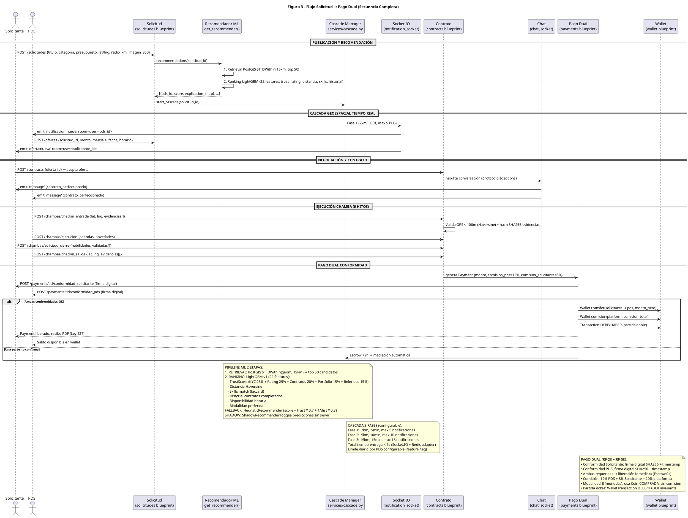

# Diagrama de Secuencia — Figura 3: Flujo Solicitud → Pago Dual (Secuencia Completa)

> **Módulo:** Flujo End-to-End: Publicación, Recomendación ML, Cascada Geoespacial, Negociación, Contrato, Ejecución 6 Hitos, Pago Dual  
> **Fuente:** `03_flujo_orden_pago.puml` (Figura 3)  
> **Referencias de Código:** `backend/app/controllers/solicitudes.py`, `backend/app/services/ai/recommender.py`, `backend/app/services/cascade.py`, `backend/app/handlers/notification_socket.py`, `backend/app/controllers/contracts.py`, `backend/app/handlers/chat_socket.py`, `backend/app/controllers/payments.py`, `backend/app/controllers/wallet.py`

---

## 1. Diagrama de Secuencia (PlantUML)

---

## 2. Actores y Participantes

| Actor/Participante | Tipo | Responsabilidad |
|--------------------|------|-----------------|
| **Solicitante (S)** | Actor | Publica solicitud, recibe ofertas, acepta, conformidad pago |
| **PDS (P)** | Actor | Recibe notificación, envía oferta, ejecuta chamba, conformidad pago |
| **Solicitud (SOL)** | Blueprint | CRUD solicitudes, geocerca PostGIS, imagen 360° |
| **Recomendador ML (REC)** | Servicio | Pipeline 2 etapas: Retrieval PostGIS + Ranking LightGBM |
| **Cascade Manager (CAS)** | Servicio | 3 fases geoespaciales, Celery tasks escalonadas |
| **Socket.IO (SIO)** | Handler | Notificaciones tiempo real, salas `user:<id>` |
| **Contrato (CON)** | Blueprint | FSM 6 estados, firma digital SHA256, chat |
| **Chat (CH)** | Handler | Mensajería 1:1, protocolo `⟦c:action⟧` |
| **Pago Dual (PAY)** | Blueprint | Conformidad dual, comisiones, Escrow 72h |
| **Wallet (WAL)** | Blueprint | Partida doble DEBE/HABER, saldo disponible/bloqueado |

---

## 3. Flujo Paso a Paso (Mensajes en Orden)

### Fase 1: Publicación y Recomendación ML
1. `S → SOL`: `POST /solicitudes {titulo, categoria, presupuesto, lat, lng, radio_km, imagen_360}`
2. `SOL → REC`: `recommendations(solicitud_id)`
3. `REC`: **Etapa 1 - Retrieval**: `PostGIS ST_DWithin(geom, 15km)` → top 50 candidatos PDS
4. `REC`: **Etapa 2 - Ranking**: LightGBM v1 (22 features: TrustScore, distancia, skills match, historial, disponibilidad, modalidad)
5. `REC → SOL`: `[{pds_id, score, explicacion_shap}, ...]`
6. `SOL → CAS`: `start_cascade(solicitud_id)`

### Fase 2: Cascada Geoespacial Tiempo Real (3 Fases)
7. `CAS → SIO`: **Fase 1** (2km, 300s, max 5 PDS)
8. `SIO → P`: `emit 'notificacion:nueva' room=user:<pds_id>` (WebSocket WSS)
9. `P → SOL`: `POST /ofertas {solicitud_id, monto, mensaje, fecha, horario}`
10. `SIO → S`: `emit 'oferta:nueva' room=user:<solicitante_id>`
11. `CAS → SIO`: **Fase 2** (5km, 600s, max 10 PDS, countdown 300s)
12. `CAS → SIO`: **Fase 3** (15km, 900s, max 15 PDS, countdown 600s)

### Fase 3: Negociación y Contrato
13. `S → CON`: `POST /contracts {oferta_id}` → acepta oferta
14. `CON → CH`: Habilita conversación (protocolo `⟦c:action⟧`)
15. `CH → S/P`: `emit 'message' (contrato_perfeccionado)` a ambos

### Fase 4: Ejecución Chamba (6 Hitos)
16. `P → CON`: `POST /chambas/checkin_entrada {lat, lng, evidencias[]}`
17. `CON`: Valida GPS < 100m (Haversine) + hash SHA256 evidencias
18. `P → CON`: `POST /chambas/ejecucion {adendas, novedades}`
19. `S → CON`: `POST /chambas/solicitud_cierre {habilidades_validadas[]}`
20. `P → CON`: `POST /chambas/checkin_salida {lat, lng, evidencias[]}`

### Fase 5: Pago Dual Conformidad
21. `CON → PAY`: Genera `Payment {monto, comision_pds=12%, comision_solicitante=8%}`
22. `PAY → S`: `POST /payments/:id/conformidad_solicitante` (firma digital SHA256)
23. `PAY → P`: `POST /payments/:id/conformidad_pds` (firma digital SHA256)
24. **Si ambas OK**:
   - `PAY → WAL`: `Wallet.transfer(solicitante → pds, monto_neto=88%)`
   - `PAY → WAL`: `Wallet.comision(platform, comision_total=20%)`
   - `PAY → WAL`: `Transaction DEBE/HABER` (partida doble invariante)
   - `PAY → S`: Payment liberado, recibo PDF (Ley 527)
   - `PAY → P`: Saldo disponible en wallet
25. **Si una parte no confirma**: `PAY → CAS`: Escrow 72h → mediación automática

---

## 4. Entidades y Tablas Involucradas

| Tabla | Campos Clave | Rol en Flujo |
|-------|-------------|--------------|
| `solicitudes` | `id`, `solicitante_id`, `lat/lng`, `radio_km`, `imagen_360`, `estado` | Origen del flujo |
| `recommendation_logs` | `solicitud_id`, `pds_id`, `puntuacion`, `ranking_pos`, `explicacion_shap`, `modelo_nombre`, `experiment_group` | Log A/B testing ML |
| `ofertas` | `solicitud_id`, `pds_id`, `monto`, `estado`, `contra_*` | Negociación bilateral |
| `contracts` | `service_id`, `proveedor_id`, `solicitante_id`, `estado[6]`, `firma_sha256` | Formalización |
| `chambas` | `contract_id UK`, `estado[7]`, 6 hitos, `evidencias JSON`, `adendas JSON` | Ejecución operativa |
| `payments` | `contract_id UK`, `monto`, `comision_pds(12%)`, `comision_solicitante(8%)`, `conformidad_dual`, `pasarela` | Liquidación |
| `wallets` | `user_id UK`, `saldo`, `saldo_bloqueado` | Billetera partida doble |
| `wallet_transactions` | `wallet_id`, `tipo[5]`, `monto`, `DEBE/HABER`, `saldo_resultante` | Libro contable |
| `notifications` | `user_id`, `tipo`, `titulo`, `mensaje`, `leida` | Centro alertas RF-10 |

---

## 5. Endpoints Clave

| Método | Endpoint | Descripción |
|--------|----------|-------------|
| POST | `/api/v1/solicitudes/` | Publicar solicitud con geocerca + 360° |
| GET | `/api/v1/solicitudes/:id/recommendations` | Obtener ranking ML con SHAP |
| POST | `/api/v1/solicitudes/:id/ofertas` | PDS envía oferta |
| POST | `/api/v1/contracts` | Aceptar oferta → crear contrato |
| POST | `/api/v1/chambas/checkin_entrada` | Hito 1: GPS < 100m + evidencias |
| POST | `/api/v1/chambas/ejecucion` | Hitos 3-4: adendas + novedades |
| POST | `/api/v1/chambas/solicitud_cierre` | Hito 5: validar habilidades |
| POST | `/api/v1/chambas/checkin_salida` | Hito 6: check-out GPS |
| POST | `/api/v1/payments/:id/conformidad_solicitante` | Firma digital solicitante |
| POST | `/api/v1/payments/:id/conformidad_pds` | Firma digital PDS |

---

## 6. Notas Técnicas (Extraídas del .puml)

### Pipeline ML 2 Etapas (Recomendador)
1. **Retrieval**: PostGIS `ST_DWithin(geom, 15km)` → top 50 candidatos
2. **Ranking**: LightGBM v1 (22 features):
   - TrustScore dimensiones (KYC 25% + Rating 25% + Contratos 20% + Portfolio 15% + Referidos 15%)
   - Distancia Haversine
   - Skills match Jaccard
   - Historial contratos completados (últimos 90d)
   - Disponibilidad horaria + Modalidad preferida
   - Embedding cosine similarity (pgvector 384-dim)
   - Contexto: hora/día + urgencia solicitud
3. **Fallback**: HeuristicRecommender (`score = trust * 0.7 + 1/dist * 0.3`)
4. **Shadow Mode**: ShadowRecommender loggea predicciones heurísticas sin servir

### Cascada Geoespacial (3 Fases Configurables)
| Fase | Radio | TTL | Max Notifs | Countdown |
|------|-------|-----|------------|-----------|
| 1 (Cercana) | 2 km | 300s (5min) | 5 | 0s |
| 2 (Media) | 5 km | 600s (10min) | 10 | 300s |
| 3 (Amplia) | 15 km | 900s (15min) | 15 | 600s |

- Configurable via `feature_flags`: `cascade_phase_1_km`, `cascade_phase_2_km`, `cascade_phase_3_km`, `cascade_max_notifs_per_phase`, `cascade_ttl_seconds`
- Entrega < 1s (Socket.IO + Redis adapter)
- Límite diario por PDS configurable

### Pago Dual (RF-23 + RF-08)
- **Conformidad dual obligatoria**: Ambas firmas digitales SHA256 + timestamp
- **Comisión**: 12% PDS + 8% Solicitante = 20% plataforma
- **Modalidad B**: Usa Coin COMPRADA, 0% comisión, conformidad dual
- **Partida doble**: `WalletTransaction` DEBE/HABER invariante (ΣDEBE = ΣHABER)
- **Escrow 72h**: Si una parte no conforma → mediación soporte automática

---

*Generado automáticamente desde `03_flujo_orden_pago.puml` (Figura 3)*