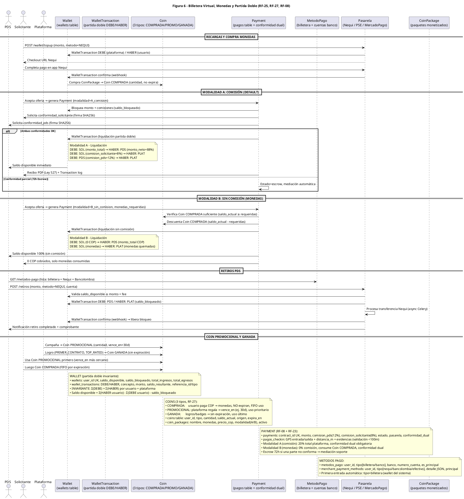

# Diagrama de Secuencia — Figura 6: Billetera Virtual, Monedas y Partida Doble (RF-25, RF-27, RF-08)

> **Módulo:** Flujo Financiero Completo: Wallet, Coins, Pagos Dual, Retiros  
> **Fuente:** `06_billetera_virtual.puml` (Figura 6)  
> **Referencias de Código:** `backend/app/controllers/wallet.py`, `backend/app/controllers/payments.py`, `backend/app/models/wallet.py`, `backend/app/models/coin.py`, `frontend/src/features/billetera/`

---

## 1. Diagrama de Secuencia (PlantUML)



---

## 2. Actores y Participantes

| Actor/Participante | Tipo | Responsabilidad |
|--------------------|------|-----------------|
| **Solicitante (SOL)** | Actor | Recarga wallet, compra Coins, paga servicios (Modalidad A/B) |
| **PDS** | Actor | Recibe pagos, retira a banco/Nequi, gestiona métodos de pago |
| **Plataforma (PLAT)** | Actor | Emite Coins promocionales/ganadas, recibe comisiones |
| **Wallet (W)** | Tabla/Entidad | Billetera virtual, partida doble DEBE/HABER, saldo disponible/bloqueado |
| **WalletTransaction (WT)** | Tabla/Entidad | Libro contable: DEBE/HABER, concepto, monto, saldo_resultante, referencia |
| **Coin (C)** | Tabla/Entidad | 3 tipos: COMPRADA/PROMOCIONAL/GANADA, FIFO por expiración |
| **Payment (PAY)** | Tabla/Entidad | Pagos contratos, comisiones 12%/8%, conformidad dual, Escrow 72h |
| **MetodoPago (MP)** | Tabla/Entidad | Métodos usuario (billetera/banco) + negocio (Nequi/Bancolombia/efectivo) |
| **Pasarela (GW)** | Servicio Externo | Nequi / PSE / MercadoPago, webhooks async |
| **CoinPackage (CP)** | Entidad | Paquetes monetizados: nombre, monedas, precio COP, modalidad A/B |

---

## 3. Flujos Principales

### A. Recargas y Compra de Monedas
1. `SOL → GW`: `POST /wallet/topup {monto, metodo=NEQUI}`
2. `GW → W`: `WalletTransaction` DEBE (plataforma) / HABER (usuario)
3. `GW → SOL`: Checkout URL Nequi
4. `SOL → GW`: Completa pago en app Nequi
5. `GW → W`: `WalletTransaction` confirma (webhook)
6. `W → C`: Compra `CoinPackage` → `Coin COMPRADA` (cantidad, no expira)

### B. Modalidad A: Comisión (Default - 20% plataforma)
1. `SOL → PAY`: `POST /contracts/{id}/accept` → genera `Payment {modalidad=A_comision}`
2. `PAY → W`: Bloquea monto + comisiones (`saldo_bloqueado`)
3. `PAY → SOL`: Solicita `conformidad_solicitante` (firma digital SHA256)
4. `PAY → PDS`: Solicita `conformidad_pds` (firma digital SHA256)
5. **Si ambas OK**:
   - `PAY → W`: `WalletTransaction` (liquidación partida doble)
     - DEBE: SOL (monto_total) → HABER: PDS (monto_neto = 88%)
     - DEBE: SOL (comision_solicitante = 8%) → HABER: PLAT
     - DEBE: PDS (comision_pds = 12%) → HABER: PLAT
   - `W → PDS`: Saldo disponible inmediato
   - `PAY → SOL`: Recibo PDF (Ley 527) + Transaction log
6. **Si conformidad parcial (72h)**: `PAY → PAY`: Estado = escrow, mediación automática

### C. Modalidad B: Sin Comisión (Monedas)
1. `SOL → PAY`: `POST /contracts/{id}/accept` → genera `Payment {modalidad=B_sin_comision, monedas_requeridas}`
2. `PAY → C`: Verifica `Coin COMPRADA` suficiente (`saldo_actual ≥ requeridas`)
3. `PAY → C`: Descuenta `Coin COMPRADA` (`saldo_actual - requeridas`)
4. `PAY → W`: `WalletTransaction` (liquidación sin comisión)
   - DEBE: SOL (0 COP) → HABER: PDS (monto_total COP)
   - DEBE: SOL (monedas) → HABER: PLAT (monedas quemadas)
5. `PAY → PDS`: Saldo disponible 100% (sin comisión)
6. `PAY → SOL`: 0 COP cobrados, solo monedas consumidas

### D. Retiros PDS
1. `PDS → MP`: `GET /metodos-pago` (lista: billetera + Nequi + Bancolombia)
2. `PDS → GW`: `POST /retiros {monto, metodo=NEQUI, cuenta}`
3. `GW → W`: Valida `saldo_disponible ≥ monto + fee`
4. `GW → W`: `WalletTransaction` DEBE: PDS / HABER: PLAT (`saldo_bloqueado`)
5. `GW → GW`: Procesa transferencia Nequi (async Celery)
6. `GW → W`: `WalletTransaction` confirma (webhook) → libera bloqueo
7. `GW → PDS`: Notificación retiro completado + comprobante

### E. Coins Promocional y Ganada
1. `PLAT → C`: Campaña → `Coin PROMOCIONAL` (cantidad, `vence_en=30d`)
2. `PLAT → C`: Logro (`PRIMER_CONTRATO`, `TOP_RATED`) → `Coin GANADA` (sin expiración)
3. `SOL → C`: Usa `Coin PROMOCIONAL` primero (`vence_en` más cercano)
4. `SOL → C`: Luego `Coin COMPRADA` (FIFO por expiración)

---

## 4. Entidades y Tablas

| Tabla | Campos Clave | Descripción |
|-------|-------------|-------------|
| `wallets` | `id PK`, `user_id FK UK`, `saldo`, `saldo_bloqueado`, `created_at/updated_at` | Billetera por usuario |
| `wallet_transactions` | `id PK`, `wallet_id FK`, `tipo[5]`, `monto (COP +/-)`, `DEBE/HABER`, `concepto`, `saldo_resultante`, `referencia_id/tipo`, `created_at` | Libro contable partida doble |
| `coins` | `id PK`, `user_id FK`, `cantidad`, `tipo[COMPRADA/PROMOCIONAL/GANADA]`, `saldo_actual`, `origen`, `expira_en`, `created_at` | Ledger de monedas por tipo |
| `coin_packages` | `id PK`, `nombre`, `monedas`, `precio_cop`, `modalidad[A/B]`, `activo` | Paquetes monetizados |
| `payments` | `id PK`, `contract_id FK UK`, `monto`, `comision_pds(12%)`, `comision_solicitante(8%)`, `estado[4]`, `pasarela[mock/nequi]`, `referencia_pasarela`, `motivo_reembolso`, `conformidad_dual`, `created_at/updated_at` | Pagos de contratos |
| `metodos_pago` | `id PK`, `user_id FK`, `tipo[billetera/banco]`, `banco`, `numero_cuenta`, `es_principal`, `created_at` | Métodos usuario |
| `merchant_payment_methods` | `id PK`, `user_id FK`, `tipo[nequi/bancolombia/efectivo...]`, `detalle JSON`, `principal`, `activo`, `created_at` | Métodos negocio |

---

## 5. Endpoints Clave

| Método | Endpoint | Descripción |
|--------|----------|-------------|
| POST | `/api/v1/wallet/topup` | Recarga wallet vía Nequi/PSE |
| POST | `/api/v1/wallet/coins/buy` | Compra paquete Coins (COMPRADA) |
| POST | `/api/v1/payments` | Genera payment (modalidad A/B) |
| POST | `/api/v1/payments/:id/conformidad_solicitante` | Firma digital solicitante |
| POST | `/api/v1/payments/:id/conformidad_pds` | Firma digital PDS |
| POST | `/api/v1/retiros` | Solicita retiro Nequi/Bancolombia |
| GET | `/api/v1/metodos-pago` | Lista métodos pago usuario/negocio |
| GET | `/api/v1/wallet/transactions` | Historial transacciones (partida doble) |
| GET | `/api/v1/wallet/coins` | Balance Coins por tipo |

---

## 6. Reglas de Negocio Críticas

### Partida Doble Invariante (Wallet)
```
wallets: user_id UK, saldo_disponible, saldo_bloqueado, total_ingresos, total_egresos
wallet_transactions: DEBE/HABER, concepto, monto, saldo_resultante, referencia_id/tipo

INVARIANTE: Σ(DEBE) = Σ(HABER) por usuario + plataforma
Saldo disponible = Σ(HABER usuario) - Σ(DEBE usuario) - saldo_bloqueado
```

### 3 Tipos de Coins (RF-27)
| Tipo | Origen | Expiración | Prioridad Uso |
|------|--------|------------|---------------|
| **COMPRADA** | Usuario paga COP | NO expiran | 2da (FIFO) |
| **PROMOCIONAL** | Plataforma regala (campañas) | `vence_en` (ej. 30d) | 1ra (más próxima a vencer) |
| **GANADA** | Logros/badges (PRIMER_CONTRATO, TOP_RATED) | Sin expiración | 3ra (última) |

### Modalidad A vs B (RF-26)
| Aspecto | Modalidad A (Comisión) | Modalidad B (Monedas) |
|---------|------------------------|----------------------|
| **Comisión** | 12% PDS + 8% Solicitante = 20% plataforma | 0% comisión |
| **Pago** | COP desde wallet | Coin COMPRADA |
| **Conformidad** | Dual obligatoria (SHA256) | Dual obligatoria |
| **Escrow** | 72h si una parte no conforma | 72h si una parte no conforma |
| **Recibo** | PDF Ley 527 | Solo transaction log |

### Retiros con Escrow Preventivo
- Validación: `saldo_disponible ≥ monto + fee`
- `saldo_bloqueado` incrementado al solicitar
- Transferencia async Celery (Nequi/Bancolombia)
- Webhook confirma → libera `saldo_bloqueado`
- Comprobante generado automáticamente

---

## 7. Notas Técnicas (Extraídas del .puml)

### Wallet (Partida Doble Invariante)
- `wallets`: `user_id UK`, `saldo_disponible`, `saldo_bloqueado`, `total_ingresos`, `total_egresos`
- `wallet_transactions`: `DEBE/HABER`, `concepto`, `monto`, `saldo_resultante`, `referencia_id/tipo`
- **INVARIANTE**: `Σ(DEBE) = Σ(HABER)` por usuario + plataforma
- **Saldo disponible** = `Σ(HABER usuario) - Σ(DEBE usuario) - saldo_bloqueado`

### Coins (3 Tipos, RF-27)
- **COMPRADA**: usuario paga COP → monedas, NO expiran, FIFO uso
- **PROMOCIONAL**: plataforma regala → `vence_en` (ej. 30d), uso prioritario
- **GANADA**: logros/badges → sin expiración, uso último
- `coins table`: `user_id`, `tipo`, `cantidad`, `saldo_actual`, `origen`, `expira_en`
- `coin_packages`: `nombre`, `monedas`, `precio_cop`, `modalidad(A/B)`, `activo`

### Payment (RF-08 + RF-23)
- `payments`: `contract_id UK`, `monto`, `comision_pds(12%)`, `comision_solicitante(8%)`, `estado`, `pasarela`, `conformidad_dual`
- `pagos_checkin`: GPS entrada/salida + `distancia_m` + evidencias (validación <100m)
- **Modalidad A (comisión)**: 20% total plataforma, conformidad dual obligatoria
- **Modalidad B (monedas)**: 0% comisión, consume Coin COMPRADA, conformidad dual
- **Escrow 72h**: si una parte no conforma → mediación soporte

### Métodos Pago
- `metodos_pago`: `user_id`, `tipo[billetera/banco]`, `banco`, `numero_cuenta`, `es_principal`
- `merchant_payment_methods`: `user_id`, `tipo[nequi/bancolombia/efectivo]`, `detalle JSON`, `principal`
- Primera entrada automática: `tipo=billetera` (wallet del sistema)

---

## 8. Validación de PlantUML

- ✅ Sintaxis validada: `java -jar plantuml.jar -tpng -charset UTF-8 06_billetera_virtual.puml` → **Sin errores**
- ✅ PNG generado: `06_billetera_virtual.png` (300 KB)
- ✅ SVG generado: `06_billetera_virtual.svg` (43 KB)
- ✅ UTXT generado: `06_billetera_virtual.utxt` (90 KB, 181 líneas)

---

## 9. Inconsistencias Detectadas y Corregidas

### Errores de Sintaxis PlantUML (Original)
1. **Líneas 30-33**: Bloque `alt` con contenido multi-línea indentado inválido:
   ```
   PAY -> W: WalletTransaction:
     DEBE: SOL (monto_total) → HABER: PDS (monto_neto=88%)
     DEBE: SOL (comision_solicitante=8%) → HABER: PLAT
     DEBE: PDS (comision_pds=12%) → HABER: PLAT
   ```
   **Corrección**: Movido a `note right of W` con salto de línea `\n`

2. **Líneas 44-46**: Mismo problema en Modalidad B:
   ```
   PAY -> W: WalletTransaction:
     DEBE: SOL (0 COP) → HABER: PDS (monto_total COP)
     DEBE: SOL (monedas) → HABER: PLAT (monedas quemadas)
   ```
   **Corrección**: Movido a `note right of W`

### Validación Contable (Partida Doble)
| Movimiento | DEBE | HABER | Validación |
|------------|------|-------|------------|
| Modalidad A - Principal | SOL (monto_total) | PDS (88%) | ✅ Balancea |
| Modalidad A - Comisión Solicitante | SOL (8%) | PLAT | ✅ Balancea |
| Modalidad A - Comisión PDS | PDS (12%) | PLAT | ✅ Balancea |
| Modalidad B - Principal | SOL (0 COP) | PDS (100%) | ✅ Balancea (0 COP = sin efectivo) |
| Modalidad B - Quema Monedas | SOL (monedas) | PLAT (monedas) | ✅ Balancea (unidades, no COP) |

**Nota**: En Modalidad B, el DEBE de SOL es "0 COP" porque no hay flujo de efectivo; el valor se transfiere vía quema de monedas. La partida doble se mantiene invariante en su dimensión contable (unidades monetarias vs COP).

---

## 10. Archivos Generados/Actualizados

| Archivo | Estado | Descripción |
|---------|--------|-------------|
| `06_billetera_virtual.puml` | ✅ Corregido | Sintaxis PlantUML válida, notas para DEBE/HABER |
| `06_billetera_virtual.utxt` | ✅ Regenerado | Texto Unicode del diagrama (90 KB, 181 líneas) |
| `06_billetera_virtual.png` | ✅ Generado | Imagen PNG (300 KB) |
| `06_billetera_virtual.svg` | ✅ Generado | Imagen SVG (43 KB) |
| `06-billetera-virtual-monedas.md` | ✅ Actualizado | Documentación sincronizada con .puml corregido |

---

*Generado automáticamente desde `06_billetera_virtual.puml` (Figura 6) — Validado sin errores de sintaxis PlantUML*