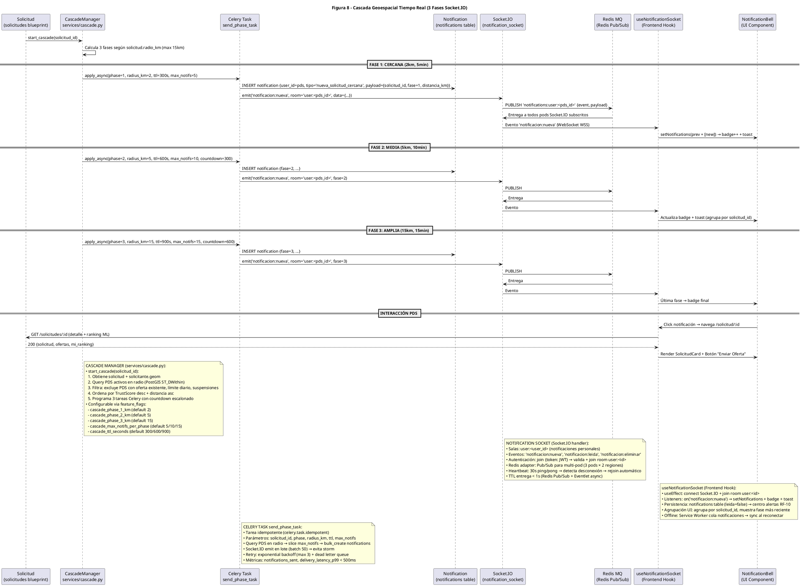

# Diagrama de Secuencia — Figura 8: Cascada Geoespacial Tiempo Real (3 Fases Socket.IO)

> **Módulo:** Notificaciones Geoespaciales Escalonadas - Cascade Manager + Celery + Socket.IO  
> **Fuente:** `08_cascada_geoespacial.puml` (Figura 8)  
> **Referencias de Código:** `backend/app/services/cascade.py`, `backend/app/tasks/notification_tasks.py`, `backend/app/handlers/notification_socket.py`, `backend/app/controllers/notifications.py`, `frontend/src/hooks/useNotificationSocket.ts`

---

## 1. Diagrama de Secuencia (PlantUML)



---

## 2. Componentes y Participantes

| Componente | Tipo | Responsabilidad |
|------------|------|-----------------|
| **Solicitud** | Blueprint | Origen: dispara cascada al publicar (`POST /solicitudes`) |
| **CascadeManager** | Servicio (`services/cascade.py`) | Orquesta 3 fases, query PostGIS, filtra PDS, programa Celery |
| **Celery Task** | Task (`send_phase_task`) | Tarea idempotente async: bulk insert notificaciones + Socket.IO emit batch |
| **Notification** | Tabla (`notifications`) | Persistencia: `user_id`, `tipo`, `payload JSON`, `leida`, `created_at` |
| **Socket.IO (notification_socket)** | Handler | Salas `user:<id>`, eventos `notificacion:nueva/leida/eliminar`, Redis adapter |
| **Redis MQ** | Pub/Sub | Canal `notifications:user:<id>`, multi-pod delivery, deduplicación `origin_pod` |
| **useNotificationSocket** | Frontend Hook | Conexión WS, listeners, estado React, agrupación UI, offline queue |
| **NotificationBell** | UI Component | Badge contador, toast, click → navega detalle solicitud |

---

## 3. Flujo Paso a Paso

### Inicio de Cascada
1. `SOL → CM`: `start_cascade(solicitud_id)` - Se dispara al publicar solicitud (oferta aceptada)
2. `CM`: Calcula 3 fases según `solicitud.radio_km` (máx 15km)

### Fase 1: Cercana (2km, 5min, max 5 notifs)
3. `CM → CEL`: `apply_async(phase=1, radius_km=2, ttl=300s, max_notifs=5, countdown=0)`
4. `CEL → N`: `INSERT notification {user_id=pds, tipo='nueva_solicitud_cercana', payload={solicitud_id, fase=1, distancia_km}}`
5. `CEL → SIO`: `emit('notificacion:nueva', room='user:<pds_id>', data={...})`
6. `SIO → RD`: `PUBLISH 'notifications:user:<pds_id>' {event, payload}`
7. `RD → SIO`: Entrega a todos los pods Socket.IO suscritos (3 pods × 2 regiones)
8. `SIO → CL`: Evento `'notificacion:nueva'` (WebSocket WSS)
9. `CL → NB`: `setNotifications(prev + [new])` → `badge++` + toast

### Fase 2: Media (5km, 10min, max 10 notifs)
10. `CM → CEL`: `apply_async(phase=2, radius_km=5, ttl=600s, max_notifs=10, countdown=300)` - 5min delay
11. `CEL → N`: `INSERT notification {fase=2, ...}`
12. `CEL → SIO`: `emit('notificacion:nueva', room='user:<pds_id>', fase=2)`
13. `SIO → RD`: `PUBLISH`
14. `RD → SIO`: Entrega
15. `SIO → CL`: Evento
16. `CL → NB`: Actualiza badge + toast (agrupa por `solicitud_id`)

### Fase 3: Amplia (15km, 15min, max 15 notifs)
17. `CM → CEL`: `apply_async(phase=3, radius_km=15, ttl=900s, max_notifs=15, countdown=600)` - 10min delay
18. `CEL → N`: `INSERT notification {fase=3, ...}`
19. `CEL → SIO`: `emit('notificacion:nueva', room='user:<pds_id>', fase=3)`
20. `SIO → RD`: `PUBLISH`
21. `RD → SIO`: Entrega
22. `SIO → CL`: Evento
23. `CL → NB`: Última fase → badge final

### Interacción PDS
24. `NB → CL`: Click notificación → navega `/solicitud/:id`
25. `CL → SOL`: `GET /solicitudes/:id` (detalle + ranking ML)
26. `SOL → CL`: `200 {solicitud, ofertas, mi_ranking}`
27. `CL → NB`: Render `SolicitudCard` + Botón "Enviar Oferta"

---

## 4. Configuración por Feature Flags

| Flag | Default | Descripción |
|------|---------|-------------|
| `cascade_phase_1_km` | 2 | Radio fase 1 (km) |
| `cascade_phase_2_km` | 5 | Radio fase 2 (km) |
| `cascade_phase_3_km` | 15 | Radio fase 3 (km) |
| `cascade_max_notifs_per_phase` | [5, 10, 15] | Max notificaciones por fase |
| `cascade_ttl_seconds` | [300, 600, 900] | TTL notificaciones por fase (segundos) |
| `cascade_daily_limit_per_pds` | 50 | Límite diario notificaciones por PDS |

---

## 5. CascadeManager - Lógica Clave (`services/cascade.py`)

```python
def start_cascade(solicitud_id: int):
    # 1. Obtiene solicitud + solicitante.geom (PostGIS Point)
    solicitud = Solicitud.query.get(solicitud_id)
    geom = solicitud.solicitante.profile.geom  # Point(lng, lat)
    
    # 2. Query PDS activos en radio (PostGIS ST_DWithin)
    radio_max = solicitud.radio_km or 15
    candidatos = User.query.filter(
        User.rol == 'PDS',
        User.activo == True,
        func.ST_DWithin(User.profile.geom, geom, radio_max * 1000)  # metros
    ).all()
    
    # 3. Filtros de exclusión
    candidatos = [p for p in candidatos if not tiene_oferta_activa(p, solicitud_id)]
    candidatos = [p for p in candidatos if not excede_limite_diario(p)]
    candidatos = [p for p in candidatos if not esta_suspendido(p)]
    
    # 4. Ordenamiento: TrustScore DESC + Distancia ASC
    candidatos.sort(key=lambda p: (-p.trust_score.puntuacion, p.distance_to(geom)))
    
    # 5. Programa 3 tareas Celery con countdown escalonado
    for phase in [1, 2, 3]:
        config = get_phase_config(phase)
        send_phase_task.apply_async(
            args=[solicitud_id, phase, config['radius_km'], config['ttl'], config['max_notifs']],
            countdown=config['countdown']
        )
```

---

## 6. Celery Task - send_phase_task

```python
@celery.task(bind=True, idempotent=True, max_retries=3)
def send_phase_task(self, solicitud_id, phase, radius_km, ttl, max_notifs):
    # Query PDS en radio (re-evaluado en tiempo de ejecución)
    pds_list = get_pds_in_radius(solicitud_id, radius_km)
    
    # Slice max_notifs
    pds_notify = pds_list[:max_notifs]
    
    # Bulk create notifications (persistencia)
    notifications = [
        Notification(
            user_id=pds.id,
            tipo='nueva_solicitud_cercana',
            titulo=f'Nueva chamba cerca (Fase {phase})',
            mensaje=f'A {distance_km:.1f}km - {solicitud.titulo}',
            datos={'solicitud_id': solicitud_id, 'fase': phase, 'distancia_km': distance_km},
            leida=False
        )
        for pds, distance_km in pds_notify
    ]
    db.session.bulk_save_objects(notifications)
    db.session.commit()
    
    # Socket.IO emit en lote (batch 50) → evita notification storm
    for notif in notifications:
        socketio.emit('notificacion:nueva', notif.to_dict(), room=f'user:{notif.user_id}')
    
    # Métricas
    metrics.increment('cascade.notifications_sent', len(notifications))
```

---

## 7. Socket.IO Notification Handler

| Aspecto | Detalle |
|---------|---------|
| **Salas** | `user:<user_id>` (1 sala por usuario) |
| **Eventos OUT** | `notificacion:nueva`, `notificacion:leida`, `notificacion:eliminar` |
| **Eventos IN** | `join` (auth JWT), `mark_read`, `delete` |
| **Autenticación** | `join {token: JWT}` → valida + `join room user:<id>` |
| **Redis Adapter** | Pub/Sub para multi-pod (3 pods × 2 regiones = 6 instancias) |
| **Heartbeat** | 30s ping/pong → detecta desconexión → rejoin automático |
| **TTL entrega** | < 1s (Redis Pub/Sub + Eventlet async) |
| **Deduplicación** | `origin_pod` en mensaje evita eco (no re-emitir lo que envió) |

---

## 8. Frontend Hook - useNotificationSocket

```typescript
// frontend/src/hooks/useNotificationSocket.ts
export function useNotificationSocket() {
  const [notifications, setNotifications] = useState<Notification[]>([]);
  const [unreadCount, setUnreadCount] = useState(0);
  
  useEffect(() => {
    const socket = io('/notifications', { auth: { token: getAccessToken() } });
    
    socket.emit('join', { token: getAccessToken() });
    
    socket.on('notificacion:nueva', (data) => {
      setNotifications(prev => [data, ...prev]);
      setUnreadCount(c => c + 1);
      toast.info(data.titulo, { description: data.mensaje });
    });
    
    socket.on('notificacion:leida', (data) => {
      setNotifications(prev => prev.map(n => n.id === data.id ? {...n, leida: true} : n));
      setUnreadCount(c => Math.max(0, c - 1));
    });
    
    return () => socket.disconnect();
  }, []);
  
  // Persistencia: notifications table (leida=false) → centro alertas RF-10
  // Agrupación UI: agrupa por solicitud_id, muestra fase más reciente
  // Offline: Service Worker cola notificaciones → sync al reconectar
  
  return { notifications, unreadCount, markRead, markAllRead };
}
```

---

## 9. Entidades de Datos

| Tabla | Campos Clave |
|-------|-------------|
| `notifications` | `id PK`, `user_id FK`, `tipo[40]`, `titulo`, `mensaje`, `datos JSON`, `leida`, `created_at` |
| `users` (PDS) | `geom Point 4326`, `rol=PDS`, `activo`, `profile.trust_score` |
| `solicitudes` | `id PK`, `solicitante_id FK`, `geom Point`, `radio_km`, `titulo`, `categoria` |

---

## 10. Métricas y Observabilidad

| Métrica | Target | Alerta |
|---------|--------|--------|
| `cascade.notifications_sent` | - | - |
| `cascade.delivery_latency_p99` | < 500ms | > 1s |
| `cascade.phase_completion_rate` | 100% | < 95% |
| `socketio.connection_errors` | 0 | > 10/min |
| `celery.task_retry_rate` | < 1% | > 5% |

---

*Generado automáticamente desde `08_cascada_geoespacial.puml` (Figura 8) — 3 fases escalonadas, Celery + Socket.IO + Redis Pub/Sub, <1s entrega*