# Diagrama de Secuencia — Flujo 14: Moderación, Soporte y Gobernanza Superadmin

> **Módulo:** Gobernanza Multi-Rol, Fronteras Regionales, Arbitraje de Disputas, Feature Flags y Auditoría Forense  
> **Fuente:** `14_moderacion_soporte_superadmin.puml` (Figura 14)  
> **Referencias de Código:** `backend/app/controllers/admin.py`, `backend/app/controllers/superadmin.py`, `backend/app/controllers/disputes.py`, `backend/app/controllers/tickets.py`, `backend/app/models/audit.py`, `frontend/src/features/disputas/`, `frontend/src/features/admin/`

---

## 1. Diagrama de Secuencia (PlantUML)

```plantuml
@startuml
title Figura 14 - Moderación, Soporte y Gobernanza Superadmin (Flujo Completo)

actor "Solicitante" as SOL
actor "PDS (Trabajador)" as PDS
actor "Admin Regional\n(Región 1 - Caribe)" as ADM
actor "Superadmin\n(Universal - Sin scope)" as SUP

box "Frontend React (Vite + Admin Panel)" #E3F2FD
  participant "Centro Disputas\nDisputasPage.tsx" as FE_DISP
  participant "Consola Moderación\nAdminPanel / SuperadminPanel" as FE_ADM
end box

box "API Gateway (Flask-Smorest + Blueprints)" #FFF3E0
  participant "/api/v1/contracts/:id/disputes\n(contracts blueprint)" as API_DISP
  participant "/api/v1/tickets/\n(tickets blueprint)" as API_TICK
  participant "/api/v1/admin/stats\n(admin blueprint)" as API_STATS
  participant "/api/v1/admin/disputes/:id/resolve\n(admin blueprint)" as API_RES
  participant "/api/v1/superadmin/flags\n(superadmin blueprint)" as API_FLAGS
  participant "/api/v1/superadmin/audit-logs\n(superadmin blueprint)" as API_AUDIT
end box

box "Control Regional y Seguridad" #F3E5F5
  participant "region_scope_id Enforcer\n(Middleware JWT + RBAC)" as SCOPE
end box

box "PostgreSQL 16 + PostGIS" #E8F5E9
  database "disputes\n(estado, resolucion, resuelto_por)" as DB_DISP
  database "tickets\n(tipo, prioridad, estado, asignado_a)" as DB_TICK
  database "feature_flags\n(nombre, habilitado, descripcion)" as DB_FLAGS
  database "audit_logs\n(actor, accion, entidad, snapshot_diff, timestamp)\nINMUTABLE APPEND-ONLY (RNF-AUD)" as DB_AUDIT
end box

== DISPUTA: RADICACIÓN Y ESCALAMIENTO ==
SOL -> FE_DISP: Radica disputa (Contrato #1, tipo=PAGO)
FE_DISP -> API_DISP: POST /contracts/1/disputes {tipo, reason}
API_DISP -> DB_DISP: INSERT dispute (estado=abierta, iniciado_por=SOL)
API_DISP --> FE_DISP: 201 {dispute_id, estado=abierta}
FE_DISP --> SOL: Disputa radicada #DISP-001

== TICKET: ASISTENCIA FORMALIZACIÓN ==
PDS -> API_TICK: POST /tickets/ {tipo=SOPORTE, prioridad=high, body}
API_TICK -> DB_TICK: INSERT ticket (estado=open, asignado_a=NULL)
API_TICK --> PDS: 201 {ticket_id, estado=open}

== ADMIN REGIONAL: GESTIÓN SCOPED ==
ADM -> FE_ADM: Abre panel Admin (JWT: rol=admin, region_scope=1)
FE_ADM -> API_STATS: GET /admin/stats (Authorization: Bearer <JWT>)
API_STATS -> SCOPE: Extrae region_scope_id=1 de JWT claims
SCOPE -> DB_DISP: SELECT * FROM disputes WHERE contract.solicitante.region_id=1
SCOPE -> DB_TICK: SELECT * FROM tickets WHERE user.region_id=1
API_STATS --> FE_ADM: 200 {kpis_region_1, disputes[], tickets[]}
FE_ADM --> ADM: Dashboard KPIs Región 1 (solo su scope)

== AISLAMIENTO REGIONAL ESTRICTO ==
ADM -> FE_ADM: Intenta ver disputa #DISP-002 (Región 2 - Andina)
FE_ADM -> API_DISP: GET /admin/disputes/2 (JWT region_scope=1)
API_DISP -> SCOPE: Valida contract.solicitante.region_id=2 vs scope=1
SCOPE --> API_DISP: MISMATCH → HTTP 404 Not Found (aislamiento)
API_DISP --> FE_ADM: 404 (no existe en tu región)
FE_ADM --> ADM: "Disputa no encontrada" (no filtra, 404 directo)

== SUPERADMIN: ARBITRAJE Y FLAGS CALIENTES ==
SUP -> FE_ADM: Abre SuperadminPanel (JWT: rol=superadmin, region_scope=NULL)
FE_ADM -> API_RES: POST /admin/disputes/2/resolve {resolucion, laudo}
API_RES -> DB_DISP: UPDATE dispute SET estado=resuelta, resolucion=..., resuelto_por=SUP, resuelto_en=NOW()
API_RES -> DB_AUDIT: INSERT audit_log {actor=SUP, action=DISPUTE_RESOLVE, entity=dispute, entity_id=2, after_json={...}, timestamp}
API_RES --> FE_ADM: 200 {dispute_id=2, estado=resuelta}

FE_ADM -> API_FLAGS: PATCH /flags/ml_ranking_enabled {habilitado: false}
API_FLAGS -> DB_FLAGS: UPDATE feature_flags SET habilitado=false, actualizado_por=SUP, actualizado_en=NOW()
API_FLAGS -> DB_AUDIT: INSERT audit_log {actor=SUP, action=FLAG_UPDATE, entity=feature_flag, entity_id=ml_ranking_enabled, before_json={habilitado:true}, after_json={habilitado:false}, timestamp}
API_FLAGS --> FE_ADM: 200 {flag: ml_ranking_enabled, habilitado: false}

FE_ADM -> API_AUDIT: GET /superadmin/audit-logs?actor=SUP&desde=2024-01-01
API_AUDIT -> DB_AUDIT: SELECT * FROM audit_logs WHERE actor_id=SUP ORDER BY timestamp DESC
API_AUDIT --> FE_ADM: 200 [audit_log_1, audit_log_2, ...]
FE_ADM --> SUP: Pista forense completa (inmutable, hash chain)

note right of SCOPE
  REGION_SCOPE ENFORCER (middleware):
  • Ejecuta ANTES de cada endpoint /admin/*
  • Lee JWT claims: {rol, region_scope_id, role_version}
  • Superadmin: region_scope_id = NULL → bypass (acceso global)
  • Admin/Verificador/Soporte: region_scope_id = región asignada
  • Inyecta WHERE region_id = scope en TODAS las queries
  • 404 (no 403) para evitar enumeración cross-region
end note

note right of DB_AUDIT
  AUDIT LOGS INMUTABLES (RNF-AUD):
  • Append-only: NUNCA UPDATE/DELETE
  • snapshot_diff_json: {before: {...}, after: {...}}
  • Hash chain: cada log incluye hash(prev_log) → detección manipulación
  • Retención: 10 años (compliance Ley 1581/2012 Habeas Data)
  • Solo Superadmin READ (no incluso Admin regional)
end note

note right of API_FLAGS
  FEATURE FLAGS HOT RELOAD:
  • Tabla feature_flags: nombre UK, habilitado, descripcion, modelo_version
  • Backend: cache en memoria + invalidación pub/sub Redis (5s TTL)
  • Frontend: polling /api/v1/config/flags cada 30s
  • Cambio Superadmin → broadcast Redis → todos pods invalidan cache
  • Auditoría automática en audit_logs (diff before/after)
end note

@enduml
```

---

## 2. Descripción Técnica y Contratos de Datos

### Actores y Participantes
| Actor | Rol | Scope Regional |
|-------|-----|----------------|
| **Solicitante** | Usuario que radica disputa contractual | — |
| **PDS (Trabajador)** | Usuario que crea tickets de soporte | — |
| **Admin Regional** | Gestión scoped a su región (ej. Caribe = region_id=1) | `region_scope_id=1` |
| **Superadmin** | Acceso global sin restricciones regionales | `region_scope_id=NULL` |

### Flujo Paso a Paso (Mensajes en Orden)

#### Subflujo A: Radicación de Disputa y Ticket
1. `SOL → FE_DISP`: Usuario accede a centro de disputas y radica controversia (Contrato #1, tipo PAGO)
2. `FE_DISP → API_DISP`: `POST /contracts/1/disputes {tipo, reason}`
3. `API_DISP → DB_DISP`: `INSERT dispute (estado='abierta', iniciado_por=SOL)`
4. `API_DISP → FE_DISP`: `201 {dispute_id, estado='abierta'}`
5. `PDS → API_TICK`: `POST /tickets/ {tipo=SOPORTE, prioridad=high, body}`
6. `API_TICK → DB_TICK`: `INSERT ticket (estado='open', asignado_a=NULL)`
7. `API_TICK → PDS`: `201 {ticket_id, estado='open'}`

#### Subflujo B: Admin Regional - Gestión Scoped
8. `ADM → FE_ADM`: Abre panel Admin (JWT con `rol=admin`, `region_scope=1`)
9. `FE_ADM → API_STATS`: `GET /admin/stats` (Bearer JWT)
10. `API_STATS → SCOPE`: Extrae `region_scope_id=1` de claims JWT
11. `SCOPE → DB_DISP`: Filtra disputes por `contract.solicitante.region_id=1`
12. `SCOPE → DB_TICK`: Filtra tickets por `user.region_id=1`
13. `API_STATS → FE_ADM`: `200 {kpis_region_1, disputes[], tickets[]}`

#### Subflujo C: Aislamiento Regional Estricto
14. `ADM → FE_ADM`: Intenta ver disputa #DISP-002 (pertenece a Región 2 - Andina)
15. `FE_ADM → API_DISP`: `GET /admin/disputes/2` (JWT `region_scope=1`)
16. `API_DISP → SCOPE`: Valida `contract.solicitante.region_id=2` vs `scope=1`
17. `SCOPE → API_DISP`: **MISMATCH** → `HTTP 404 Not Found` (aislamiento, no 403)
18. `API_DISP → FE_ADM`: `404` (recurso no encontrado en tu región)

#### Subflujo D: Superadmin - Arbitraje y Feature Flags
19. `SUP → FE_ADM`: Abre SuperadminPanel (JWT `rol=superadmin`, `region_scope=NULL`)
20. `FE_ADM → API_RES`: `POST /admin/disputes/2/resolve {resolucion, laudo}`
21. `API_RES → DB_DISP`: `UPDATE dispute SET estado='resuelta', resolucion=..., resuelto_por=SUP`
22. `API_RES → DB_AUDIT`: `INSERT audit_log {actor=SUP, action=DISPUTE_RESOLVE, entity=dispute, entity_id=2, after_json={...}, timestamp}`
23. `FE_ADM → API_FLAGS`: `PATCH /flags/ml_ranking_enabled {habilitado: false}`
24. `API_FLAGS → DB_FLAGS`: `UPDATE feature_flags SET habilitado=false, actualizado_por=SUP`
25. `API_FLAGS → DB_AUDIT`: `INSERT audit_log {actor=SUP, action=FLAG_UPDATE, entity=feature_flag, entity_id=ml_ranking_enabled, before_json={habilitado:true}, after_json={habilitado:false}, timestamp}`
26. `FE_ADM → API_AUDIT`: `GET /superadmin/audit-logs?actor=SUP&desde=2024-01-01`
27. `API_AUDIT → DB_AUDIT`: `SELECT * FROM audit_logs WHERE actor_id=SUP ORDER BY timestamp DESC`
28. `API_AUDIT → FE_ADM`: `200 [audit_log_1, audit_log_2, ...]`

### Entidades y Tablas Relevantes
| Tabla | Campos Clave | Propósito |
|-------|-------------|-----------|
| `disputes` | `id`, `contract_id FK`, `estado[abierta/resuelta]`, `resolucion`, `resuelto_por FK`, `resuelto_en` | Controversias contractuales |
| `tickets` | `id`, `user_id FK`, `tipo[SOPORTE/FORMALIZACION]`, `prioridad`, `estado[open/closed]`, `asignado_a` | Mesa de ayuda |
| `feature_flags` | `nombre UK`, `habilitado Boolean`, `descripcion`, `modelo_version` | Toggles calientes sin deploy |
| `audit_logs` | `id PK`, `actor_id`, `action`, `entity_type`, `entity_id`, `before_json`, `after_json`, `ip`, `created_at` | Trazabilidad inmutable (RNF-AUD) |

### Endpoints Clave
| Método | Endpoint | Rol Requerido | Descripción |
|--------|----------|---------------|-------------|
| POST | `/api/v1/contracts/:id/disputes` | Solicitante/PDS | Radicar disputa |
| POST | `/api/v1/tickets/` | Cualquier usuario autenticado | Crear ticket soporte |
| GET | `/api/v1/admin/stats` | Admin Regional | KPIs scoped a región |
| GET | `/api/v1/admin/disputes/:id` | Admin Regional | Ver disputa (scoped) |
| POST | `/api/v1/admin/disputes/:id/resolve` | Superadmin | Laudo arbitral |
| PATCH | `/api/v1/superadmin/flags/:name` | Superadmin | Toggle feature flag |
| GET | `/api/v1/superadmin/audit-logs` | Superadmin | Pista forense |

### Notas del Diagrama (Extraídas del .puml)
- **Region Scope Enforcer**: Middleware que ejecuta ANTES de cada endpoint `/admin/*`, lee JWT claims `{rol, region_scope_id, role_version}`, inyecta `WHERE region_id = scope` en todas las queries, retorna 404 (no 403) para evitar enumeración cross-region
- **Audit Logs Inmutables**: Append-only (nunca UPDATE/DELETE), `snapshot_diff_json: {before: {...}, after: {...}}`, hash chain (cada log incluye hash del anterior), retención 10 años (Ley 1581/2012), solo Superadmin READ
- **Feature Flags Hot Reload**: Tabla `feature_flags` con cache en memoria + invalidación pub/sub Redis (5s TTL), frontend polling cada 30s, broadcast Redis invalida cache en todos los pods, auditoría automática en audit_logs

---

## 3. Puntos de Decisión y Reglas de Negocio

1. **Segregación Estricta de Fronteras Regionales (RF-76)**: El middleware `region_scope_id()` extrae la jurisdicción del admin desde su JWT. Si un operador regional intenta leer/alterar disputas o contratos fuera de su territorio, el sistema retorna `HTTP 404 Recurso no encontrado en tu región`, impidiendo fuga de datos entre departamentos.

2. **Autoridad Universal del Superadministrador**: El rol `superadmin` posee `region_scope_id = NULL`, otorgándole mediación universal, conmutación de políticas globales y resolución de controversias escaladas.

3. **Conmutación de Funcionalidades en Caliente (RNF-CFG)**: Algoritmos de IA (ej. `ml_ranking_enabled`) se gobiernan mediante tabla `feature_flags`. Permite activar/desactivar modelos predictivos en runtime sin redeploy ni reinicio de contenedores.

4. **Pistas Inmutables de Auditoría Forense (RNF-AUD)**: Cada mutación administrativa (aprobación KYC, laudo de disputa, cambio de bandera o parámetro económico) inserta registro inmutable en `audit_logs` con `actor_id`, `ip_address`, `timestamp_utc`, entidad afectada y `snapshot_diff` antes/después.

---

*Generado automáticamente desde `14_moderacion_soporte_superadmin.puml` (Figura 14)*