# Diagrama de Casos de Uso — Figura 5: Casos de Uso Implementados (Roles y Funcionalidades)

> **Módulo:** Vista Funcional por Roles - Casos de Uso Implementados  
> **Fuente:** `05_casos_uso.puml` (Figura 5)  
> **Referencias de Código:** Historias de Usuario en `documentation/Requerimientos/HistoriasDeUsuario.md`, Controladores en `backend/app/controllers/`

---

## 1. Diagrama de Casos de Uso (PlantUML)

```plantuml
@startuml
!pragma layout smetana
title Figura 5 - Casos de Uso Implementados (Roles y Funcionalidades)

actor "Solicitante" as SOL
actor "PDS" as PDS
actor "Admin Regional" as ADM
actor "Merchant" as MER
actor "Verificador" as VER
actor "Soporte" as SOP
actor "Superadmin" as SUP

rectangle "Plataforma ChambeApp" {
  package "Solicitudes y Mercado" {
    SOL -- (Publicar solicitud con geocerca + 360°)
    SOL -- (Recibir recomendación ML 2-etapas)
    SOL -- (Gestionar ofertas + contraofertas)
    SOL -- (Aceptar oferta → Contrato digital)
    PDS -- (Explorar solicitudes cercanas Mapbox 3D)
    PDS -- (Enviar oferta con negociación)
    PDS -- (Ver Trust Score + Badges propios)
  }

  package "Ejecución y Operaciones" {
    SOL -- (Ejecutar Chamba: 6 hitos + evidencias GPS)
    PDS -- (Ejecutar Chamba: check-in/out <100m + adendas)
    SOL -- (Validar habilidades en sitio + solicitud cierre)
    PDS -- (Pago dual conformidad + calificación 360°)
    SOL -- (Lanzar Marana desde adenda → micro-trabajo)
    PDS -- (Ofertar y responder Marana ágil)
  }

  package "Finanzas y Wallet" {
    SOL -- (Pagar servicio: digital/efectivo + conformidad)
    PDS -- (Recibir saldo neto + gestionar wallet)
    SOL -- (Comprar paquetes Coins modalidad B)
    PDS -- (Retirar a Nequi/Bancolombia + Escrow)
    SOL -- (Descargar certificado ingresos Ley 527)
  }

  package "Negocios y Empleo" {
    MER -- (Crear Negocio + horarios + imágenes MinIO)
    MER -- (Gestionar payment methods + preferencias)
    MER -- (Publicar AnuncioLaboral + moderar postulaciones)
    PDS -- (Postularse a anuncio + contactar negocio)
    SOL -- (Explorar directorio negocios Mapbox + filtros)
  }

  package "Habilidades y Certificación" {
    PDS -- (Certificarse: quiz opción múltiple ≥70%)
    PDS -- (Certificarse: subir certificado estudios)
    PDS -- (Recibir endoso habilidad al cerrar contrato)
    VER -- (Aprobar/rechazar certificaciones técnicas)
  }

  package "Gobernanza y Soporte" {
    VER -- (Revisar KYC 11 docs + multi-instancia)
    VER -- (Aprobar/rechazar verificación identidad)
    SOP -- (Atender tickets regionales + disputas)
    ADM -- (Panel stats scoped: users, solicitudes, contratos, disputas)
    ADM -- (Suspender usuarios + resolver disputas región)
    SUP -- (Feature flags calientes + auditoría forense)
    SUP -- (Gestionar regiones + reindex match + admins globales)
  }

  package "Comunicación Tiempo Real" {
    SOL -- (Chat 1:1 con PDS + acciones contractuales ⟦c:⟧)
    PDS -- (Recibir notificaciones push/in-app cascada)
    SOL -- (Centro notificaciones persistente RF-10)
  }
}

note right of SOL
  SOLICITANTE (rol público):
  • Publica solicitudes con geocerca radio_km
  • Recibe ranking ML explicable (SHAP)
  • Negocia ofertas (contraofertas precio/fecha/horario)
  • Firma contrato digital SHA256
  • Ejecuta chamba: 6 hitos GPS + evidencias
  • Pago dual conformidad + calificación bilateral
  • Lanza maranas desde adendas
end note

note right of PDS
  PDS (rol trabajador):
  • Explora mapa 3D + cascada notificaciones tiempo real
  • Envía ofertas con negociación completa
  • Trust Score + Badges visibles para solicitante
  • Check-in/out GPS < 100m + hash evidencias
  • Pago dual → saldo wallet inmediato
  • Certificación habilidades (quiz + certificado)
  • Endosos clientes + TrustScore recálculo nocturno
end note

note right of ADM
  ADMIN REGIONAL (scoped):
  • Stats KPIs filtrados por region_scope_id
  • Users, solicitudes, contratos, disputas, tickets → SOLO su región
  • Suspensión usuarios + roles (dentro scope)
  • Resolución disputas + laudo (dentro scope)
  • 404 estricto si intenta acceder datos otra región
end note

note right of SUP
  SUPERADMIN (global):
  • Feature flags hot reload (ml_ranking_enabled, etc.)
  • Audit logs inmutables (hash chain, 10 años)
  • CRUD regiones + departamentos JSON + reindex
  • Crear/editar admins globales + asignar region_scope
  • Bypass region_scope (region_scope_id = NULL)
end note

@enduml
```

---

## 2. Actores (7 Roles)

| Actor | Descripción | Scope |
|-------|-------------|-------|
| **Solicitante (SOL)** | Usuario que publica solicitudes de servicio (empleador/contratante) | Público |
| **PDS** | Prestador de Servicios / Trabajador que ejecuta chambas | Público |
| **Admin Regional (ADM)** | Administrador con alcance regional (region_scope_id) | Regional |
| **Merchant (MER)** | Comerciante/Negocio local que publica anuncios laborales | Público |
| **Verificador (VER)** | Validador de documentos KYC y certificaciones técnicas | Regional |
| **Soporte (SOP)** | Atención tickets, disputas, moderación contenido | Regional |
| **Superadmin (SUP)** | Acceso global sin restricciones, feature flags, auditoría | Global |

---

## 3. Casos de Uso por Paquete Funcional

### Solicitudes y Mercado
| Caso de Uso | Actor(es) | Descripción | RF/HU |
|-------------|-----------|-------------|-------|
| Publicar solicitud con geocerca + 360° | SOL | Crear solicitud con radio_km, lat/lng, panorama 360° equirrectangular | HU-08, HU-49 |
| Recibir recomendación ML 2-etapas | SOL | Ranking LightGBM (22 features) + SHAP explanations | HU-13, RF-ML |
| Gestionar ofertas + contraofertas | SOL | Ver ofertas, aceptar, contraofertar (precio/fecha/horario) | HU-15, HU-44 |
| Aceptar oferta → Contrato digital | SOL | Firma digital SHA256, FSM 6 estados | HU-16, RF-07 |
| Explorar solicitudes cercanas Mapbox 3D | PDS | Mapa 3D con geocercas, filtros categoría/urgencia/distancia | HU-13, HU-43 |
| Enviar oferta con negociación | PDS | Postular con monto, mensaje, fecha, horario; contraofertas | HU-14, HU-44 |
| Ver Trust Score + Badges propios | PDS | Score 0-1, nivel (nuevo→experto), 9 badges | HU-23, RF-Trust |

### Ejecución y Operaciones
| Caso de Uso | Actor(es) | Descripción | RF/HU |
|-------------|-----------|-------------|-------|
| Ejecutar Chamba: 6 hitos + evidencias GPS | SOL | Seguimiento hitos: activación→finalización, validar evidencias | HU-17 a HU-22 |
| Ejecutar Chamba: check-in/out <100m + adendas | PDS | GPS Haversine <100m, hash SHA256 evidencias, adendas alcance/precio | HU-17, HU-19 |
| Validar habilidades en sitio + solicitud cierre | SOL | Confirmar skills demostradas, solicitar cierre chamba | HU-21, HU-22 |
| Pago dual conformidad + calificación 360° | PDS | Firma dual SHA256, calificación bilateral 1-5 estrellas | HU-23, HU-24 |
| Lanzar Marana desde adenda → micro-trabajo | SOL | Derivar adenda no cubierta a Marana (rebusque barrial) | HU-53 |
| Ofertar y responder Marana ágil | PDS | Ciclo 3 estados: publicado→asignado→completado→pagado | HU-54 |

### Finanzas y Wallet
| Caso de Uso | Actor(es) | Descripción | RF/HU |
|-------------|-----------|-------------|-------|
| Pagar servicio: digital/efectivo + conformidad | SOL | Pasarela Nequi/PSE o efectivo, firma dual obligatoria | HU-21, HU-22 |
| Recibir saldo neto + gestionar wallet | PDS | Saldo disponible inmediato (88% neto), historial transacciones | HU-25 |
| Comprar paquetes Coins modalidad B | SOL | Paquetes ChambeCoins (COMPRADA, no expiran, FIFO) | HU-66, HU-67 |
| Retirar a Nequi/Bancolombia + Escrow | PDS | Retiro bancario, saldo_bloqueado preventivo, dispersión ACH | HU-27 |
| Descargar certificado ingresos Ley 527 | SOL | PDF tributario ingresos formales para seguridad social | HU-68 |

### Negocios y Empleo
| Caso de Uso | Actor(es) | Descripción | RF/HU |
|-------------|-----------|-------------|-------|
| Crear Negocio + horarios + imágenes MinIO | MER | Ficha comercial geolocalizada, 7 días horarios, galería MinIO | HU-55, HU-58 |
| Gestionar payment methods + preferencias | MER | Métodos pago negocio (Nequi/Bancolombia/efectivo), notificaciones UI | HU-55 |
| Publicar AnuncioLaboral + moderar postulaciones | MER | Vacantes empleo barrial, contactar candidatos directo | HU-61, HU-62 |
| Postularse a anuncio + contactar negocio | PDS | Postulación no vinculante con tel/email, sin escrow | HU-62 |
| Explorar directorio negocios Mapbox + filtros | SOL | Mapa interactivo pines, clusterización, botón WhatsApp directo | HU-56, HU-57 |

### Habilidades y Certificación
| Caso de Uso | Actor(es) | Descripción | RF/HU |
|-------------|-----------|-------------|-------|
| Certificarse: quiz opción múltiple ≥70% | PDS | Quiz técnico por oficio, score ≥70% para certificar nivel | HU-49 |
| Certificarse: subir certificado estudios | PDS | Carga certificado formal (SENA, instituciones), verificación | HU-49 |
| Recibir endoso habilidad al cerrar contrato | PDS | Cliente endosa competencias demostradas en obra | HU-50 |
| Aprobar/rechazar certificaciones técnicas | VER | Revisión documental certificaciones, estado [en_revision/verificado/rechazado] | HU-51 |

### Gobernanza y Soporte
| Caso de Uso | Actor(es) | Descripción | RF/HU |
|-------------|-----------|-------------|-------|
| Revisar KYC 11 docs + multi-instancia | VER | 11 documentos, 4 grupos (identidad/antecedentes/financiero/opcional), multi-instancia | HU-51 |
| Aprobar/rechazar verificación identidad | VER | Validación identidad, recálculo automático `Profile.verificado` | HU-51 |
| Atender tickets regionales + disputas | SOP | Mesa ayuda scoped, prioridad [low/normal/high], estado [open/pending/closed] | HU-75 |
| Panel stats scoped: users, solicitudes, contratos, disputas | ADM | KPIs filtrados por region_scope_id, solo su región | RF-76 |
| Suspender usuarios + resolver disputas región | ADM | Suspensión/roles dentro scope, laudo disputas | RF-74, RF-76 |
| Feature flags calientes + auditoría forense | SUP | Toggle flags sin deploy, audit_logs inmutables hash chain | RNF-CFG, RNF-AUD |
| Gestionar regiones + reindex match + admins globales | SUP | CRUD regiones DANE, reindex match_region_from_text, crear admins | RF-Regiones |

### Comunicación Tiempo Real
| Caso de Uso | Actor(es) | Descripción | RF/HU |
|-------------|-----------|-------------|-------|
| Chat 1:1 con PDS + acciones contractuales ⟦c:⟧ | SOL/PDS | Mensajería WebSocket, protocolo estructurado `⟦c:contraoferta⟧`, `⟦c:pago_confirmado⟧` | HU-29, HU-30 |
| Recibir notificaciones push/in-app cascada | PDS | Socket.IO salas `user:<id>`, 3 fases geoespaciales, badge + toast | HU-33, RF-10 |
| Centro notificaciones persistente RF-10 | SOL | Cajón lateral, marcación leída atómica/masiva, preferencias canales | HU-34, HU-35, HU-70 |

---

## 4. Matriz Actor vs Paquete Funcional

| Paquete | SOL | PDS | ADM | MER | VER | SOP | SUP |
|---------|-----|-----|-----|-----|-----|-----|-----|
| Solicitudes y Mercado | ✅ | ✅ | | | | | |
| Ejecución y Operaciones | ✅ | ✅ | | | | | |
| Finanzas y Wallet | ✅ | ✅ | | | | | |
| Negocios y Empleo | ✅ | ✅ | | ✅ | | | |
| Habilidades y Certificación | | ✅ | | | ✅ | | |
| Gobernanza y Soporte | | | ✅ | | ✅ | ✅ | ✅ |
| Comunicación Tiempo Real | ✅ | ✅ | | | | | |

---

## 5. Reglas de Negocio Transversales

1. **RBAC por `role_version`**: Revocación inmediata de sesión sin blacklist Redis (incrementa version en BD)
2. **Scoping Regional**: `region_scope_id` en JWT claims, middleware inyecta `WHERE region_id = scope`, 404 (no 403) cross-region
3. **Conformidad Dual Obligatoria**: Pago requiere ambas firmas digitales SHA256 (solicitante + PDS)
4. **Partida Doble Invariante**: `Σ(DEBE) = Σ(HABER)` en `wallet_transactions`, saldo = HABER - DEBE - bloqueado
5. **Feature Flags Hot Reload**: Tabla `feature_flags` + cache memoria + Redis pub/sub invalidation (5s)
6. **Audit Logs Inmutables**: Append-only, hash chain, `snapshot_diff_json {before/after}`, retención 10 años (Ley 1581)

---

*Generado automáticamente desde `05_casos_uso.puml` (Figura 5) — 7 actores, 7 paquetes funcionales, 33 casos de uso*