# Guía de la Analítica — secciones, gráficas y lectura de cada KPI

**Producto:** ChambeApp · Analítica de impacto social
**Ruta:** Admin → Analítica (`/superadmin/analitica`)
**Versión:** noviembre 2026
**Audiencia:** SuperAdmin, PM, Impacto, Inversión
**Capturas:** `assets/analitica/` (pantallazos del tablero en vivo, noviembre 2026)

---

## 0. Cómo se lee el tablero

### Estructura de navegación

```
Panorama
├── Roles y Equidad
│   ├── Mercado y perfiles
│   ├── Equidad e inclusión
│   └── Territorio
├── Oficios y habilidades
│   ├── Demanda y oferta
│   ├── Validación de competencias
│   └── Progresión profesional
├── Formalización
│   ├── Umbral y seguridad social
│   ├── Certificados y validación bancaria
│   └── Empleo y movilidad
└── Gobernanza
    ├── Integridad y riesgo
    ├── Calidad y servicio
    └── Equidad algorítmica y ambiental
```

### Reglas de lectura

| Elemento | Qué significa |
|---|---|
| **Semáforo** (Óptimo / Atención / Crítico) | Se calcula con las bandas de cada KPI, no con un criterio único |
| **Valor actual** | Último dato del periodo. Decimales dinámicos: se muestran hasta 3, sin ceros sobrantes |
| **Filtro cruzado** | Al hacer clic en una barra, dona o fila, **todas** las gráficas se recalculan sobre ese subconjunto |
| **Chips de filtro** | Arriba se acumulan los filtros activos; se quitan con la ✕ o con “Limpiar todo” |
| **Arrastrar gráficas** | Cada sección permite reordenar las tarjetas; el orden se guarda por sección |
| **La gráfica que filtra no se renormaliza** | Ej.: “Solicitudes por oficio” mantiene los porcentajes globales para que puedas comparar |
| **Periodo (30 / 90 / 180 días)** | Re-filtra **todo** el tablero sobre la ventana ene–jun 2026. 180 = ventana completa; 90 = abr–jun; 30 = junio |

### Origen de los datos

- **Calculado del dataset analítico (114.000 unidades):** D2.1, D2.2, D3.1, D3.3, D3.4, D3.10 y todas las gráficas con selector de oficio.
- **Payload de métricas de impacto (demo/API):** D1.x, D2.3–D2.8, D3.2, D3.5, D3.9 y D4.x.
- **Métricas archivadas (no visibles):** D3.6 (% PDS → Merchant), D3.7 (Prima), D3.8 (Retención), D4.3 (Evasión de comisión), FUNNEL, TOC, 2DO.

---

# 1. PANORAMA
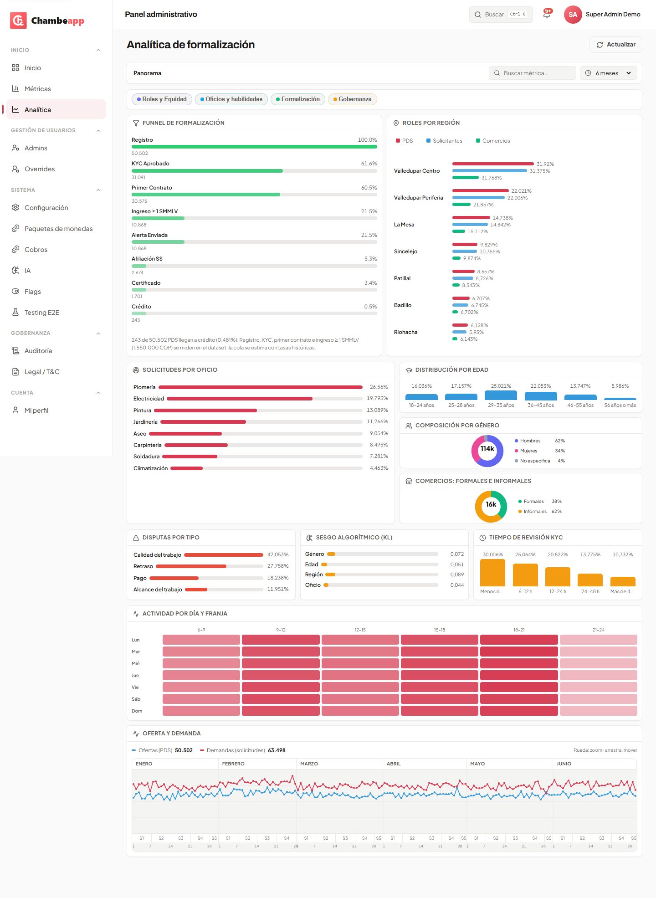


Vista de entrada. No tiene filtros propios: muestra el sistema completo y sirve para decidir **a qué dimensión entrar**.

## 1.1 Gráficas

| Gráfica | Tipo | Qué muestra | Cómo se usa |
|---|---|---|---|
| **Regiones** | Barras agrupadas por región (PDS, Solicitantes, Comercios) | Cobertura territorial y mezcla de roles | Clic en región → filtra todo |
| **Solicitudes por oficio** | Barras horizontales | Demanda relativa por oficio | Clic en oficio → filtra todo |
| **Distribución por edad** | Columnas | Composición etaria de la base | Detecta si el onboarding es joven o adulto |
| **Distribución por género** | Columnas | Composición por género | Base para D1.3 |
| **Comercios: formales e informales** | Dona | Formalidad de los comercios | Clic en segmento → filtra |
| **Disputas por tipo** | Barras horizontales | Calidad del trabajo, retraso, pago, alcance | Clic → filtra |
| **Sesgo por grupo (KL)** | Barras por grupo | Divergencia del motor ML | Alerta temprana de sesgo |
| **Tiempo de revisión KYC** | Barras por franja | Velocidad de verificación | Detecta cuellos de botella |
| **Actividad por día y franja** | Mapa de calor (7 días × 6 franjas) | Cuándo ocurre la actividad | Timing de push y publicación |
| **Oferta y demanda** | Línea diaria con zoom (mes → semana → día) | Ofertas (PDS) y demandas (solicitudes) día a día | Estacionalidad y timing |

### Ejemplo de narrativa

> “El 38% de la actividad ocurre entre 18:00 y 21:00, pero el 62% de las solicitudes ‘para hoy’ se publican entre 9:00 y 12:00. Hay un desfase de horario entre oferta y demanda que explica parte de la atención del 90%.”

---

# 2. ROLES Y EQUIDAD

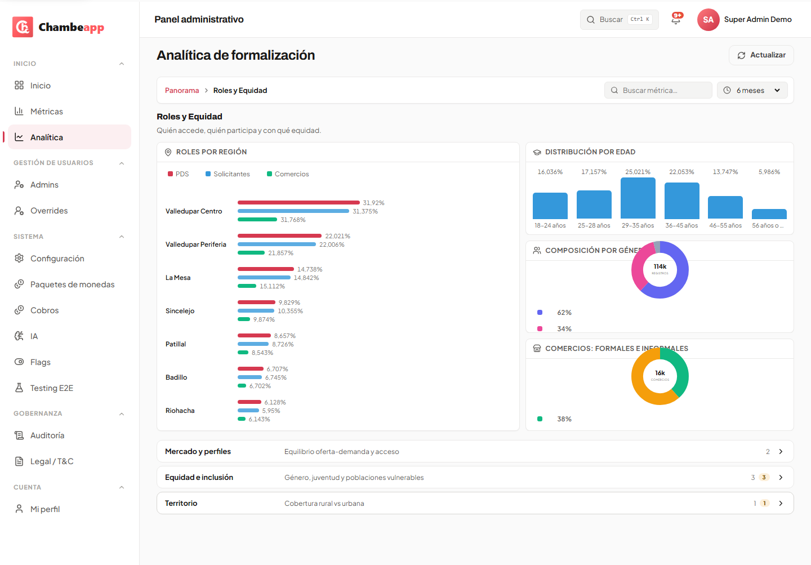

**Pregunta de la dimensión:** ¿quién accede, quién participa y con qué equidad?
**Vista de dimensión:** regiones + edad + género + comercios; abajo disputas, sesgo y tiempo KYC.

## 2.1 Mercado y perfiles
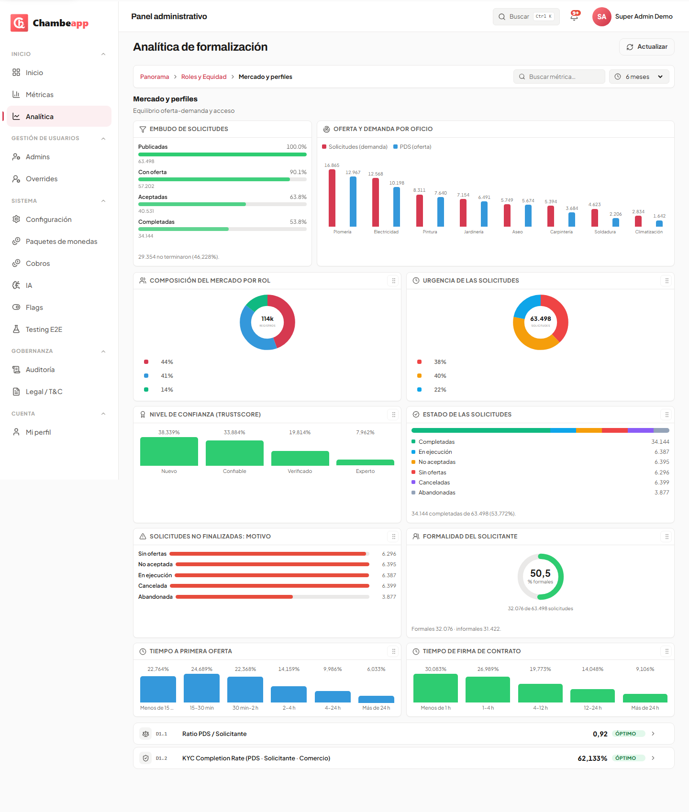


**Pregunta:** ¿el mercado está equilibrado y quién puede entrar?

### Gráficas

| Gráfica | Tipo | Lectura |
|---|---|---|
| **Embudo de solicitudes** | Embudo | Publicadas → con oferta → aceptadas → completadas. Dice dónde se pierde demanda |
| **Oferta y demanda por oficio** | Columnas agrupadas | Solicitudes vs PDS por oficio |
| **Mezcla de roles** | Dona | PDS / Solicitantes / Comercios |
| **Urgencia de las solicitudes** | Dona | Para hoy / esta semana / flexible. Clic filtra |
| **Nivel de confianza (TrustScore)** | Columnas | Nuevo / Confiable / Verificado / Experto |
| **Estado de las solicitudes** | Barra 100% apilada | Completadas, en ejecución, no aceptadas, sin ofertas, canceladas, abandonadas |
| **Solicitudes no finalizadas: motivo** | Barras | Sin ofertas / no aceptada / en ejecución / cancelada / abandonada |
| **Formalidad del solicitante** | Medidor | % de solicitudes de solicitantes formales |
| **Primera oferta** | Barras por franja | Menos de 15 min … más de 24 h |
| **Firma** | Barras por franja | Velocidad de cierre del contrato |

### KPIs

#### D1.1 · Ratio PDS / Solicitante
- **Fórmula:** MAU PDS / MAU Solicitante
- **Meta:** 0,8 – 1,5
- **Valor:** **0,920** → *Zona óptima*
- **Bandas:** <0,5 desierto de talento · 0,5–0,8 mercado comprador · 0,8–1,5 óptimo · 1,5–2 mercado vendedor · >2 hambre de trabajo
- **Narrativa ejemplo:** “Con 0,92 hay casi un prestador por cada solicitante: el cuello no es oferta, es conversión. Cada punto que bajemos de 0,8 empieza a encarecer el servicio.”

#### D1.2 · KYC Completion Rate
- **Fórmula:** KYC aprobado por rol / registrados del rol
- **Metas:** PDS > 60% · Solicitante > 70% · Comercio > 60%
- **Valores:** PDS **58,4%** · Solicitante **76,0%** · Comercio **52,0%**
- **Bandas:** <40% onboarding roto · 40–60% progreso · >60% madurez
- **Narrativa ejemplo:** “El solicitante ya pasa el umbral (76%), pero el comercio se queda en 52%: el comercio que no completa KYC no publica anuncios, y eso se ve en D3.9.”

## 2.2 Equidad e inclusión
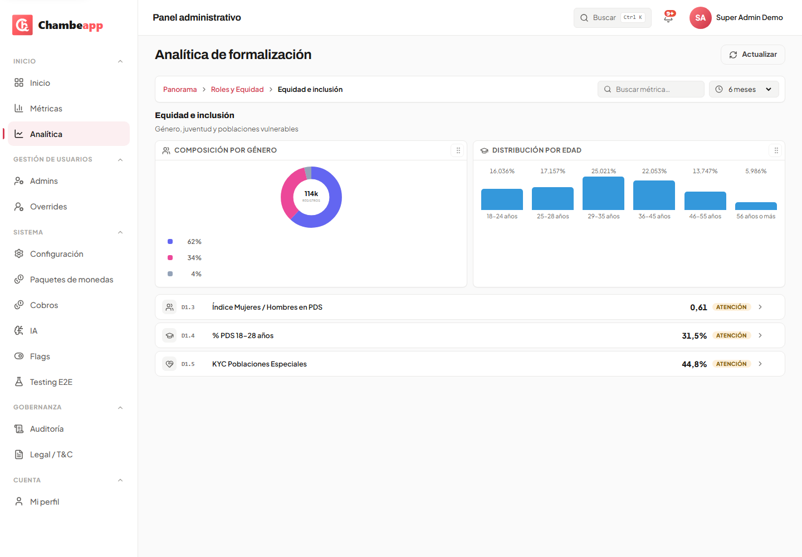


**Pregunta:** ¿quiénes participan respecto a la población?

### Gráficas
- **Distribución por género** (columnas)
- **Distribución por edad** (columnas)

### KPIs

#### D1.3 · Índice Mujeres / Hombres en PDS
- **Fórmula:** % PDS mujeres / % PDS hombres (vs población)
- **Meta:** 0,8 – 1,2 · **Valor:** **0,610** · *Progreso parcial*
- **Narrativa ejemplo:** “Por cada 10 hombres PDS hay 6 mujeres. En Aseo y Estética la brecha se cierra; en Soldadura y Climatización se abre. La política no es ‘captar mujeres’, es abrir esos dos oficios.”

#### D1.4 · % PDS 18–28 años
- **Meta:** ≥ 35% · **Valor:** **31,5%** · *Entrada funcional*
- **Narrativa ejemplo:** “Estamos 3,5 puntos debajo de la meta: el onboarding juvenil funciona, pero no compensa el envejecimiento de la base.”

#### D1.5 · KYC Poblaciones Especiales
- **Meta:** > 50% · **Valor:** **44,8%** · *Ruta alternativa lenta*
- **Narrativa ejemplo:** “La documentación exigida no calza con esta población: 55 de cada 100 no logran verificar. Cada documento extra es una barrera de exclusión.”

## 2.3 Territorio
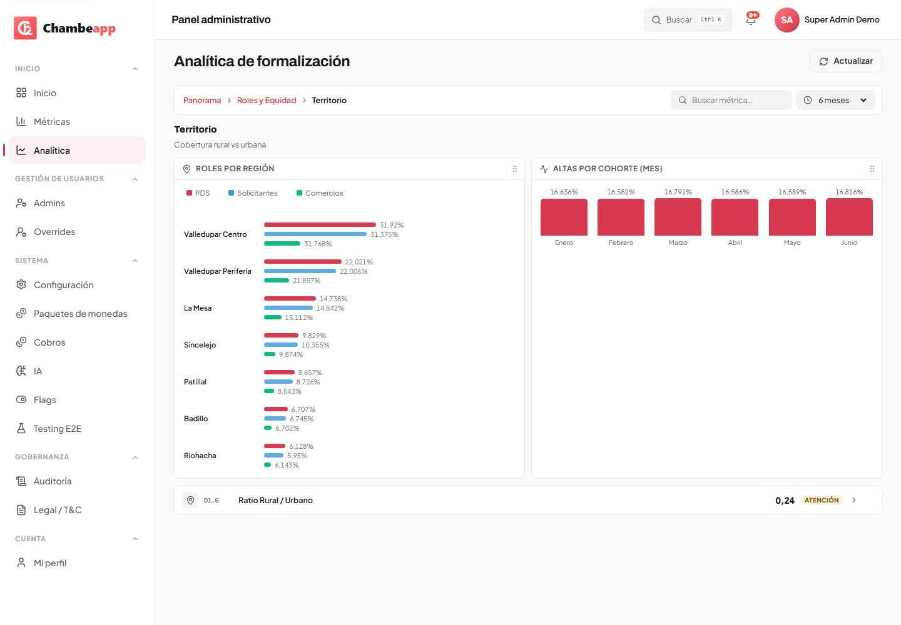


**Pregunta:** ¿la plataforma llega al rural o solo al casco urbano?

### Gráficas
- **Regiones** (barras agrupadas)
- **Altas por cohorte** (columnas por mes)

### KPI

#### D1.6 · Ratio Rural / Urbano
- **Fórmula:** PDS rural / PDS urbano
- **Meta:** > 0,3 · **Valor:** **0,240** · *Penetración incipiente*
- **Narrativa ejemplo:** “Por cada 10 prestadores urbanos hay 2,4 rurales. Si el ratio sube a 0,3 sin subir el ticket rural, lo que crece es la informalidad, no la cobertura.”

---

# 3. OFICIOS Y HABILIDADES

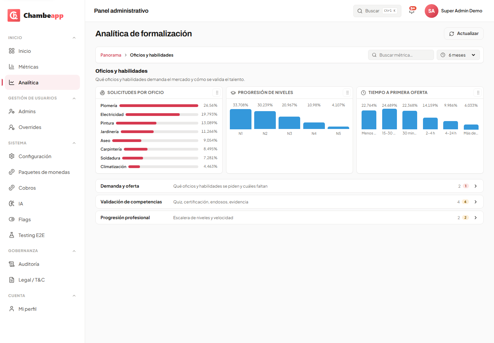

**Pregunta:** ¿qué se pide, qué falta y cómo se valida el talento?

## 3.1 Demanda y oferta
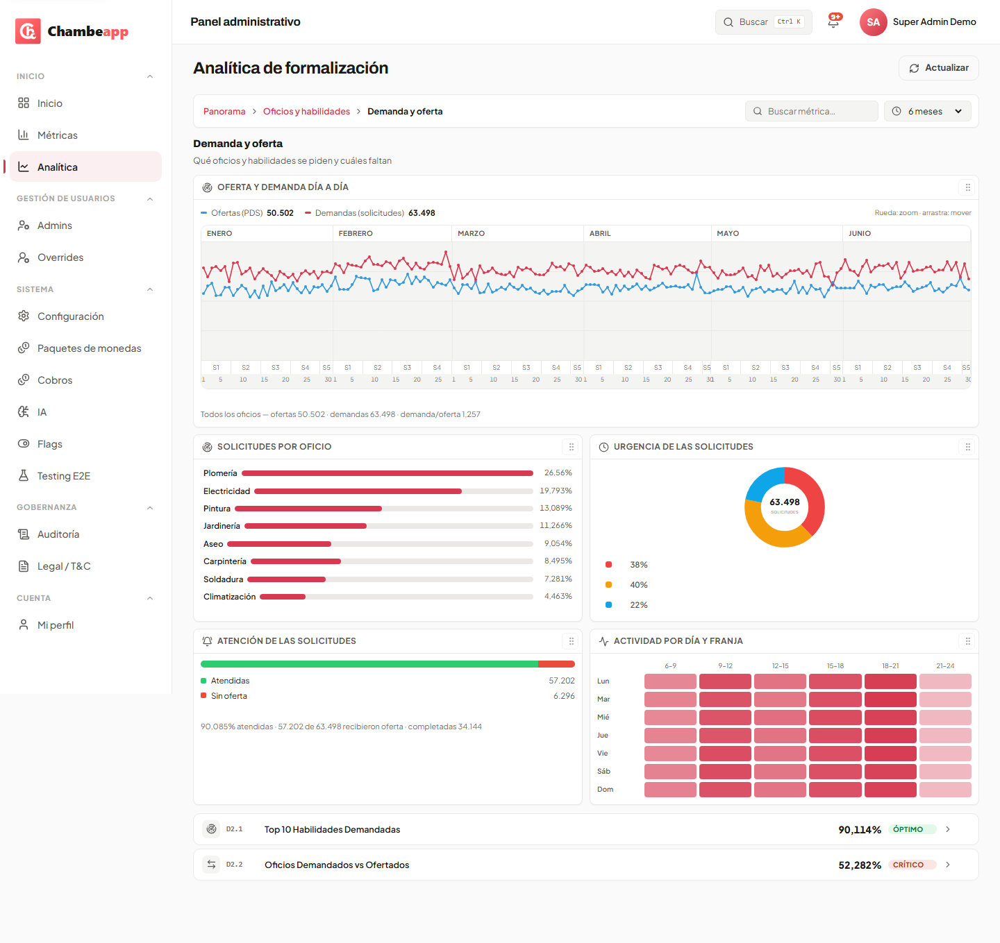


### Gráficas

| Gráfica | Tipo | Lectura |
|---|---|---|
| **Oferta y demanda día a día** | Línea con zoom (mes → semana → día), scroll | Rueda = zoom, arrastra = mover. Tooltip por día |
| **Solicitudes por oficio** | Barras horizontales (8 oficios) | Porcentajes estables al filtrar |
| **Habilidades acreditadas · {oficio}** | Columnas | Aparece al elegir oficio: cuántas solicitudes acreditaron cada habilidad |
| **Urgencia de las solicitudes** | Dona | Clic filtra |
| **Atención de las solicitudes** | Barra 100% apilada | Atendidas vs sin oferta |
| **Actividad por día y franja** | Mapa de calor | Cuándo se demanda |

### KPIs

#### D2.1 · Top 10 habilidades demandadas
- **Fórmula:** solicitudes atendidas / solicitudes de las 10 habilidades más pedidas
- **Meta:** ≥ 90% de atención · **Valor:** **90,0%** · *Atención alta*
- **Garantía:** el top 10 incluye **al menos una habilidad por oficio** (los 8 oficios).
- **Ejemplo de la tabla:** Motobombas (Plomería) 2.858 · Cortos (Electricidad) 2.169 · Estuco (Pintura) 1.698 · Poda (Jardinería) 1.464 · Organización (Aseo) 1.190 · Barniz (Carpintería) 947 · Pasamanos (Soldadura) 828 · Tarjetas (Climatización) 590.
- **Narrativa ejemplo:** “La atención está en 90%: el problema no es que falten ofertas, es que se concentran. Destape atiende 89,6% y Pasamanos 88%: el esfuerzo debe ir a los oficios con menor tasa, no al promedio.”

#### D2.2 · Oficios demandados vs ofertados
- **Fórmula:** (solicitudes del oficio − PDS del oficio) / solicitudes del oficio
- **Meta:** brecha < 20% · **Valor:** **52,3%** (peor oficio: Soldadura) · *Emergencia*
- **Brechas actuales:**

```
Soldadura        ██████████████████████████  52,3%   Emergencia
Climatización    █████████████████████       42,1%   Oportunidad
Carpintería      ███████████████             31,7%   Oportunidad
Plomería         ███████████                 23,1%   Oportunidad
Electricidad     █████████                   18,9%   Equilibrado
Jardinería       ████                         9,3%   Equilibrado
Pintura          ████                         8,1%   Equilibrado
Aseo             █                            1,3%   Equilibrado
```

- **Selector:** chips de oficio + clic en la tabla; el KPI, la banda y la serie mensual cambian con el oficio.
- **Narrativa ejemplo:** “El promedio de brecha es 21%, pero el máximo es 52% en Soldadura. No es un problema de oferta general: es un problema de dos oficios. Reclutar soldadores vale más que captar aseadores.”

---

## 3.2 Validación de competencias
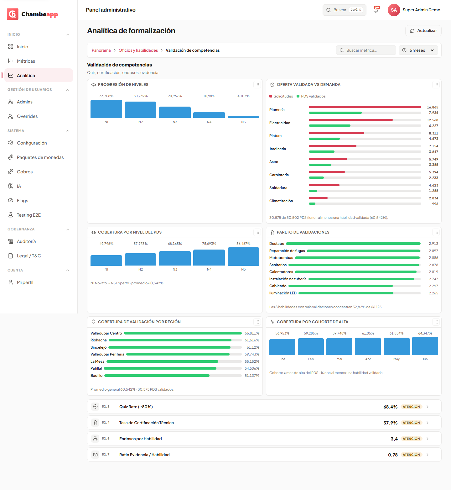


### Gráficas

| Gráfica | Tipo | Lectura |
|---|---|---|
| **Progresión de niveles** | Columnas | Distribución N1–N5 |
| **Habilidades más validadas** | Barras | Top 10 con cobertura de los 8 oficios |
| **Tasa de validación** | Barras | % de habilidades ofertadas que se validan (requiere oficio) |
| **Oferta validada vs demanda** | Barras agrupadas | PDS con ≥1 habilidad validada vs solicitudes |
| **Cobertura por nivel del PDS** | Columnas | % con validación en N1–N5 |
| **Pareto de validaciones** | Barras | Concentración por habilidad |
| **Cobertura por región** | Barras | Brecha territorial de validación |
| **Cobertura por cohorte** | Columnas | Mejora del onboarding mes a mes |

### KPIs

#### D2.3 · Quiz Rate (≥80%)
- **Meta:** > 60% · **Valor:** **68,4%** · *Ajuste fino*
- **Narrativa ejemplo:** “Dos de cada tres intentos aprueban. Si subimos el umbral a 85%, el quiz deja de filtrar y empieza a expulsar: primero hay que mejorar el material.”

#### D2.4 · Tasa de certificación técnica
- **Meta:** > 40% · **Valor:** **37,9%** · *Funciona lento*
- **Narrativa ejemplo:** “Casi 4 de cada 10 certificados enviados se verifican. El cuello no es el PDS, es la institución: sin API del SENA, cada verificación es manual.”

#### D2.6 · Endosos por habilidad
- **Meta:** ≥ 5 · **Valor:** **3,4** · *Emergente*
- **Narrativa ejemplo:** “3,4 endosos alcanzan para mostrar ‘validado por clientes’, no para priorizar en el ranking. El endoso compite contra el olvido: hay que pedirlo en el mismo cierre de la chamba.”

#### D2.7 · Ratio evidencia / habilidad
- **Meta:** ≥ 1,0 · **Valor:** **0,78** · *Básico*
- **Narrativa ejemplo:** “Con 0,78 la evidencia 360° es decorativa: no cubre todas las habilidades exigidas. Mapear 1:1 habilidad ↔ evidencia es la condición para que sirva como prueba.”

## 3.3 Progresión profesional
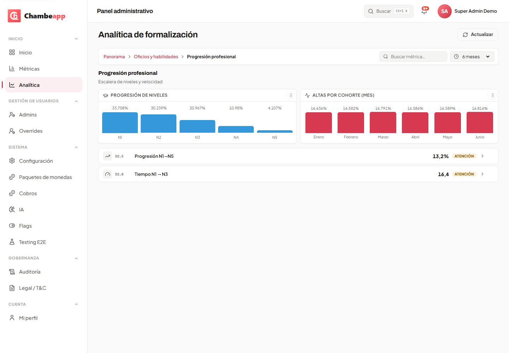


### Gráficas
- **Progresión de niveles** (columnas)
- **Tasa de validación** (si hay oficio)
- **Altas por cohorte** (columnas)

### KPIs

#### D2.5 · Progresión N1→N5
- **Meta:** > 15% / trimestre · **Valor:** **13,2%** · *Valle de la muerte*
- **Narrativa ejemplo:** “13 de cada 100 suben de nivel por trimestre. El embudo se rompe en N3: llegar a Práctico requiere evidencia y ahí se cae la mitad.”

#### D2.8 · Tiempo N1 → N3
- **Meta:** < 18 meses · **Valor:** **16,4 meses** · *Estándar*
- **Narrativa ejemplo:** “16,4 meses está dentro de meta, pero cerca del límite: cualquier fricción en evidencias lo empuja a ‘escalera lenta’.”

---

# 4. FORMALIZACIÓN

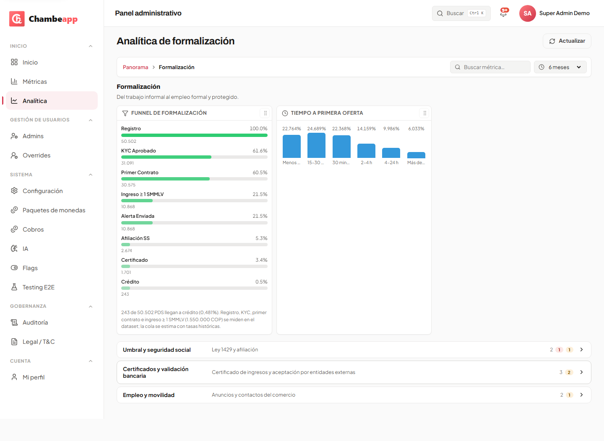

**Pregunta:** ¿cómo se pasa del trabajo informal al empleo protegido?

## 4.1 Umbral y seguridad social
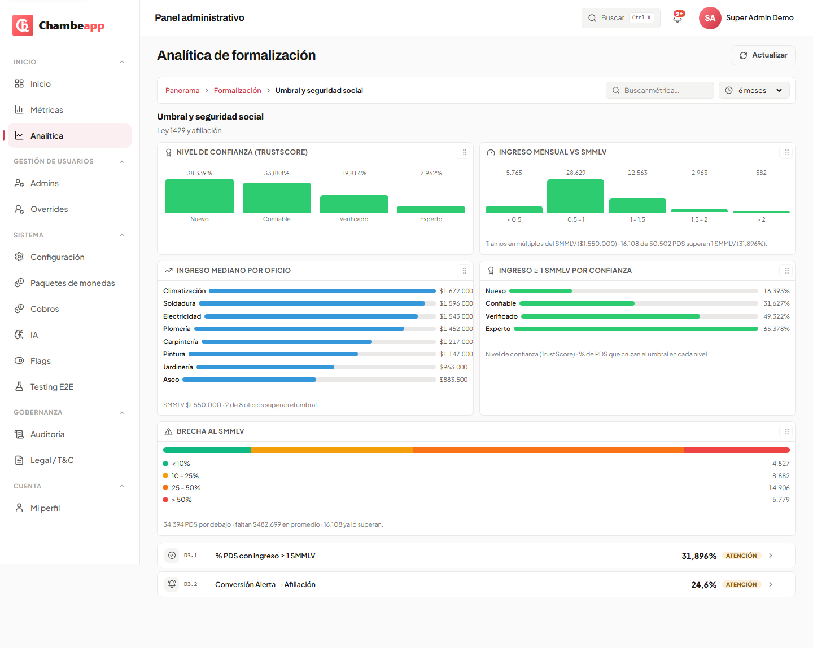


### Gráficas

| Gráfica | Tipo | Lectura |
|---|---|---|
| **Nivel de confianza (TrustScore)** | Columnas | Composición de la base por reputación |
| **Ingreso mensual vs SMMLV** | Columnas (histograma) | Tramos <0,5 · 0,5–1 · 1–1,5 · 1,5–2 · >2 SMMLV |
| **Ingreso mediano por oficio** | Barras | Qué oficios pueden sostener seguridad social |
| **Ingreso ≥ 1 SMMLV por confianza** | Barras | Si el TrustScore predice capacidad de pago |
| **Brecha al SMMLV** | Barra 100% apilada | Distancia de los que están por debajo (<10%, 10–25%, 25–50%, >50%) |

**Ejemplo de las tres gráficas de ingreso:**

```
Ingreso mediano por oficio (SMMLV 2026 = $1.550.000)
Climatización  ████████████████████  $1.672.000
Soldadura      ███████████████████   $1.596.000
Electricidad   ██████████████████    $1.543.000
Plomería       █████████████████     $1.452.000
Carpintería    ██████████████        $1.217.000
Pintura        █████████████         $1.147.000
Jardinería     ███████████            $963.000
Aseo           ██████████             $883.500

Ingreso ≥ 1 SMMLV por confianza
Nuevo          ████                 16,4%
Confiable      ████████             31,6%
Verificado     █████████████        49,3%
Experto        █████████████████    65,4%
```

### KPIs

#### D3.1 · % PDS con ingreso ≥ 1 SMMLV

> **SMMLV configurable:** el valor se edita en **Configuración → General → smmlv_vigente** (por defecto 1.550.000 COP). El tablero lo lee al cargar y recalcula todos los tramos de ingreso, el funnel y D3.1.
- **Fórmula:** PDS con ingreso mensual ≥ SMMLV / PDS activo
- **Meta:** > 45% · **Valor:** **31,9%** · *En transición*
- **Narrativa ejemplo:** “Tres de cada diez prestadores pueden pagar salud, pensión y ARL. No es un problema de afiliación: es de ingreso. La palanca es ticket promedio, no descuentos.”

#### D3.2 · Conversión alerta → afiliación
- **Meta:** > 30% · **Valor:** **24,6%** · *Funciona*
- **Narrativa ejemplo:** “Una de cada cuatro alertas termina en afiliación. La alerta llega, pero sin acompañamiento el PDS se afilia un mes y deserta.”

## 4.2 Certificados y validación bancaria
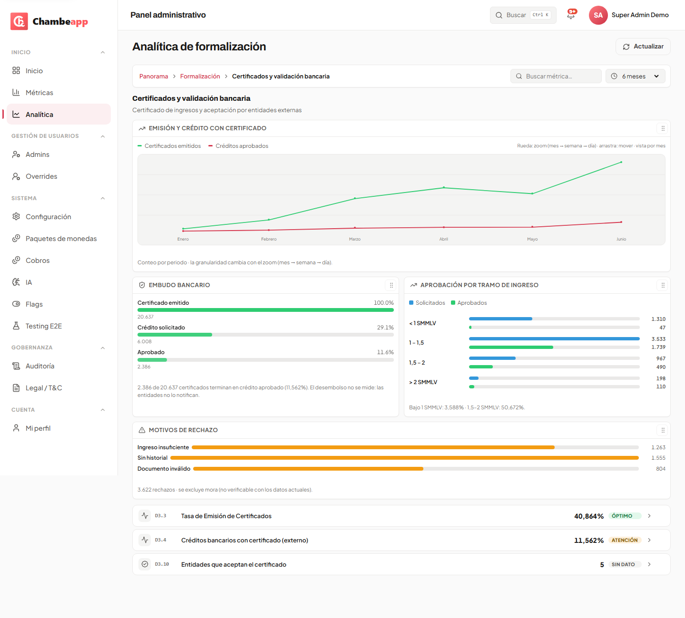


### Gráficas

| Gráfica | Tipo | Lectura |
|---|---|---|
| **Emisión y crédito con certificado** | Línea con zoom (mes → semana → día) | Conteo de certificados emitidos y créditos aprobados por periodo |
| **Embudo bancario** | Embudo | Certificado → solicitud → aprobación (el desembolso no se notifica) |
| **Aprobación por tramo de ingreso** | Barras agrupadas | Solicitados vs aprobados por tramo de SMMLV |
| **Motivos de rechazo** | Barras | Sin historial / ingreso insuficiente / documento inválido (sin mora: no verificable) |

```
Embudo bancario
Certificado emitido   ████████████████████ 20.637
Crédito solicitado    ██████                6.008  (29,1%)
Aprobado              ██                    2.386  (11,6%)

Aprobación por ingreso
< 1 SMMLV      █                     3,6%
1 – 1,5 SMMLV  ███████████████████  49,2%
1,5 – 2 SMMLV  ████████████████████ 50,7%
> 2 SMMLV      █████████████████████ 55,6%
```

### KPIs

#### D3.3 · Tasa de emisión de certificados
- **Meta:** > 40% · **Valor:** **40,9%** · *Herramienta estándar*
- **Narrativa ejemplo:** “Cuatro de cada diez PDS ya tienen certificado. La emisión crece con la antigüedad (63% en la cohorte de enero vs 19% en junio): es un producto de maduración, no de campaña.”

#### D3.4 · Créditos bancarios con certificado
- **Meta:** > 15% · **Valor:** **11,6%** · *Pilotos*
- **Narrativa ejemplo:** “El certificado se emite, pero solo 29% se usa para pedir crédito y 40% de esas solicitudes se aprueba. El cuello está en el uso, no en la emisión.”

#### D3.10 · Entidades que aceptan el certificado
- **Fórmula:** entidades distintas con ≥1 crédito aprobado
- **Meta:** ≥ 3 · **Valor:** **5** · *Estándar de facto*
- **Narrativa ejemplo:** “Cinco entidades ya aprobaron con el certificado. Con 5 el riesgo de dependencia baja: si una se retira, el producto sigue vivo.”

## 4.3 Empleo y movilidad
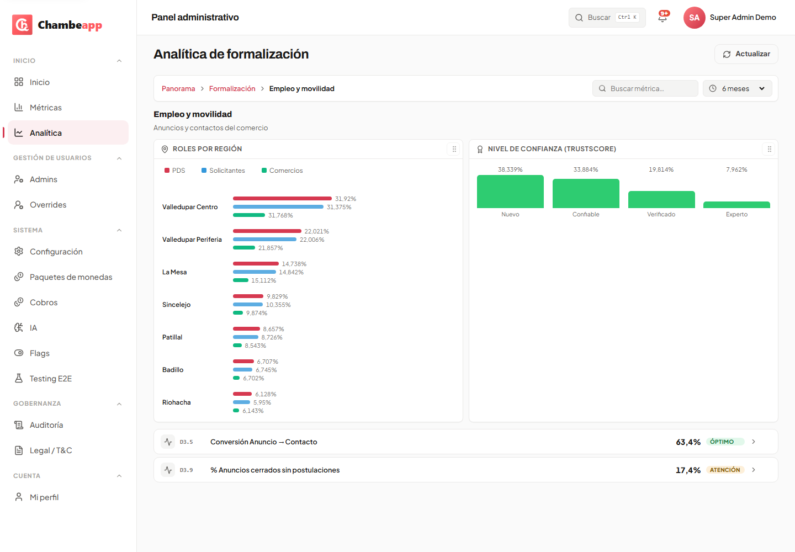


### Gráficas
- **Regiones** (barras agrupadas)
- **Nivel de confianza** (columnas)

### KPIs

#### D3.5 · Conversión anuncio → contacto
- **Fórmula:** anuncios cerrados con al menos un seleccionado / anuncios publicados
- **Meta:** > 60% · **Valor:** **63,4%** · *Canal efectivo*
- **Narrativa ejemplo:** “Seis de cada diez anuncios terminan en contacto. El anuncio no genera contrato: genera conversación. El valor está en que el comercio elija con criterio, no en que firme.”

#### D3.9 · % anuncios cerrados sin postulaciones
- **Meta:** < 20% · **Valor:** **17,4%** · *Atención*
- **Narrativa ejemplo:** “Uno de cada seis anuncios muere sin que nadie postule. Distinto es el que cierra porque el comercio encontró al trabajador por otro medio: ese es competencia, no falla del canal.”

---

# 5. GOBERNANZA

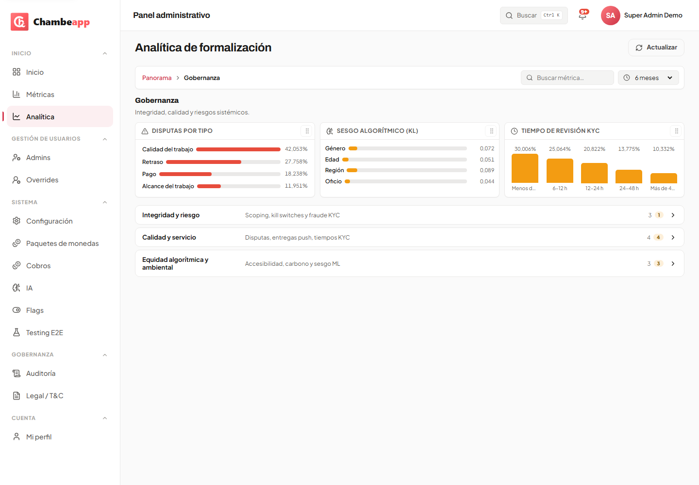

**Pregunta:** ¿la plataforma opera dentro de sus reglas y con quién?

## 5.1 Integridad y riesgo
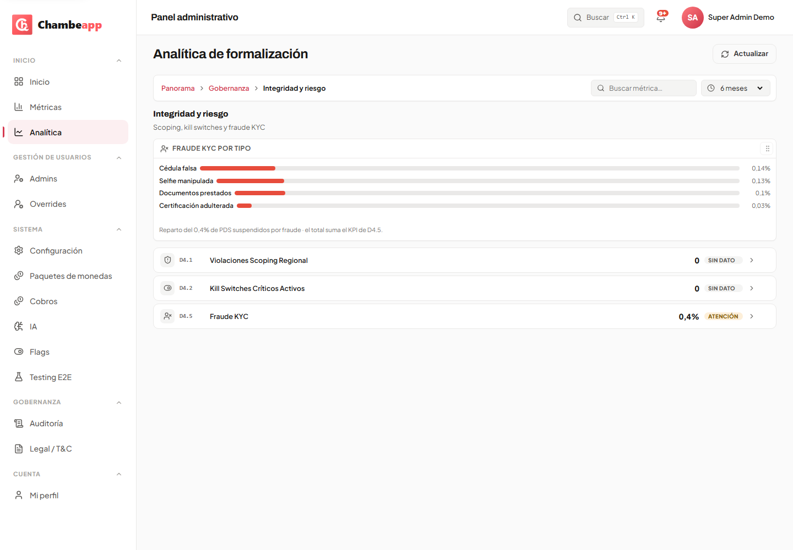


### Gráfica
- **Fraude KYC por tipo** (barras): cédula falsa, certificación adulterada, selfie manipulada, documentos prestados. La suma equivale a D4.5.

### KPIs

#### D4.1 · Violaciones de scoping regional
- **Meta:** 0 · **Valor:** **0** · *Gobernanza perfecta*
- **Narrativa ejemplo:** “Cero contratos cruzaron región. No es suerte: es el único KPI donde 1 ya es incidente P1 y bloquea el despliegue.”

#### D4.2 · Kill switches críticos activos
- **Meta:** 0 · **Valor:** **0** · *Operación normal*
- **Narrativa ejemplo:** “Ningún interruptor crítico está apagado. Si `payments_enabled` se apaga 10 minutos, el revenue del día es cero.”

#### D4.5 · Fraude KYC
- **Meta:** < 1% · **Valor:** **0,4%** · *Casos aislados*
- **Narrativa ejemplo:** “Cuatro de cada mil PDS suspendidos por fraude. No es epidemia, pero el 0,4% se concentra en un verificador: hay que auditar al verificador, no al sistema.”

## 5.2 Calidad y servicio
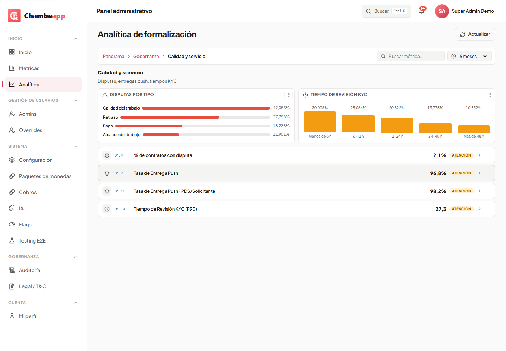


### Gráficas
- **Disputas por tipo** (barras)
- **Tiempo de revisión KYC** (barras por franja)

### KPIs

#### D4.4 · % de contratos con disputa
- **Fórmula:** contratos con disputa / contratos completados × 100
- **Meta:** < 3% · **Valor:** **2,1%** · *Normal*
- **Narrativa ejemplo:** “2,1% de los contratos terminan en disputa. El 42% son por calidad: no es un problema de matching, es de expectativas y validación.”

#### D4.7 · Tasa de entrega push
- **Meta:** > 95% · **Valor:** **96,8%** · *Gap*
- **Narrativa ejemplo:** “96,8% global parece bien, pero el promedio esconde roles: en PDS baja a 98,2% (D4.11). Un push perdido es una oferta perdida.”

#### D4.11 · Entrega push PDS/Solicitante
- **Meta:** > 99% · **Valor:** **98,2%** · *Gap*
- **Narrativa ejemplo:** “Falta 0,8 puntos para la meta. En estos dos roles cada notificación es dinero: Ley 1429, oferta o pago.”

#### D4.10 · Tiempo de revisión KYC (P90)
- **Meta:** < 48 h · **Valor:** **27,3 h** · *Límite legal*
- **Narrativa ejemplo:** “El P90 está en 27 horas: dentro de la ley, pero el 10% más lento supera las 48. Ese 10% es el que abandona.”

## 5.3 Equidad algorítmica y ambiental
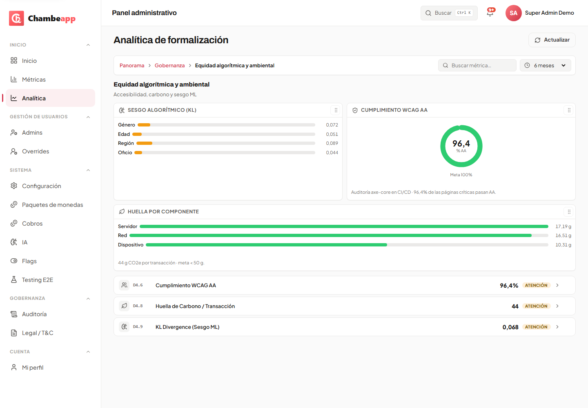


### Gráficas

| Gráfica | Tipo | Lectura |
|---|---|---|
| **Sesgo por grupo (KL)** | Barras | Divergencia del motor ML por género, edad, región, oficio |
| **Cumplimiento WCAG AA** | Medidor | % de páginas críticas que pasan AA |
| **Huella por componente** | Barras | Reparto de g CO2e: servidor, red, dispositivo |

```
Sesgo por grupo (KL, meta < 0,05)
Región     ███████████████████ 0,089
Género     ███████████████     0,072
Edad       ███████████         0,051
Oficio     █████████           0,044
Global     ██████████████      0,068
```

### KPIs

#### D4.6 · Cumplimiento WCAG AA
- **Meta:** 100% · **Valor:** **96,4%** · *Gap crítico*
- **Segmentos:** dispositivo, rol, **página crítica** (Login, Publicar chamba, Checkout, Perfil, Chat), conectividad.
- **Narrativa ejemplo:** “96,4% de las páginas pasan AA, pero el 3,6% restante está en Checkout: ahí la exclusión cuesta dinero y es ilegal (Ley 1618).”

#### D4.8 · Huella de carbono por transacción
- **Meta:** < 50 g CO2e · **Valor:** **44 g** · *Objetivo*
- **Segmentos:** componente, tipo de transacción, dispositivo, región.
- **Narrativa ejemplo:** “44 g por transacción está en el límite de la banda ‘objetivo’. El componente de red aporta la mayor parte: optimizar imágenes y batch reduce más que cambiar servidores.”

#### D4.9 · KL Divergence (sesgo ML)
- **Meta:** < 0,05 · **Valor:** **0,068** · *Sesgo incipiente*
- **Segmentos:** género, edad, región, oficio, cohorte.
- **Narrativa ejemplo:** “El sesgo global es 0,068: incipiente, no crítico. Región (0,089) es el foco porque es proxy de estrato: corregirlo reduce pobreza territorial, no solo un número.”

---

# 6. SESGOS ALGORÍTMICOS (detalle)

## 6.1 Qué es el sesgo en ChambeApp

El motor ML ordena y filtra prestadores. **Sesgo** es que la exposición recomendada no se parezca a la población real: a las mujeres se les muestra menos en construcción, a los rurales en todo.

## 6.2 Cómo se mide

```
KL( P_recomendado || P_población )  por grupo protegido
```

- **0** = la recomendación reproduce la población.
- **No es un porcentaje** y no tiene techo.
- **Bandas:** < 0,05 equidad · 0,05–0,1 incipiente · > 0,1 inaceptable (ML OFF + P1).

## 6.3 Lectura actual

| Grupo | KL | Lectura | Acción |
|---|---:|---|---|
| Región | 0,089 | A un paso del crítico | Feature audit; región es proxy de estrato |
| Género | 0,072 | Incipiente claro | Adversarial debiasing |
| Edad | 0,051 | Borde | Vigilar cohortes jóvenes |
| Oficio | 0,044 | Aceptable | Mantener |
| Global | 0,068 | Incipiente | Monitoreo semanal + A/B por grupo |

## 6.4 Lo que la métrica no dice

- **Dirección:** no distingue sobre-exposición de sub-exposición.
- **Justicia:** puede reflejar diferencias reales de skill o disponibilidad.
- **Tamaño:** con grupos pequeños el KL se infla solo.

Complementar con: paridad de exposición, disparate impact (regla 80%), calibración por grupo y counterfactual fairness.

## 6.5 Riesgo si se ignora

Efecto Mateo: un PDS sin impresiones no consigue contratos, no mejora TrustScore y nunca sale del fondo. El sesgo se vuelve permanente.

---

# 7. Anexo A — Tabla maestra de KPIs

| Código | KPI | Unidad | Meta | Valor | Estado |
|---|---|---|---:|---:|---|
| D1.1 | Ratio PDS / Solicitante | ratio | 0,8–1,5 | 0,920 | Óptimo |
| D1.2 | KYC Completion Rate | % | >60 / >70 / >60 | 58,4 / 76,0 / 52,0 | Atención (2 de 3 roles) |
| D1.3 | Índice Mujeres / Hombres | índice | 0,8–1,2 | 0,610 | Atención |
| D1.4 | % PDS 18–28 | % | ≥35 | 31,5 | Atención |
| D1.5 | KYC Poblaciones especiales | % | >50 | 44,8 | Atención |
| D1.6 | Ratio Rural / Urbano | ratio | >0,3 | 0,240 | Atención |
| D2.1 | Top 10 habilidades (atención) | % | ≥90 | 90,0 | Óptimo |
| D2.2 | Brecha oficios (peor) | % | <20 | 52,3 | Crítico |
| D2.3 | Quiz Rate | % | >60 | 68,4 | Atención |
| D2.4 | Certificación técnica | % | >40 | 37,9 | Atención |
| D2.5 | Progresión N1→N5 | % | >15 | 13,2 | Atención |
| D2.6 | Endosos por habilidad | conteo | ≥5 | 3,4 | Atención |
| D2.7 | Ratio evidencia / habilidad | ratio | ≥1,0 | 0,78 | Atención |
| D2.8 | Tiempo N1→N3 | meses | <18 | 16,4 | Atención |
| D3.1 | Ingreso ≥ 1 SMMLV | % | >45 | 31,9 | Atención |
| D3.2 | Alerta → afiliación | % | >30 | 24,6 | Atención |
| D3.3 | Emisión de certificados | % | >40 | 40,9 | Óptimo |
| D3.4 | Créditos con certificado | % | >15 | 11,6 | Atención |
| D3.5 | Anuncio → contacto | % | >60 | 63,4 | Óptimo |
| D3.9 | Anuncios sin postulaciones | % | <20 | 17,4 | Atención |
| D3.10 | Entidades que aceptan | conteo | ≥3 | 5 | Óptimo |
| D4.1 | Violaciones scoping | conteo | 0 | 0 | Óptimo |
| D4.2 | Kill switches activos | conteo | 0 | 0 | Óptimo |
| D4.4 | Contratos con disputa | % | <3 | 2,1 | Atención |
| D4.5 | Fraude KYC | % | <1 | 0,4 | Atención |
| D4.6 | WCAG AA | % | 100 | 96,4 | Atención |
| D4.7 | Entrega push | % | >95 | 96,8 | Atención |
| D4.8 | Huella carbono | g CO2e | <50 | 44 | Atención |
| D4.9 | KL sesgo ML | índice | <0,05 | 0,068 | Atención |
| D4.10 | KYC P90 | horas | <48 | 27,3 | Atención |
| D4.11 | Push PDS/Solicitante | % | >99 | 98,2 | Atención |

---

# 8. Anexo B — Estado y mantenimiento

## 8.1 Métricas archivadas

| Código | Motivo |
|---|---|
| D3.6 · % PDS → Merchant | No existe mecanismo de formalización PDS→Merchant (rol manual, sin verificación de negocio ni historial) |
| D3.7 · Prima de formalidad | Sección “Incentivos y retención” eliminada |
| D3.8 · Retención 12 meses | Sección “Incentivos y retención” eliminada |
| D4.3 · Evasión de comisión | Ya no se cobran comisiones |
| FUNNEL / TOC / 2DO | Sección “Transversal” eliminada |

## 8.2 Cómo agregar una gráfica

1. Calcular el agregado en `crossFilterData.js` (función pura sobre `records`).
2. Crear el panel dentro de `AnalyticsDashboard.jsx`.
3. Añadirlo al arreglo `charts` de la sección, con un `id` único.
4. Si aplica, definir su segmentación en `metricSegmentation.js`.
5. Verificar que la gráfica responda a los filtros y que la última tarjeta no quede sola (la app la expande automáticamente).

## 8.3 Cómo agregar un KPI

1. Añadir la narrativa en `metricNarratives.js` (código, fórmula, meta, bandas, segmentos, palancas, riesgos).
2. Incluir el código en `analyticsHierarchy.js` (grupo).
3. Mapear su valor en `metricValues.js` o en `valueFor` del tablero.
4. Definir su segmentación si aplica.

---

*Documento generado como referencia operativa. Los valores corresponden al snapshot de noviembre 2026.*
